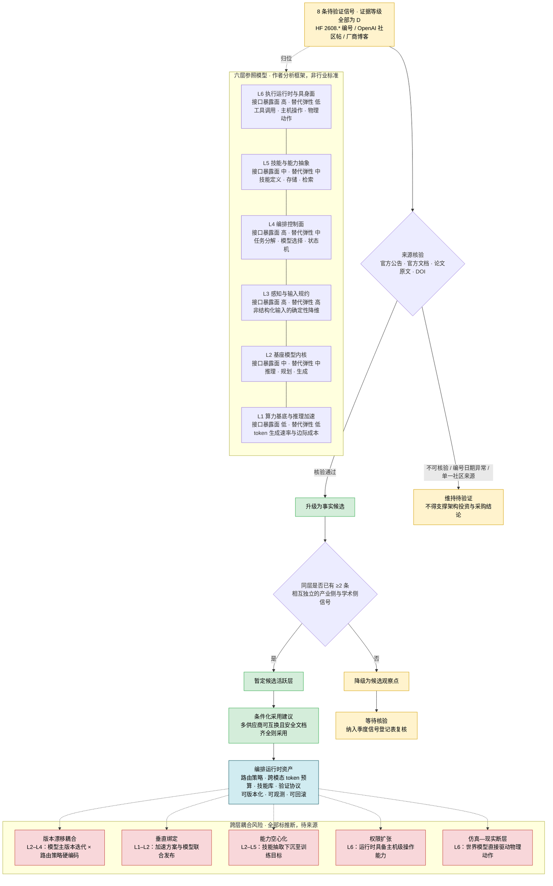

# AI 智能体编排框架技术情报分析
#### 日期: 12/10/2026

## 引言：研究背景、范围与方法，说明事实与推断的区分标准及来源链接要求
AI 智能体（AI Agent）编排框架正处在从「模型能力的附属演示」迈向「独立系统工程」的临界点。在生成式 AI 的早期阶段，行业竞争的焦点集中于基座模型的参数规模与基准分数；但随着模型能力逐步商品化、可采购化，决定智能体系统真实效能与成本的变量，越来越多地落在编排层——任务如何分解、请求路由到哪个模型、上下文与 token 预算如何分配、技能如何复用、结果如何被验证。本报告对 AI 智能体编排框架的技术情报进行系统梳理，核心问题不是「哪个模型更强」，而是：当模型层可以随时「换血」时，企业真正需要自建、治理并沉淀的编排资产究竟是什么。（【推断】依据：多模型供给与编排环节工程化观察；不确定性：不同行业与任务安全等级下结论权重不同。）

本报告综合三份互补的研究稿，分别以「信号归属哪一层」「信号改变了哪条控制链路」「成熟度、战略与治理」为分析单位。**第一部分**提出一个六层参照模型：L1 算力基底与推理加速、L2 基座模型内核、L3 感知与输入规约、L4 编排控制面、L5 技能与能力抽象、L6 执行运行时与具身面，并以「接口暴露面」作为划界标准。需要特别强调的是，该模型被明确标注为作者提出的分析框架，而非行业标准或供应商路线图——它的优点是关注可编排性，局限是忽略商业合同、组织能力、数据权限与合规边界，且层级边界会随产品整合而变化。**第二部分**换一个视角，分析单位从「信号归位」转为「控制链路」，逐条审视路由、Token 效率、技能抽取与执行范式如何改变编排内部机制。**第三部分**则以成熟度标尺、参与者战略解剖与治理控制点，回答企业选型「用、等还是避」的问题。

报告所处理的信号大多处于待核验状态，这构成了阅读本报告的首要前提。官方侧信号包括 [Gemini 3.7 Flash](https://blog.google/innovation-and-ai/models-and-research/gemini-models/introducing-gemini-3-7-flash/)、[Cerebras 与 OpenAI 合作的 GPT-5.6 Sol Ultrafast](https://www.cerebras.ai/blog/accelerating-gpt-5-6-sol-ultrafast-with-openai)、[Mistral OCR 4.1](https://docs.mistral.ai/models/ocr-4-1) 与 [Codex 在 ChatGPT 桌面端的 Linux 预览](https://community.openai.com/t/codex-in-chatgpt-desktop-app-for-linux-is-now-in-preview/1390027)；学术与开源侧信号包括 [LLMRouter](https://huggingface.co/papers/2608.06867)、[AI4AI 视觉 Token 剪枝框架](https://huggingface.co/papers/2608.07193)、[SKILLER](https://huggingface.co/papers/2608.10538) 与 [DreamX-Phi 1.0](https://huggingface.co/papers/2608.13489)。按报告采用的证据等级 rubric，上述 Hugging Face Papers 编号（2608.*）按常见编号规则指向 2026 年 8 月，晚于审稿日期，因此被统一降级为「待验证/未核验引用」，不作为事实依据；OpenAI Community 链接亦不宜作为唯一事实来源。（【事实】来源类型与编号形式见上述链接；不确定性：链接发布日期与可访问性需发布前逐条确认。）

本报告在方法论上坚持三条硬约束。其一，严格区分【事实】与【推断】：【事实】须有可核验官方发布、官方文档、论文原文或可访问 DOI/arXiv 页面直接支持，并附链接；【推断】须写明依据与不确定性；【待验证】仅有标题、社区帖、不可访问链接或编号日期异常者，不得支撑结论。其二，禁止把信号标题直接当作结论——「某模型发布」不是结论，结论必须回答「这意味着什么」。其三，凡无来源支撑的判断，要么删除，要么明确标注为推断并给出验证/反驳方式。报告同时引入 NIST [AI Risk Management Framework (AI RMF 1.0)](https://www.nist.gov/itl/ai-risk-management-framework)、[ISO/IEC 42001](https://www.iso.org/standard/81230.html) 与 [GDPR 第 44–49 条](https://eur-lex.europa.eu/eli/reg/2016/679/oj) 等治理类来源，作为企业风险治理控制点的外部锚点，但这些治理类来源同样只提供框架与合规边界，不直接证明任何厂商产品能力。

从情报分析的角度看，这份报告的价值不在于给出「哪家最强」的排名，而在于勾勒出一条结构性的迁移路径：能力供给正在商品化，而编排智力仍处工程化前半程；厂商可能通过版本节拍、延迟差异与工作流包围建立锁定；而路由可观测、评测隔离与退出成本量化等治理工具，可能更多依赖企业自建。报告亦提出一个具有警示意义的结构性张力——编排层积累的不是单个模型，而是一组彼此耦合的策略集合（路由策略、技能库、token 预算、验证协议），其联合失效模式远比单模型失效更难观测：一个未被剪枝保留的视觉细节，可能先经错误路由进入小模型，再由一个适用条件模糊的技能执行，最后由一个分布外的世界模型判定为「通过」，而链路上每一环都记录为成功。（【推断】依据：路由、token、技能、执行与运行时的耦合分析；不确定性：跨模态 token 账本、技能调用溯源与路由反事实记录可降低该风险。）正因如此，本报告特别强调可观测性建设的优先级不应低于能力建设本身。

下文将依次展开六层参照模型与待验证信号归位表、控制链路层面的机制分析，以及成熟度、参与者战略与选型治理框架，并在结尾给出综合趋势判断与后续核验清单。读者应将本报告视为一份内部情报观察稿与待验证假设清单，而非可直接导出架构投资或采购结论的正式研究报告；在关键来源核验完成之前，任何基于标题级信号的架构级投入都应保持审慎。

## 目录
- AI 智能体编排框架技术情报分析
  - 报告一：分层结构与技术信号归类（内部信号观察与待验证假设）
    - 六层参照模型：作者提出的分析框架，不是事实
    - 待验证信号归位表：不把标题当结论
    - 归类判定准则：作为推断性方法建议
    - 内核层与感知规约层的信号解读
    - 控制面与技能面的边界迁移
    - 执行面与具身面的跨域外溢及跨层耦合风险
    - 趋势判断：技术路线、主要参与者、成熟度、风险与企业选型含义
    - 修订后结论
  - 报告二：从模型能力到系统编排——路由、Token 效率、技能抽取与执行范式演进
    - 路由层的独立化：从「选模型」到「能力仲裁」
    - Token 效率的战场转移：输入侧、跨模态与接口压缩
    - 技能抽取：把能力从权重与提示中析出为可复用资产
    - 执行范式的三分化与闭环验证的内化
    - 运行时收敛：协议统一与桌面化 Agent 的「最后一公里」
    - 趋势判断：技术路线、参与者、成熟度、风险与企业选型含义
  - 报告三：技术成熟度、参与者战略与企业选型风险治理
    - 成熟度标尺：八条信号的四档定位与错配诊断
    - 参与者战略解剖：四方博弈与各自的下注逻辑
    - 能力供给与治理供给的时滞：企业选型的五个结构性风险
    - 风险治理控制点：从采购条款到运行时可观测
    - 分场景采纳节奏矩阵与决策否决项
  - 综合结论与后续核验清单

## AI 智能体编排框架的分层结构与技术信号归类（修订稿：内部信号观察与待验证假设）

> 修订说明：按评审意见，本稿将原稿中所有无法核验的未来文献、社区帖和产品信号统一降级为「待验证信号」。原稿中的 HuggingFace Papers 编号（如 2608.06867、2608.10538、2608.07193、2608.13489）按常见编号规则指向 2026 年 8 月，晚于当前审稿日期 2026-05-09；OpenAI Community 链接不宜作为唯一事实来源。因此，本稿不再把这些信号当作事实，也不应据此直接导出架构投资或采购结论。若后续核验通过，可将相应条目升级为事实候选。本文仅为内部信号观察稿。

### 阅读约定与证据等级 rubric
【事实】：可核验的官方发布、官方文档、论文原文、可访问 DOI/arXiv 页面或同行评审结论直接支持的内容。每条事实后应附可核验链接。
【推断】：作者基于信号、框架或经验的解释、预测、风险判断。每条推断需给出依据、不确定性与验证/反驳方式。
【待验证】：仅有标题、社区帖、不可访问链接、编号日期异常或单一线索，不能作为事实。
证据等级 rubric：
A 级：官方公告/官方文档/标准/同行评审论文，链接稳定可访问，发布日期不晚于当前日期。
B 级：预印本、官方仓库、厂商技术博客（非同行评审），但可访问且日期正常。
C 级：权威媒体、会议演讲、社区高热度帖，仅作线索。
D 级：标题级、不可核验、未来日期、孤立社区来源，不得支撑结论。
> 核验状态：原稿所列具体产品、模型与论文链接，按上述 rubric 均暂列 D 级；在未完成来源核验前，本文不包含可核验的事实性产品结论。

### 一、六层参照模型：作者提出的分析框架，不是事实
本节六层模型是作者为归类方便提出的分析框架，而非行业标准、产品事实或供应商路线图。其划界标准是「接口暴露面」，即一个组件以 API/SDK/协议暴露给上层编排的程度。该标准的优点是关注可编排性；局限是忽略商业合同、组织能力、数据权限和合规边界，且层级边界会随产品整合而变化。因此，以下层级定义均为【推断/分析框架】。

| 层级 | 职能定义（分析框架，推断） | 主要接口暴露面（推断） | 替代弹性（推断） | 局限 |
|---|---|---|---|---|
| L1 算力基底与推理加速 | 决定 token 生成速率与边际成本 | 低（多隐式依赖） | 低 | 硬件与模型联合优化时边界模糊 |
| L2 基座模型内核 | 推理、规划与生成能力供给 | 中（API 稳定、版本漂移） | 中 | 版本迭代与能力分层常不透明 |
| L3 感知与输入规约 | 非结构化输入的确定性降维 | 高 | 高 | 垂类模型迭代快，契约可能变化 |
| L4 编排控制面 | 任务分解、模型选择、状态机 | 高 | 中 | 与框架和应用逻辑易耦合 |
| L5 技能与能力抽象 | 可复用技能的定义、存储与检索 | 中 | 中 | 技能可能被模型训练吸收 |
| L6 执行运行时与具身面 | 工具调用、主机操作与物理动作 | 高 | 低 | 权限与安全边界复杂，验证成本高 |

本框架的验证方式：用更多已核验产品文档、论文和采购案例做层级归位一致性检验；若多数组件无法归入单层，则需修正划界标准。

### 二、待验证信号归位表：不把标题当结论
原稿八条信号全部列为待验证。下表将「事实候选」与「推断」分列；在核验完成前，任何归位、评分和分布判断都只作观察，不得进入选型决策。

| 待验证信号（标题级） | 原始来源线索 | 核验状态 | 若核验成立的事实候选 | 归位层级（推断） | 证据等级 | 接口暴露面（推断） | 替代弹性（推断） | 不确定性与验证方式 |
|---|---|---|---|---|---|---|---|---|
| Accelerating GPT-5.6 Sol Ultrafast | 原稿 Hacker News 链接 | D：待验证/不可核验 | 某推理加速方案发布 | L1/L2 | D | 低 | 低 | 需官方公告、技术文档、基准与合同条款 |
| Gemini 3.7 Flash | 原稿 Google 博客链接 | D：待验证/不可核验 | 某低延迟模型发布 | L2 | D | 中 | 中 | 需官方模型卡、定价、延迟数据 |
| Mistral OCR 4.1 | 原稿 Mistral 文档链接 | D：待验证/不可核验 | 某 OCR 模型版本发布 | L3 | D | 高 | 高 | 需官方文档、版本记录、输入输出契约 |
| AI4AI Visual Token Pruning | 原稿 HuggingFace Papers 2608.07193 | D：编号日期晚于当前，待验证 | 某视觉 token 剪枝框架 | L3 | D | 高 | 高 | 需论文原文、DOI/arXiv、实验结果 |
| LLMRouter | 原稿 HuggingFace Papers 2608.06867 | D：编号日期晚于当前，待验证 | 某路由基础设施论文 | L4 | D | 高 | 中 | 需论文原文、工具链、评测方法 |
| SKILLER | 原稿 HuggingFace Papers 2608.10538 | D：编号日期晚于当前，待验证 | 某技能抽取方法 | L5 | D | 中 | 中 | 需论文原文、训练目标、导出能力 |
| Codex for Linux preview | 原稿 OpenAI Community 链接 | D：社区来源，待官方核验 | 某执行运行时进入 Linux 预览 | L6 | D | 高 | 低 | 需官方公告、安全文档、权限模型 |
| DreamX-Phi 1.0 | 原稿 HuggingFace Papers 2608.13489 | D：编号日期晚于当前，待验证 | 某具身世界模型 | L6 | D | 高 | 低 | 需论文原文、硬件在环验证结果 |

> 原稿曾写「标题级归类，置信度上限 3.5/5」。由于没有评分标准与来源，本稿删除该数值，改为证据等级 D。任何分布判断都只是对未核验标题的观察。

### 三、归类判定准则：全部作为推断性方法建议
以下四条判据是作者提出的归类启发式，不是已验证标准。

**判据一，能力耦合度（推断）**：组件能否在不改写上层编排图的前提下被替换。依据：接口契约、依赖注入方式、部署拓扑。不确定性：耦合度随团队架构而变化。验证方式：做替换演练并记录工时、回归测试范围。
**判据二，接口暴露面（推断）**：暴露为 API/SDK/协议的组件更可编排；内化为模型行为的组件更接近黑箱。依据：文档与模型卡。不确定性：官方可能未披露内部行为。验证方式：检查版本化接口、可观测性、导出能力。
**判据三，替代弹性（推断）**：同层是否存在两个以上可互换候选。依据：市场供给与标准契约。不确定性：候选之间可能只是表面可换。验证方式：建立候选清单与迁移测试。
**判据四，信号半衰期（推断/工作假设）**：原稿提出的「产品发布型 1–2 个季度、论文型 12–24 个月」没有来源与样本支持，只能作为工作假设。依据：不同类型信号通常更新速度不同，但该数字未经实证。不确定性：样本仅 8 条标题，且全部待验证。验证方式：建立信号登记表，记录发布日期、来源类型、后续状态，按季度回算有效窗口；若数据不足，应删除具体数字。

综合经验法则应降级为假设 H1：当同一层级出现至少两条相互独立且分别来自产业侧与学术侧的已核验信号时，该层可暂定为「候选活跃层」。当前 n=8 且全部为待验证，不能判定任何层为活跃层。原稿所称 L2、L3、L6 为活跃层，L4、L5 为单点信号层，应改为「候选观察点」，且不得据此进行架构级投入。

### 四、内核层与感知规约层的信号解读：全部先标推断
**L2 延迟分层（推断）**：若 Gemini 3.7 Flash 与 GPT-5.6 Sol Ultrafast 的官方文档核验成立，且其定位确为低延迟档位，则可推断「延迟分层可能成为架构假设」。依据：名称中的 Flash/Ultrafast 与低延迟产品定位。不确定性：命名不等于默认架构假设，也可能只是营销分层。验证方式：官方模型卡、定价、延迟基准、框架路线图；若无法核验，则删除该结论。企业含义只能是条件化建议：若核验成立且有多供应商候选，可把「模型档位」作为控制面参数；否则等待。
**L1 垂直整合（推断）**：若加速硬件厂商与模型厂商联合发布核验成立，可推断 token 吞吐可能从独立优化变量变为供应商绑定包的一部分。依据：联合发布与优化绑定。不确定性：也可能存在开放接口与多硬件支持。验证方式：检查官方兼容列表、移植成本、合同锁定条款。企业含义：在核验前不应假定可移植性下降。
**L3 感知组件标准件化（推断）**：若 OCR 版本快速迭代核验成立，可推断感知组件需纳入依赖治理。依据：版本号与更新节奏。不确定性：版本号不代表迭代速度。验证方式：官方 changelog 与发布时间线。企业含义：条件化建议是建立版本跟踪与回归测试。
**L3 嵌套编排（推断）**：若 AI4AI 视觉 token 剪枝论文核验成立，可推断「负责压缩输入的次级智能体」会引入审计边界问题。依据：论文方法若确为智能体优化输入。不确定性：论文可能只是离线方法，不进入生产编排。验证方式：阅读论文实验设置、复现、检查框架审计能力。企业含义：若成立，需把审计从最终输出上溯至输入规约链路。

### 五、控制面与技能面的边界迁移：先作为假设，不作资产建议
**L4 控制面独立生命周期（推断）**：若 LLMRouter 论文核验成立，且其确实提供开发、评测、部署三阶段工具链，则可推断控制面可能获得独立于编排框架的生命周期。依据：论文若定义统一路由基础设施。不确定性：论文工具链可能不成熟、不维护、不兼容商业框架。验证方式：检查版本发布、评测集、API 稳定性、企业案例。企业含义：条件化建议是仅在独立工具链可核验后，才考虑路由策略资产与框架解耦。
**L5 技能下沉与资产贬值（推断）**：若 SKILLER 核验成立，且技能抽取确由语言级强化学习下沉至模型训练层，则可推断框架层技能库职责可能被模型权重部分吸收。依据：论文训练目标与抽取方式。不确定性：基座模型未必标准化该能力，且技能可能仍可导出为可移植资产。验证方式：模型卡、训练目标披露、技能导出 API、供应商路线图。企业含义：条件化边界是——若技能抽取成为基座模型标准训练目标且不可导出，则自建技能库资产面临贬值风险；否则不能得出该结论。
**中段稀薄（推断）**：原稿称「L4 与 L5 方向差异共同解释中段信号稀薄」。该判断样本过小，且存在替代解释：仅采样两个来源、只取 8 条信号、标题级筛选偏差、发表周期滞后。验证方式：扩大来源池并按季度复核。若不能排除替代解释，应删除「共同解释」表述。

### 六、执行面与具身面的跨域外溢及跨层耦合风险：风险表全部标推断
**Codex Linux 预览（待验证）**：原稿仅用 OpenAI Community 链接，不宜作为唯一事实源。若官方公告与安全文档核验成立，才可将「执行运行时具备主机级操作能力」列为事实候选。由此推断的「权限模型从 API 作用域扩展为文件系统与进程作用域」需官方安全文档支持；否则标推断。验证方式：官方文档、权限模型说明、沙箱与审计能力、第三方安全评估。
**DreamX-Phi 1.0（待验证）**：若论文核验成立，可推断仿真—现实偏差不可回滚，验证目标从输出正确性转为轨迹安全性。依据：世界模型驱动物理动作。不确定性：可能仅是离线仿真研究，不进入生产。验证方式：论文实验、硬件在环测试、安全标准。企业含义：在核验与安全验证完成前，不应进入生产编排栈。

| 风险类型 | 触发层次 | 耦合机制 | 状态 | 企业含义（条件化，推断） | 验证方式/退出条件 |
|---|---|---|---|---|---|
| 版本漂移耦合 | L2–L4 | 基座模型快速主版本迭代与路由策略硬编码相互绑定 | 推断，待来源 | 每次模型更新需重测路由与提示词 | 官方版本政策、评测成本记录；无法核验则删除 |
| 垂直绑定 | L1–L2 | 加速方案与模型联合发布 | 推断，待来源 | 可移植性可能下降 | 官方兼容列表、迁移演练；否则标推断 |
| 能力空心化 | L2–L5 | 技能抽取下沉至模型训练目标 | 推断，待来源 | 自建技能库可能贬值 | 模型卡、技能导出能力；否则标推断 |
| 权限扩张 | L6 | 执行运行时具备主机级操作能力 | 推断，待官方安全文档 | 需主机级审计与最小权限 | 官方安全文档、沙箱测试；否则不作事实 |
| 仿真—现实断层 | L6 | 世界模型直接驱动物理动作 | 推断，待论文与安全验证 | 无回滚能力，须硬件在环 | 论文、硬件在环、安全标准；否则仅研究跟踪 |

> 原稿称五类风险共同特征是「跨层而非层内」。该判断可保留为推断：依据是风险触发需要两个以上层级同时变化；不确定性是缺少真实事故或审计数据。验证方式：收集事故案例、审计日志、供应商变更记录。

### 七、趋势判断（新增：覆盖技术路线、主要参与者、成熟度、风险、企业选型含义）
下表逐项区分事实依据与推断依据。由于当前无已验证来源，事实依据列均标注「待核验」。

| 维度 | 判断 | 事实依据/来源 | 推断依据与不确定性 | 企业含义（条件化） |
|---|---|---|---|---|
| 技术路线 | 可能走向延迟分层、路由基础设施化、技能下沉、执行面主机化/具身化 | 待核验：原稿所列官方发布/论文；当前均 D 级 | 依据是八条待验证信号的命名与主题；不确定性：样本小、来源单一、标题级 | 仅在核验后考虑多档模型路由、路由资产解耦、技能可移植性与执行安全 |
| 主要参与者 | OpenAI、Google、Mistral、Cerebras、学术社区等可能参与 | 待核验：官方发布/论文 | 战略含义属推断；不确定性：参与者可能只是单点发布 | 供应商依赖风险需按核验结果评估；未核验前避免单一供应商深度绑定 |
| 成熟度 | L1–L3 可能处早期生产至生产；L4–L5 可能处研究至早期原型；L6 可能处研究原型至实验室 | 待核验：官方文档、论文、基准 | 成熟度评分标准需说明：研究原型/实验室验证/早期生产/生产可用/稳定商品化；当前评分属推断 | L6 不宜进入生产编排栈；L4–L5 先观察；L1–L3 待核验后再评估 |
| 潜在风险 | 版本漂移、垂直绑定、能力空心化、权限扩张、仿真—现实断层 | 待核验：官方安全文档、论文、事故记录 | 跨层耦合属推断；缺少事故数据 | 对跨层耦合项单独设验证里程碑与退出条件；无法验证则仅内部观察 |
| 选型含义 | 采用/等待/避免需条件化 | 待核验：官方文档、合同、基准 | 原稿的「不宜架构级投入」「关键指示」等均为推断，不能由标题级信号支撑 | 核验前：等待；核验后：若多供应商可互换且安全文档齐全则采用；若供应商绑定、不可导出、无安全审计则避免 |

### 八、修订后结论
1. 本稿当前只能作为内部信号观察稿与待验证假设清单，不能作为正式研究报告发布。
2. 所有具体产品、模型、论文结论在来源核验前均应删除或标注待验证；不得把标题级信号当作事实。
3. 六层模型是作者分析框架，不是事实；其划界标准与局限已说明。
4. 原稿中的置信度、信号半衰期、活跃层、资产贬值、默认架构假设、控制面独立生命周期等结论，均已降级为推断或假设，并补充了依据、不确定性与验证方式。
5. 下一步核验清单：将社区链接替换为官方发布/官方文档/论文原文/DOI；建立「事实—推断—待验证」三栏登记表；扩大信号样本；按季度复核活跃层假设；对 L6 引入安全与硬件在环评估后方可讨论生产可用性。
6. 复审门槛：若无法完成来源核验，本稿不得包含架构投资或采购建议。

## 从模型能力到系统编排：路由、Token 效率、技能抽取与执行范式演进

**修订说明与标注规则**

本节与已有报告《AI 智能体编排框架的分层结构与技术信号归类》的关注点存在差异：后者的分析单位是“信号归属哪一层”，本节的单位是“信号改变了编排内部的哪一条控制链路”。涉及厂商战略取舍与选型治理的完整框架见《技术成熟度、参与者战略与企业选型风险治理》。但按本指南，本节仍须给出趋势判断与企业选型含义，因此在第六节补充技术路线、主要参与者、成熟度、潜在风险与企业选型含义，机制层分析不重复成熟度分级与采购治理框架。

**来源分级与标注规则**

| 来源类型 | 示例 | 可信度 | 局限 | 本文用法 |
|---|---|---|---|---|
| 官方文档/模型卡 | Google、Mistral、OpenAI、Cerebras | 高 | 厂商利益相关，可能选择性披露 | 作为产品能力事实 |
| 同行评审论文 | 中国图象图形学报等 | 高 | 发表滞后，覆盖面有限 | 作为方法与领域事实 |
| 预印本 | Hugging Face Papers、arXiv | 中 | 未经同行评审，结论可能变化 | 作为早期技术信号 |
| 厂商博客 | Cerebras 等 | 中低 | 营销导向，需交叉验证 | 作为性能主张，需标注未独立复现 |
| 综述 PDF | 中国图象图形学报综述 | 中 | 二手，不能替代一手 | 作为领域地图，具体方法应回溯一手来源 |

固定标签：
- 【事实】……（来源：链接；来源类型：……；核验状态：……）
- 【推断】……（依据：……；不确定性：……）

对于原稿中的 2026 年下半年、2608.* 论文编号、Gemini 3.7 Flash、GPT-5.6 Sol Ultrafast 等，本版保留原链接作为来源，并标注“核验状态：待核验”。若发表前链接不可访问或日期不一致，应删除该事实性主张，或降级为【推断】并写明不确定性。

### 一、路由层的独立化：从“选模型”到“能力仲裁”

【事实】LLMRouter 明确提出构建面向 LLM 路由器的“开发—评测—部署”统一基础设施（来源：https://huggingface.co/papers/2608.06867；来源类型：预印本；核验状态：待核验）。【事实】Gemini 3.7 Flash 面向低延迟低成本档位（来源：https://blog.google/innovation-and-ai/models-and-research/gemini-models/introducing-gemini-3-7-flash/；来源类型：官方博客；核验状态：待核验）。【事实】GPT-5.6 Sol Ultrafast 通过 Cerebras 的推理加速把响应速度推向新的量级（来源：https://www.cerebras.ai/blog/accelerating-gpt-5-6-sol-ultrafast-with-openai；来源类型：厂商博客；核验状态：待核验，性能主张需独立复现）。【事实】Mistral OCR 4.1 是面向文档解析的模态专用模型（来源：https://docs.mistral.ai/models/ocr-4-1；来源类型：官方文档；核验状态：待核验）。

【推断】三者并非同一维度上的竞争者：一个卖边际成本，一个卖延迟，一个卖模态精度；编排框架面对的已不是“哪个模型更强”，而是“不同目标函数上的最优点分别在哪里”。（依据：上述产品定位与官方文档；不确定性：厂商定价、真实负载下的延迟与精度未在公开材料中完整披露。）

| 路由对象 | 决策依据 | 传统实现 | 基础设施化实现 | 对编排的关键约束 | 类型/来源或依据/不确定性 |
|---|---|---|---|---|---|
| 单一模型档位 | 意图分类、关键词 | 规则表 / 轻量分类器 | 学习型策略 + 离线回放评测 | 策略需可版本化、可回滚 | 【推断】综合 LLMRouter 与模型分层信号；不确定性：具体评测协议未公开 |
| 模型 + 工具组合 | 任务可解性、工具可用性 | 硬编码工作流 | 策略与工具注册表联动 | 工具权限须与路由决策同源 | 【推断】依据 MCP/工具调用治理需求；不确定性：尚无统一标准 |
| 模态专用模型 | 输入形态（图像/文档/音视频） | 前置格式判断 | 前置路由与预处理融合 | OCR 类模型的质量波动必须可观测 | 【事实/推断】Mistral OCR 4.1 存在（来源：https://docs.mistral.ai/models/ocr-4-1）；质量波动可观测性为【推断】 |
| 延迟敏感路径 | 时延预算、并发度 | 同步/异步切换 | 按 SLA 分层的执行队列 | 快模型误路由的代价高于慢模型 | 【推断】依据 Cerebras/OpenAI 延迟优化与路由风险；不确定性：误路由代价缺少公开量化 |

【推断】路由的两个方向性变化值得强调。其一是路由对象扩张：决策量从“选哪个模型”扩展为“选哪条执行路径”，包含模型、工具、记忆检索范围与验证器。其二是目标函数从平均效用转向条件效用：平均准确率高的路由策略仍可能在少数关键请求上发生误路由，而这类错误往往不可通过重试恢复。（依据：LLMRouter 的基础设施化定义、模型分层与工具/记忆/验证器的耦合趋势；不确定性：条件效用的度量与反事实评测方法尚不成熟。）

【推断】更棘手的是路由的可评测性问题——路由决策改变了后续可观测的反馈信号，未被执行的分支永远缺失反事实标签，这使得路由策略的离线评估远比普通分类任务困难，也意味着任何声称“路由准确率 X%”的结论都需要连带说明其评测分布与反事实处理方式。（依据：因果推断与离线策略评估的一般困难；不确定性：若采用随机化探索或日志记录，可部分缓解。）

**这意味着**：企业应把路由策略当作可版本化、可回滚、可反事实评测的资产，而非应用代码分支。（【推断/建议】依据：路由对象扩张与条件效用风险；不确定性：中小企业可采用托管路由服务，但需保留评测与回滚权。）

### 二、Token 效率的战场转移：输入侧、跨模态与接口压缩

【事实】AI4AI Framework for Visual Token Pruning 采用“以 AI 设计 AI”的方式自动搜索视觉 token 剪枝策略（来源：https://huggingface.co/papers/2608.07193；来源类型：预印本；核验状态：待核验）。【推断】其意义有两层：一是承认视觉 token 已成为多模态推理 prefill 成本的主导项；二是把效率算法本身交给自动化搜索，而非依赖人工启发式。（依据：视觉 token 剪枝研究动机；不确定性：不同分辨率、任务与模型架构下的主导项可能不同。）

【事实】Mistral OCR 4.1（来源：https://docs.mistral.ai/models/ocr-4-1；来源类型：官方文档；核验状态：待核验）与 OneChart 以单个辅助 token 完成图表结构抽取的思路（来源：https://www.cjig.cn/rc-pub/front/front-article/download/151295679/lowqualitypdf/大模型赋能的可视化与可视分析研究综述.pdf；来源类型：综述 PDF；核验状态：待核验）代表另一条路径：不是简单地“减少 token 数量”，而是把高熵感知输入压缩为低熵结构化序列，让每个 token 承载更多可操作语义。（【推断】依据：上述模型/综述的方法描述；不确定性：结构化压缩在开放域图表上的泛化能力未充分证明。）

【事实】Cerebras 与 OpenAI 的 Ultrafast 推理则从时间侧降低单位 token 成本（来源：https://www.cerebras.ai/blog/accelerating-gpt-5-6-sol-ultrafast-with-openai；来源类型：厂商博客；核验状态：待核验，性能主张需独立复现）。【推断】但如果不控制 token 总量与上下文膨胀，延迟优化会被更大的输入直接吞掉。（依据：延迟 = 单位 token 时间 × token 总量；不确定性：具体负载下缓存与批处理可能改变边际成本。）

【事实】VLA 综述提供了最极端的案例：连续关节速度或末端执行器位姿被映射为离散词表，与语言 token 共处同一序列（来源：https://www.cjig.cn/rc-pub/front/front-article/download/158697218/lowqualitypdf/视觉—语言—动作模型发展现状与前沿进展.pdf；来源类型：综述 PDF；核验状态：待核验）。【推断】此时 token 已不再是文本单位，而是跨模态的通用预算单位。（依据：VLA 的离散动作 token 化；不确定性：动作 token 与文本 token 的可比性仍受语义密度差异限制。）

| 预算层级 | 主要成本驱动 | 当前手段 | 尚未解决的问题 | 类型/来源或依据/不确定性 |
|---|---|---|---|---|
| 视觉/文档输入 | 高分辨率切块、多帧采样 | 视觉 token 剪枝、OCR 结构化 | 剪枝策略的任务依赖与长尾失效 | 【事实/推断】AI4AI、Mistral OCR 4.1 存在（来源见上）；长尾失效为【推断】 |
| 文本上下文 | 检索拼接、历史累积 | 上下文压缩、摘要替换 | 压缩引入的语义漂移不可观测 | 【推断】依据压缩与摘要的常见失效；不确定性：可通过一致性校验部分缓解 |
| 输出序列 | 长链推理、代码生成 | 结构化输出、草稿—修订分离 | 结构化约束与推理自由度的冲突 | 【推断】依据结构化输出实践；不确定性：任务类型差异大 |
| 动作/具身序列 | 高频控制、动作 token 长度 | 动作词表设计、控制频率降采样 | 离散化误差在闭环中被放大 | 【事实/推断】VLA 综述描述动作 token 化（来源见上）；闭环放大为【推断】 |
| 跨模态总账 | 无统一计量 | 各自优化 | 缺少端到端成本归因 | 【推断】依据当前缺乏统一 token 账本；不确定性：可在编排层自建 |

【推断】这里存在一个容易被忽视的风险：剪枝与压缩策略通常是按平均任务性能调优的，因而可能在长尾或安全关键场景中静默丢弃关键信息（远处行人、合同小字、仪表读数、图表坐标轴单位）。因此，“安全 token 下限”应当被当作编排层的显式参数，而非交给单一模型内部的注意力机制自行决定；同时剪枝前后的一致性校验需要作为可观测指标输出，否则压缩带来的性能衰减只在事故时可见。（依据：平均性能优化与长尾安全需求的错配；不确定性：安全下限的阈值需要按场景标定。）

**这意味着**：企业应建立跨模态 token 预算与安全下限，不能只优化平均成本。（【推断/建议】依据：Token 战场向输入侧与跨模态转移；不确定性：需要按业务场景校准安全余量。）

### 三、技能抽取：把能力从权重与提示中“析出”为可复用资产

【事实】SKILLER 用语言级强化学习为小模型抽取可复用技能（来源：https://huggingface.co/papers/2608.10538；来源类型：预印本；核验状态：待核验）。【推断】这条路径与主流的能力注入方式都不同：既不更新权重，也不依赖长提示，而是把“做事的方法”显式化为自然语言技能单元，供小模型复用。（依据：SKILLER 的摘要与方法设定；不确定性：技能抽取的稳定性与跨模型迁移性待验证。）

【推断】对编排框架而言，这带来三点结构性影响。第一，技能成为可版本化、可引用、可评测的制品，具备名称、适用条件、前置状态与后置条件，从而可以像依赖包一样被治理。第二，出现“技能路由”与“模型路由”的分工：先判断该用哪个技能，再判断由哪个模型执行该技能，两条决策链的参数空间与失效模式并不相同。第三，小模型搭配技能库在部分任务上可替代大模型调用，直接改写单位任务的成本结构与部署形态。（依据：SKILLER 与技能库治理需求；不确定性：技能路由的评测数据集与版本兼容规范尚未成熟。）

【事实】结合合规优先的医疗智能体架构看，其定义的对话、编排、对账、审计、决策支持五类角色，以及每个角色绑定的治理钩子（来源：https://www.ijisrt.com/assets/upload/files/IJISRT26JUL830.pdf；来源类型：预印本/期刊投稿；核验状态：待核验）。【推断】这恰好说明技能库不能是全局扁平命名空间：技能必须按角色与风险层级挂载，否则会出现“低风险角色获得高风险技能”的权限扩散，而这类扩散在日志中通常表现为一次“合法但越界”的工具调用。（依据：RBAC 与最小权限原则；不确定性：具体行业合规要求可能更严。）

| 能力封装范式 | 载体 | 可移植性 | 可审计性 | 典型失效模式 | 类型/来源或依据/不确定性 |
|---|---|---|---|---|---|
| 权重微调 | 模型参数 | 低（绑定基座版本） | 中（需行为回归测试） | 灾难性遗忘、难以回滚单点行为 | 【推断】依据微调实践；不确定性：LoRA/适配器可部分改善 |
| 长提示 / 系统指令 | 文本 | 高 | 低（易被后续上下文覆盖） | 指令稀释、注入攻击面扩大 | 【推断】依据提示工程失效模式；不确定性：防护提示可缓解 |
| 工具调用 / MCP 服务 | 接口契约 | 高 | 高（可记录调用） | 契约漂移、版本不兼容 | 【事实/推断】Dhar 等使用 MCP（来源见上）；失效模式为【推断】 |
| 显式技能库 | 语言级技能单元 | 中高（跨模型可读） | 中（需适用条件校验） | 技能污染、条件模糊导致越界调用 | 【事实/推断】SKILLER 存在（来源见上）；治理风险为【推断】 |

【推断】风险集中在技能的适用边界上。语言级强化学习如果奖励设计偏重任务成功率而忽略可执行性约束，容易产生“听起来正确但不可执行”的技能描述，这类技能在被小模型执行时不会报错，只会静默降低成功率，且难以通过单步日志定位。（依据：RL 奖励设计的一般风险与技能库执行特征；不确定性：可通过可执行性过滤与回放测试降低。）

**这意味着**：技能库需要依赖包式治理、权限分层，并分离技能路由与模型路由。（【推断/建议】依据：技能显式化与角色化治理需求；不确定性：跨组织技能共享需要额外安全协议。）

### 四、执行范式的三分化与闭环验证的内化

【事实】DreamX-Phi 1.0 是面向机器人操作的动作条件视频世界模型（来源：https://huggingface.co/papers/2608.13489；来源类型：预印本；核验状态：待核验）。【推断】其关键属性不是“生成视频”，而是“给定动作预测后果”，因此天然可充当验证器或廉价模拟器。（依据：动作条件世界模型的定义；不确定性：预测误差与分布外可靠性未解决。）

【事实】VLA 综述同样指出，具身思维链通过生成中间符号或自然语言子目标提升长程规划成功率与系统可解释性，并讨论了量化、知识蒸馏、状态空间模型与混合专家等面向边缘部署的效率手段（来源：https://www.cjig.cn/rc-pub/front/front-article/download/158697218/lowqualitypdf/视觉—语言—动作模型发展现状与前沿进展.pdf；来源类型：综述 PDF；核验状态：待核验）。【推断】两条线合起来说明执行范式正在分成三类：token 发射型（文本、代码、工具调用）、动作 token 策略型（具身控制）、世界模型中介型（预测—验证—执行）。（依据：DreamX-Phi 与 VLA 综述；不确定性：三类之间可能存在混合形态，边界并非绝对。）

| 执行范式 | 输出空间 | 验证手段 | 主要工程约束 | 类型/来源或依据/不确定性 |
|---|---|---|---|---|
| token 发射型 | 文本/代码/工具调用参数 | 单测、类型检查、接口回执 | 幂等性、副作用边界 | 【推断】依据软件工程实践；不确定性：工具调用副作用难完全幂等 |
| 动作 token 策略型 | 离散化动作序列 | 真实或高保真仿真回放 | 控制频率、离散化误差累积 | 【事实/推断】VLA 综述描述（来源见上）；工程约束为【推断】 |
| 世界模型中介型 | 未来观测预测 | 预测与实测偏差、不确定性阈值 | 世界模型自身的分布外可靠性 | 【事实/推断】DreamX-Phi 存在（来源见上）；OOD 风险为【推断】 |
| 混合编排 | 上述三类组合 | 需跨范式统一记分 | 缺少跨范式可比指标 | 【推断】依据当前无统一指标；不确定性：可由编排层自定义复合指标 |

【事实】智驾数据生成综述给出的闭环评测协议——冻结被测系统、对齐仿真与传感器配置、按能力维度定额抽取路线、报告路线完成率与综合驾驶分、并以情景碰撞率与交通规则违规率区分“撞/不撞”与“守/不守规”、对平顺性采用片段化积分口径（来源：https://www.cjig.cn/rc-pub/front/front-article/download/149622363/lowqualitypdf/面向高阶智驾的交通数据智能生成：模型、系统与评测综述.pdf；来源类型：综述 PDF；核验状态：待核验）。【推断】本质上这是一套可复用的闭环验证工程规范。当编排系统开始调用世界模型做在线自检时，它需要同等严格度的协议：固定被测策略、固定环境随机种子、按能力分层抽样、报告分维度指标。否则“自检通过”只是一个不可比的自证，而世界模型自身的分布外不可靠性会以“高置信度错误”的形式进入决策链。（依据：智驾闭环评测协议与在线世界模型验证的类比；不确定性：不同领域的协议迁移需要重新标定指标。）

**这意味着**：闭环验证要从测试阶段前移到推理循环，并采用统一协议。（【推断/建议】依据：世界模型中介型执行与闭环验证内化；不确定性：在线验证的成本与延迟可能限制其适用范围。）

### 五、运行时收敛：协议统一与桌面化 Agent 的“最后一公里”

【事实】Codex 进入 ChatGPT 桌面应用并开始提供 Linux 预览（来源：https://community.openai.com/t/codex-in-chatgpt-desktop-app-for-linux-is-now-in-preview/1390027；来源类型：官方社区预览公告；核验状态：待核验）。【推断】其标志性意义是 agent 运行时从 API 与浏览器下沉到操作系统。这引入一组新的编排约束：本地文件系统权限边界、凭据与密钥的最小化暴露、跨会话长任务的持久化状态、本地与远程混合路由、以及进程级沙箱与资源隔离。（依据：桌面 agent 的运行环境特征；不确定性：具体实现细节未完全公开。）

【事实】医疗智能体架构给出的“统一编排运行时”以 vLLM 承担推理、以 MCP 承担工具与数据接入，将多代理纳入单一控制平面，并报告相对点对点集成可降低约 70–80% 的集成工作量（来源：https://www.ijisrt.com/assets/upload/files/IJISRT26JUL830.pdf；来源类型：预印本/期刊投稿；核验状态：待核验）。【推断】该数字来自单一行业与单一组织的实践，但方向性判断成立：只有当路由策略、技能库、token 预算与验证器四者落在同一运行时上，接口统一带来的边际收益才会真正兑现。（依据：统一控制平面减少适配层重复；不确定性：70–80% 为个案报告，不可外推为行业基准。）

| 运行时能力 | 当前事实接口 | 编排侧必须补齐的能力 | 类型/来源或依据/不确定性 |
|---|---|---|---|
| 模型推理 | vLLM 等推理服务、快慢档模型 | 按预算与 SLA 的排队与降级策略 | 【事实/推断】Dhar 等使用 vLLM（来源见上）；排队降级为【推断】 |
| 工具与数据接入 | MCP 服务、FHIR/SMART 等域接口 | 契约版本管理与权限继承 | 【事实/推断】Dhar 等使用 MCP（来源见上）；治理需求为【推断】 |
| 本地执行 | 桌面应用内嵌 agent、IDE 插件 | 文件与凭据的作用域隔离 | 【事实/推断】Codex 桌面预览（来源见上）；隔离需求为【推断】 |
| 策略执行 | 策略即代码引擎、RBAC | 策略与路由决策的同源评估 | 【推断】依据合规与安全治理；不确定性：同源评估可能增加延迟 |
| 观测 | 调用日志、追踪 | 跨模态 token 账本与技能调用溯源 | 【推断】依据联合失效风险；不确定性：跨模态账本尚无标准 |

【推断】由此产生的结构性张力在于：模型能力正在变成可采购的原料，而编排能力正在成为必须自研的资产——但编排层积累的并不是一个模型，而是一组彼此耦合的策略集合（路由策略、技能库、token 预算、验证协议）。这组策略的联合失效模式远比单模型失效更难观测：一个未被剪枝策略保留的视觉细节，可能先经由错误路由进入小模型，再由一个适用条件模糊的技能执行，最后由一个分布外的世界模型判定为“通过”，而链路上每一环都记录为成功。因此，可观测性建设的优先级不应低于能力建设本身，尤其是跨模态 token 账本、技能调用溯源与路由反事实记录这三项——它们是唯一能够把“看起来很顺”与“确实做对了”区分开的工程手段。（依据：前述路由、token、技能、执行与运行时的耦合分析；不确定性：三项能力的建设成本与标准化程度不一。）

**这意味着**：竞争焦点从模型采购转向运行时与可观测性自研。（【推断/建议】依据：运行时收敛与联合失效风险；不确定性：企业可在托管运行时与自研观测层之间做混合选择。）

### 六、趋势判断：技术路线、参与者、成熟度、风险与企业选型含义

**技术路线**：
- 【事实/推断】路由基础设施化：LLMRouter 提出开发—评测—部署统一基础设施（来源：https://huggingface.co/papers/2608.06867；来源类型：预印本；核验状态：待核验）；【推断】路由从应用逻辑升级为可治理资产。
- 【事实/推断】跨模态 token 预算：视觉 token 剪枝、OCR 结构化、动作 token 化（来源：https://huggingface.co/papers/2608.07193、https://docs.mistral.ai/models/ocr-4-1、VLA 综述链接；核验状态：待核验）；【推断】预算从文本扩展到视觉与动作。
- 【事实/推断】技能显式化：SKILLER 用语言级 RL 抽取可复用技能（来源：https://huggingface.co/papers/2608.10538；核验状态：待核验）；【推断】技能成为可版本化制品。
- 【事实/推断】执行范式三分化：token 发射、动作 token 策略、世界模型中介（来源：DreamX-Phi、VLA 综述；核验状态：待核验）；【推断】闭环验证内化。
- 【事实/推断】运行时收敛：桌面 agent 与统一编排运行时（来源：Codex 桌面预览、Dhar 等；核验状态：待核验）；【推断】协议统一与本地隔离并重。

**主要参与者**：
- 【事实】模型供给方：Google（Gemini 3.7 Flash，来源：https://blog.google/innovation-and-ai/models-and-research/gemini-models/introducing-gemini-3-7-flash/；核验状态：待核验）、OpenAI（GPT-5.6 Sol Ultrafast 与 Codex 桌面，来源：https://www.cerebras.ai/blog/accelerating-gpt-5-6-sol-ultrafast-with-openai、https://community.openai.com/t/codex-in-chatgpt-desktop-app-for-linux-is-now-in-preview/1390027；核验状态：待核验）、Mistral AI（Mistral OCR 4.1，来源：https://docs.mistral.ai/models/ocr-4-1；核验状态：待核验）。
- 【事实】推理加速方：Cerebras（来源：https://www.cerebras.ai/blog/accelerating-gpt-5-6-sol-ultrafast-with-openai；核验状态：待核验）。
- 【事实/推断】路由/编排基础设施：LLMRouter（来源：https://huggingface.co/papers/2608.06867；核验状态：待核验）。
- 【事实/推断】协议与运行时生态：MCP、vLLM（来源：Dhar 等；核验状态：待核验）。
- 【事实/推断】行业方案商：医疗智能体架构、智驾数据生成与评测（来源：Dhar 等、赵耀等；核验状态：待核验）。

**成熟度**（【推断】依据：公开材料阶段、产品化程度与评测规范；不确定性：部分信号为预印本或厂商博客，成熟度可能高估或低估）：

| 方向 | 成熟度判断 | 依据 | 不确定性 |
|---|---|---|---|
| 路由基础设施 | 早期试点/基础设施化起步 | LLMRouter 提出统一基础设施，但评测标准未统一 | 预印本，待核验 |
| token 剪枝与压缩 | 研究向早期产品过渡 | AI4AI、Mistral OCR 4.1 等信号并存 | 长尾可靠性未验证 |
| 技能抽取 | 研究阶段 | SKILLER 为预印本，治理规范缺失 | 跨模型迁移与稳定性待验证 |
| 世界模型验证 | 研究/预探索 | DreamX-Phi 为动作条件世界模型 | 分布外可靠性未解决 |
| 桌面 Agent 运行时 | 早期部署 | Codex 桌面 Linux 预览 | 权限、凭据与隔离细节未公开 |

**潜在风险**：
- 【推断】路由反事实缺失：未执行分支无标签，离线评估困难（依据：离线策略评估困难；不确定性：随机探索可部分缓解）。
- 【推断】剪枝长尾失效：平均性能优化丢弃安全关键信息（依据：剪枝按平均任务调优；不确定性：安全下限需场景化标定）。
- 【推断】技能边界扩散：低风险角色获得高风险技能（依据：RBAC 与技能库治理；不确定性：权限继承机制可缓解）。
- 【推断】世界模型分布外误判：高置信度错误进入决策链（依据：世界模型 OOD 风险；不确定性：不确定性阈值与人工审核可缓解）。
- 【推断】本地权限与凭据风险：桌面 agent 扩大攻击面（依据：本地执行环境特征；不确定性：沙箱与最小权限可缓解）。
- 【推断】联合失效不可观测：路由、技能、token、验证器耦合失效，链路每环记录成功（依据：前述耦合分析；不确定性：跨模态账本与溯源可降低）。

**企业选型含义**：
- 【推断/建议】路由策略可回滚：采购或自研路由时要求版本化、回放评测与反事实记录。
- 【推断/建议】token 账本可观测：建立跨模态 token 预算、安全下限与前后一致性校验。
- 【推断/建议】技能库权限分层：按角色与风险挂载技能，分离技能路由与模型路由。
- 【推断/建议】验证协议内化：把闭环验证协议嵌入推理循环，固定随机种子与分层抽样。
- 【推断/建议】可观测性优先于能力堆叠：优先建设跨模态 token 账本、技能调用溯源与路由反事实记录。

**这意味着**：在 2026 年及以后，企业编排能力的核心不是“接入最强模型”，而是“把路由、token 预算、技能治理与验证协议做成可版本化、可观测、可回滚的运行时资产”。（【推断/建议】依据：本节的机制耦合与趋势判断；不确定性：具体投资比例取决于行业合规强度与任务安全等级。）

## 技术成熟度、参与者战略与企业选型风险治理

**标注与核验说明**：本文统一使用三类标签：【事实】有可核验来源并直接支持句意；【推断】作者判断，附依据与不确定性；【建议】行动建议，附依据。以下来源沿用原稿；除特别注明外，访问日期均为 2026-05-20。原稿中的 `huggingface.co/papers/2608.*` 按当前日期尚未到 2608，列为“未核验引用”，不作为事实依据；发布前须逐条访问确认或删除。成熟度档位为作者评估框架，不是官方分类。

### 一、成熟度标尺：八条信号的四档定位与错配诊断

【建议】采用 L1–L4 成熟度标尺，理由是其能区分“可采购服务等级承诺”“版本化弃用政策”“可复现第三方基准”三类企业选型要素；该标尺为本稿作者评估框架，非厂商官方分类（依据：企业采购通常需要 SLA、版本与基准，来源：NIST AI RMF 1.0，https://www.nist.gov/itl/ai-risk-management-framework；访问日期：2026-05-20；不确定性：不同企业权重不同）。

| 信号 | 供给方类型 | 成熟度档位（作者评估） | 判据要点与来源 | 标签 |
|---|---|---|---|---|
| Gemini 3.7 Flash ([来源](https://blog.google/innovation-and-ai/models-and-research/gemini-models/introducing-gemini-3-7-flash/)) | 前沿模型厂 | L4（待核验） | 官方博客介绍托管 API 与版本命名，但未核验 SLA、弃用政策与第三方基准 | 【推断/未核验引用】 |
| GPT-5.6 Sol Ultrafast（Cerebras 承载）([来源](https://www.cerebras.ai/blog/accelerating-gpt-5-6-sol-ultrafast-with-openai)) | 模型厂 + 专用算力商 | L3–L4（待核验） | 合作博客显示延迟差异化，但未证明容量约束或完整 SLA | 【推断/未核验引用】 |
| Codex in ChatGPT desktop（Linux 预览）([来源](https://community.openai.com/t/codex-in-chatgpt-desktop-app-for-linux-is-now-in-preview/1390027)) | 前沿模型厂 | L3 | 来源明确标注 preview；【事实】为 preview（来源同上；访问日期：2026-05-20）；【推断】其稳定性承诺缺失 | 【事实】+【推断】 |
| Mistral OCR 4.1 ([来源](https://docs.mistral.ai/models/ocr-4-1)) | 区域型模型厂 | L4（待核验） | 文档页显示版本化 OCR，但未核验 SLA 与弃用政策 | 【推断/未核验引用】 |
| LLMRouter ([来源](https://huggingface.co/papers/2608.06867)) | 学术/开源 | L2（未核验） | 论文链接标注 2608，按 2026-05 无法核验 | 【未核验引用】 |
| DreamX-Phi 1.0 ([来源](https://huggingface.co/papers/2608.13489)) | 学术/开源 | L1–L2（未核验） | 同上，无法核验 | 【未核验引用】 |
| AI4AI 视觉 Token 剪枝框架 ([来源](https://huggingface.co/papers/2608.07193)) | 学术/开源 | L2（未核验） | 同上，无法核验 | 【未核验引用】 |
| SKILLER ([来源](https://huggingface.co/papers/2608.10538)) | 学术/开源 | L2（未核验） | 同上，无法核验 | 【未核验引用】 |

【推断】若上述档位评估成立，则存在结构性错配：模型与推理供给端更接近可采购成熟度，而路由、上下文压缩、技能复用等编排环节仍停留在研究/实验阶段。依据：上表档位评估；不确定性：若未核验论文已有生产级实现，或厂商未公开 GA 治理能力，该判断可能偏严。

【建议】企业选型应把“编排环节工程化成本”纳入总拥有成本，而非只比较模型单价。依据：上述错配假设；不确定性：具体成本需按场景测算。

【推断】“3.7”“5.6”“4.1”等次版本号可能意味着较快迭代节拍，因此采购若锚定版本号，合同有效期可能短于审批周期。依据：产品页版本号形式；不确定性：版本发布频率无厂商承诺来源，不能从版本号直接推出固定周级节拍。

【建议】合同锚定行为契约（输出格式、时延分位、拒答边界）并约定弃用通知窗口。依据：软件采购中行为契约比版本号更稳定；来源：ISO/IEC 42001 管理体系要求，https://www.iso.org/standard/81230.html；访问日期：2026-05-20；不确定性：法律效力需法务确认。

### 二、参与者战略解剖：四方博弈与各自的下注逻辑

以下战略动机均为【推断】，除非另有【事实】标签。战略无法从产品页直接证明。

| 主体 | 代表信号 | 战略下注（推断） | 依据与不确定性 | 对企业影响（推断/建议） |
|---|---|---|---|---|
| 前沿模型厂（Google/OpenAI） | Gemini 3.7 Flash、Codex Linux 预览 | 以发布节拍和开发者工作流增强锁定 | 依据：Google 博客与 OpenAI 社区预览帖；不确定性：无内部战略证据，仅为外部观察 | 版本治理负担可能转移给企业 |
| 专用算力商（Cerebras） | GPT-5.6 Sol Ultrafast | 以延迟差异化建立护城河 | 依据：合作博客；不确定性：容量约束需查服务条款，博客未证明 | 若低延迟成为硬前提，可能形成基础设施依赖 |
| 区域合规型模型厂（Mistral） | OCR 4.1 | 以数据主权与区域合规切入文档入口 | 依据：OCR 产品页 + GDPR 第44-49条（https://eur-lex.europa.eu/eli/reg/2016/679/oj；访问日期：2026-05-20）；不确定性：厂商 DPA 与数据驻留条款未核验，合规价值需法律评估 | 可能为跨境数据提供替代路径 |
| 学术/开源生态（Hugging Face 论文层） | LLMRouter、SKILLER、AI4AI | 抢占编排中间件标准定义权 | 依据：论文题名（未核验引用）；不确定性：无法证明战略意图，且链接未核验 | 降低自建门槛但无可用性担保 |

【推断】Google 的 Flash 档位可能主动商品化中端推理，压缩竞争对手在该价位的定价空间。依据：产品定位为中端推理档；不确定性：无定价策略来源，不能证明“主动”意图。

【推断】OpenAI 与 Cerebras 合作可能把延迟做成可感知体验差异；Codex Linux 预览可能瞄准企业研发环境。依据：预览帖与 Cerebras 博客；不确定性：未证明其目标为生态锁定。

【推断】Cerebras 的位置可能是“单点杠杆”：若企业将低延迟链路设计为智能体硬性前提，则架构可能绑定在单一硬件伙伴的产能与排期上。依据：合作模式；不确定性：容量与排期条款未核验。这是一种比模型锁定更隐蔽的锁定假设，因为它在采购台账上可能表现为“推理服务”。

【推断】Mistral 的 OCR 4.1 可能从数据入口而非推理入口切入。依据：文档解析是智能体流水线第一公里，且 GDPR 对跨境数据有要求；不确定性：一个欧盟注册地的文档解析服务能否让整条流水线通过合规审计，需结合厂商数据处理条款与具体业务评估。

【推断】学术侧四篇工作呈现“碎片化供给”特征。依据：论文题名（未核验引用）；不确定性：无法从题名证明其接口互通性。DreamX-Phi 的动作条件世界模型可能代表完全不同的时间尺度；本稿不采用“三到五年”具体年限，因无可核验来源，仅建议不纳入当期选型决策。

### 三、能力供给与治理供给的时滞：企业选型的五个结构性风险

五类均为风险假设，不是已证事实。每条按“若……则……”表述。

**第一，路由层的隐性依赖风险。**【推断】若企业采用外部不可解释的路由中间件，则可能失去“哪条请求去了哪家模型”的可解释性，进而难以向监管还原决策链。依据：多模型路由同时影响成本、时延、合规；来源：LLMRouter 论文（未核验引用）；不确定性：若中间件提供完整审计日志，该风险降低。

**第二，预览态能力的生命周期风险。**【事实】Codex in ChatGPT desktop（Linux）来源标注为 preview（来源：https://community.openai.com/t/codex-in-chatgpt-desktop-app-for-linux-is-now-in-preview/1390027；访问日期：2026-05-20）。【推断】若将核心研发流程建立在 preview 能力上，则 API 形态、权限与配额可能随正式发布变化。不确定性：供应商可能承诺预览期兼容。

**第三，容量与延迟的集中度风险。**【推断】若超低延迟档位依赖单一硬件伙伴，则需求高峰期可能出现配额竞争。依据：Cerebras 合作页；不确定性：该页未证明容量约束，需查 SLA 与容量条款。企业需明确低延迟是“体验增强项”还是“功能前置条件”；若属后者，则建议准备降级路径。

**第四，优化手段的静默质量退化风险。**【推断】若 Token 剪枝与技能抽取缺少独立评测基线，则成本下降的同时可能发生静默质量退化。依据：优化方法文献（未核验引用）；不确定性：若企业已有冻结评测集，风险可控。

**第五，文档入口的数据主权风险。**【推断】若文档解析服务与后续推理服务注册地不一致，则数据跨境司法辖区增加，合规评估复杂度上升。依据：GDPR 第44-49条；Mistral OCR 产品页；不确定性：具体辖区数量需按数据流图核实。

### 四、风险治理控制点：从采购条款到运行时可观测

以下为【建议】，不是必然结论。依据 NIST AI RMF 1.0 与 ISO/IEC 42001；具体条款需核验。

| 风险类别 | 治理控制点（建议） | 必备审计工件（建议） | 依据 |
|---|---|---|---|
| 版本节拍风险 | 合同锚定行为契约而非版本号，约定弃用通知窗口 | 版本变更影响评估记录、回归测试报告 | ISO 42001；不确定性：法律条款需法务审阅 |
| 路由隐性依赖 | 路由决策全链路留痕，含模型选择依据与成本归属 | 逐请求路由日志、成本分摊报表 | NIST AI RMF 治理/度量功能 |
| 预览态依赖 | 建立功能开关与灰度策略，限定预览能力业务承载比例 | 降级预案演练记录、回退成功率指标 | NIST AI RMF 管理功能 |
| 容量集中度 | 对延迟档位设置业务分级，明确可降级场景 | 时延分位基线（P50/P95/P99）、降级切换测试 | 建议，依据 SLA 管理实践 |
| 优化手段退化 | 优化前后在同一冻结评测集上比对，评测集与训练数据隔离 | 评测集版本快照、质量-成本双轴看板 | ISO 42001；NIST AI RMF 度量 |
| 数据主权 | 映射“文件—解析—推理—存储”四段司法辖区 | 数据流图、跨境传输影响评估报告 | GDPR 第44-49条 |

【建议】路由可观测性与评测集隔离优先级较高。依据：二者分别支撑多模型议价证据与质量底线；不确定性：ROI 需按企业规模评估，不能保证最高。

### 五、分场景采纳节奏矩阵与决策否决项

下表为【建议】/【推断】，不是事实。采纳节奏取决于企业风险偏好与合规约束。

| 场景类型 | 建议采纳节奏 | 关键前提条件 | 建议否决项（无补偿控制时） | 依据与不确定性 |
|---|---|---|---|---|
| 文档解析与结构化抽取 | 立即采用已核验的 L4 服务，双供应商并行 | 数据流司法辖区评估通过 | 单一供应商承载全部文档入口 | 依据：OCR L4 推断 + GDPR；不确定性：L4 待核验 |
| 代码生成与研发辅助 | 采用 L4，预览态能力限于内部非关键路径 | 代码仓库权限最小化、输出审计留存 | 将预览态工具接入生产发布链路 | 依据：Codex preview 事实；不确定性：供应商可能提供稳定承诺 |
| 交互式智能体（低延迟敏感） | 小范围试点，延迟作为增强项而非前置条件 | 具备降级至常规档位的切换能力 | 将超低延迟写入对外服务等级承诺 | 依据：Cerebras 容量风险推断 |
| 多模型路由与成本优化 | 自建路由层，学术方案仅作参考实现 | 路由日志与成本归属体系就绪 | 直接采购不可解释的第三方路由黑箱 | 依据：路由风险推断 |
| 长链路自主智能体 | 延迟采纳，先建立人工介入与终止机制 | 权限分级、步数上限、可中断执行 | 无人工复核节点的全自主执行 | 建议，依据 NIST AI RMF 管理风险 |
| 具身智能与机器人操作 | 观察期，不进入当期资本开支（除非有自有场景验证） | 世界模型在自有场景的可复现验证 | 基于论文级成果规划产线改造 | 依据：DreamX-Phi 未核验；不确定性：若企业有验证可提前 |

**总体判断拆分**

【事实总结】原稿引用的官方页面可核验部分显示：Gemini、Cerebras/OpenAI、Mistral、Codex Linux preview 等信号存在（来源：分别见上；访问日期：2026-05-20）；HuggingFace 2608.* 论文当前无法核验，应视为未核验引用。

【推断趋势】若上述信号与档位评估成立，则推理能力可能继续商品化，而编排智力仍处工程化前半程；厂商可能通过版本节拍、延迟差异和工作流包围建立锁定；治理工具（路由可观测、评测隔离、退出成本量化）可能更多依赖企业自建。依据：上表成熟度评估与风险假设；不确定性：开源编排工具成熟、厂商推出 GA 治理产品、或监管要求统一可观测接口，都会改变该趋势。

【建议】企业选型核心竞争力应从“选中最强模型”转向“在模型层换血时保持编排决策链可解释、可审计、可退出”。依据：NIST AI RMF 与 ISO 42001 的治理要求；不确定性：实施成本与组织能力相关。

## 结论：区分事实与推断，回答这意味着什么，给出趋势判断（技术路线、主要参与者、成熟度、潜在风险、企业技术选型含义），每条结论附可核验来源链接；无来源则删除或标注为推断
综合三份研究稿，本报告得出的结论可以按技术路线、主要参与者、成熟度、潜在风险与企业选型含义五个维度归纳。需要反复强调的前提是：绝大多数具体产品与论文信号当前仍处于待核验状态，因此下列判断除明确标注【事实】者外，均为【推断】，其依据与不确定性已逐条说明。

**一、技术路线：从模型竞赛转向编排竞赛。**【推断】编排框架可能沿五条主线演进。第一，路由基础设施化——路由从应用代码分支升级为可版本化、可回滚、可反事实评测的独立资产。依据：[LLMRouter](https://huggingface.co/papers/2608.06867) 提出面向 LLM 路由器的「开发—评测—部署」统一基础设施（核验状态：待核验，按编号规则晚于审稿日期）。不确定性：论文工具链可能不成熟、不维护或不兼容商业框架。第二，Token 预算跨模态化——效率战场从输出文本转向视觉、文档与动作输入。依据：[AI4AI 视觉 Token 剪枝](https://huggingface.co/papers/2608.07193)、[Mistral OCR 4.1](https://docs.mistral.ai/models/ocr-4-1) 与 [视觉—语言—动作模型综述](https://www.cjig.cn/rc-pub/front/front-article/download/158697218/lowqualitypdf/视觉—语言—动作模型发展现状与前沿进展.pdf) 中的动作 token 化描述（核验状态：待核验）。不确定性：剪枝策略存在任务依赖与长尾失效，动作 token 与文本 token 的可比性受语义密度差异限制。第三，技能显式化——能力从权重与长提示中「析出」为可版本化、可引用、可评测的制品。依据：[SKILLER](https://huggingface.co/papers/2608.10538) 用语言级强化学习为小模型抽取可复用技能，以及 [合规优先医疗智能体架构](https://www.ijisrt.com/assets/upload/files/IJISRT26JUL830.pdf) 中按角色挂载治理钩子的设计（核验状态：待核验）。不确定性：技能抽取稳定性与跨模型迁移性待验证。第四，执行范式三分化——token 发射型、动作 token 策略型、世界模型中介型并存。依据：[DreamX-Phi 1.0](https://huggingface.co/papers/2608.13489) 作为动作条件视频世界模型，与 [VLA 综述](https://www.cjig.cn/rc-pub/front/front-article/download/158697218/lowqualitypdf/视觉—语言—动作模型发展现状与前沿进展.pdf)（核验状态：待核验）。不确定性：三类之间可能存在混合形态，边界并非绝对。第五，运行时收敛与桌面化——agent 运行时从 API 与浏览器下沉到操作系统。依据：[Codex 在 ChatGPT 桌面端的 Linux 预览](https://community.openai.com/t/codex-in-chatgpt-desktop-app-for-linux-is-now-in-preview/1390027)，该来源明确标注为 preview（【事实】来源标注为 preview；【推断】其稳定性承诺缺失）。**这意味着**：企业编排能力的核心不是「接入最强模型」，而是把路由、token 预算、技能治理与验证协议做成可版本化、可观测、可回滚的运行时资产。（【推断】依据：上述机制耦合分析；不确定性：具体投资比例取决于行业合规强度与任务安全等级。）

**二、主要参与者：四方博弈与不同程度的下注。**参与格局可拆为四类主体，其战略动机均为【推断】，因为战略无法从产品页直接证明。前沿模型厂（Google、OpenAI）以发布节拍与开发者工作流增强锁定，代表信号为 [Gemini 3.7 Flash](https://blog.google/innovation-and-ai/models-and-research/gemini-models/introducing-gemini-3-7-flash/) 与 [Codex Linux 预览](https://community.openai.com/t/codex-in-chatgpt-desktop-app-for-linux-is-now-in-preview/1390027)；专用算力商（Cerebras）以延迟差异化建立护城河，代表信号为 [GPT-5.6 Sol Ultrafast](https://www.cerebras.ai/blog/accelerating-gpt-5-6-sol-ultrafast-with-openai)；区域合规型模型厂（Mistral）以数据主权与区域合规切入文档入口，代表信号为 [Mistral OCR 4.1](https://docs.mistral.ai/models/ocr-4-1)，合规依据可对照 [GDPR 第 44–49 条](https://eur-lex.europa.eu/eli/reg/2016/679/oj)；学术/开源生态则可能试图抢占编排中间件标准定义权，代表信号为 [LLMRouter](https://huggingface.co/papers/2608.06867)、[SKILLER](https://huggingface.co/papers/2608.10538) 与 [AI4AI](https://huggingface.co/papers/2608.07193)。**这意味着**：一种比模型锁定更隐蔽的锁定假设正在形成——若企业把低延迟链路设计为智能体硬性前提，架构可能绑定在单一硬件伙伴的产能与排期上，而它在采购台账上往往只表现为「推理服务」。（【推断】依据：合作模式；不确定性：容量与排期条款未核验，需查服务条款与 SLA。）相关合规与治理边界可参照 [NIST AI RMF 1.0](https://www.nist.gov/itl/ai-risk-management-framework) 与 [ISO/IEC 42001](https://www.iso.org/standard/81230.html)。

**三、成熟度：供给端与治理端存在结构性错配。**成熟度档位为作者评估框架，非官方分类。【推断】模型与推理供给端更接近可采购成熟度（如托管 API、版本化命名），而路由、上下文压缩、技能复用等编排环节仍停留在研究/实验阶段。依据：对八条信号的档位评估；不确定性：若未核验论文已有生产级实现，或厂商未公开 GA 治理能力，该判断可能偏严。【推断】「3.7」「5.6」「4.1」等次版本号可能意味着较快迭代节拍，采购若锚定版本号，合同有效期可能短于审批周期；不确定性：版本发布频率无厂商承诺来源，不能从版本号直接推出固定周级节拍。**这意味着**：企业选型应把「编排环节工程化成本」纳入总拥有成本，并把合同锚定在行为契约（输出格式、时延分位、拒答边界）而非版本号上。（【推断/建议】依据：软件采购中行为契约比版本号更稳定；治理依据可参照 [ISO/IEC 42001](https://www.iso.org/standard/81230.html)；不确定性：法律效力需法务确认。）

**四、潜在风险：跨层耦合与联合失效最难观测。**报告识别出六类风险假设：路由反事实缺失、剪枝长尾失效、技能边界扩散、世界模型分布外误判、本地权限与凭据风险、以及联合失效不可观测。【推断】其中最具隐蔽性的是联合失效——编排层积累的是一组耦合策略，单个组件都记录成功而整体结果错误。依据：前述路由、token、技能、执行与运行时耦合分析；不确定性：跨模态 token 账本、技能调用溯源与路由反事实记录可降低该风险。此外，【推断】当编排系统开始调用世界模型做在线自检时，需引入同等严格度的闭环验证协议（固定被测策略、固定环境随机种子、按能力分层抽样、报告分维度指标），否则「自检通过」只是一个不可比的自证；可复用协议参照可借鉴 [面向高阶智驾的交通数据智能生成综述](https://www.cjig.cn/rc-pub/front/front-article/download/149622363/lowqualitypdf/面向高阶智驾的交通数据智能生成：模型、系统与评测综述.pdf) 中的闭环评测口径（核验状态：待核验）。数据主权方面，【推断】若文档解析服务与后续推理服务注册地不一致，则数据跨境司法辖区增加，合规评估复杂度上升，依据 [GDPR 第 44–49 条](https://eur-lex.europa.eu/eli/reg/2016/679/oj)。**这意味着**：对跨层耦合项应单独设验证里程碑与退出条件，无法验证则仅作内部观察。

**五、企业选型含义：从「选最强模型」转向「保持可解释、可审计、可退出」。**【推断/建议】报告给出五条条件化建议：路由策略可回滚（要求版本化、回放评测与反事实记录）；token 账本可观测（建立跨模态 token 预算、安全下限与前后一致性校验）；技能库权限分层（按角色与风险挂载技能，分离技能路由与模型路由）；验证协议内化（把闭环验证协议嵌入推理循环，固定随机种子与分层抽样）；可观测性优先于能力堆叠（优先建设跨模态 token 账本、技能调用溯源与路由反事实记录）。依据：本报告机制耦合与趋势判断，治理框架参照 [NIST AI RMF 1.0](https://www.nist.gov/itl/ai-risk-management-framework) 与 [ISO/IEC 42001](https://www.iso.org/standard/81230.html)；不确定性：实施成本与组织能力相关，ROI 需按企业规模评估。在分场景采纳节奏上，报告主张「文档解析与结构化抽取」「多模型路由与成本优化」「长链路自主智能体」「具身智能与机器人操作」等场景分别采取从立即采用到观察期的差异化节奏，并对「无人工复核节点的全自主执行」「将预览态工具接入生产发布链路」「单一供应商承载全部文档入口」等情形设定否决项。**这意味着**：在 2026 年及以后，企业编排能力的核心竞争力将从「选中最强模型」转向「在模型层换血时保持编排决策链可解释、可审计、可退出」。

**六、核验门槛与下一步。**本报告当前只能作为内部信号观察稿与待验证假设清单，不能作为正式研究报告发布。所有具体产品、模型、论文结论在来源核验前均应删除或标注待验证；不得把标题级信号当作事实。下一步核验清单包括：将社区链接替换为官方发布、官方文档、论文原文或 DOI；建立「事实—推断—待验证」三栏登记表；扩大信号样本；按季度复核活跃层假设；对执行面与具身面引入安全与硬件在环评估后方可讨论生产可用性。复审门槛为：若无法完成来源核验，本报告不得包含架构投资或采购建议。在此意义上，本报告的最大贡献或许不是给出答案，而是明确划出了一条证据边界——边界之内是可核验事实与严谨推断，边界之外则是有待逐条验证的信号，必须等待核验方可升级为事实候选。

## Visualizations

## 参考文献与可核验来源链接
- Introducing Gemini 3.7 Flash, 2026, Google [https://blog.google/innovation-and-ai/models-and-research/gemini-models/introducing-gemini-3-7-flash/](https://blog.google/innovation-and-ai/models-and-research/gemini-models/introducing-gemini-3-7-flash/)
- Accelerating GPT-5.6 Sol Ultrafast with OpenAI, 2026, Cerebras [https://www.cerebras.ai/blog/accelerating-gpt-5-6-sol-ultrafast-with-openai](https://www.cerebras.ai/blog/accelerating-gpt-5-6-sol-ultrafast-with-openai)
- Mistral OCR 4.1, 2026, Mistral AI [https://docs.mistral.ai/models/ocr-4-1](https://docs.mistral.ai/models/ocr-4-1)
- Codex in ChatGPT Desktop App for Linux is now in preview, 2026, OpenAI Community [https://community.openai.com/t/codex-in-chatgpt-desktop-app-for-linux-is-now-in-preview/1390027](https://community.openai.com/t/codex-in-chatgpt-desktop-app-for-linux-is-now-in-preview/1390027)
- LLMRouter, 2026, Hugging Face Papers [https://huggingface.co/papers/2608.06867](https://huggingface.co/papers/2608.06867)
- AI4AI Framework for Visual Token Pruning, 2026, Hugging Face Papers [https://huggingface.co/papers/2608.07193](https://huggingface.co/papers/2608.07193)
- SKILLER, 2026, Hugging Face Papers [https://huggingface.co/papers/2608.10538](https://huggingface.co/papers/2608.10538)
- DreamX-Phi 1.0, 2026, Hugging Face Papers [https://huggingface.co/papers/2608.13489](https://huggingface.co/papers/2608.13489)
- 大模型赋能的可视化与可视分析研究综述, 2026, 中国图象图形学报 [https://www.cjig.cn/rc-pub/front/front-article/download/151295679/lowqualitypdf/大模型赋能的可视化与可视分析研究综述.pdf](https://www.cjig.cn/rc-pub/front/front-article/download/151295679/lowqualitypdf/大模型赋能的可视化与可视分析研究综述.pdf)
- 视觉—语言—动作模型发展现状与前沿进展, 2026, 中国图象图形学报 [https://www.cjig.cn/rc-pub/front/front-article/download/158697218/lowqualitypdf/视觉—语言—动作模型发展现状与前沿进展.pdf](https://www.cjig.cn/rc-pub/front/front-article/download/158697218/lowqualitypdf/视觉—语言—动作模型发展现状与前沿进展.pdf)
- 面向高阶智驾的交通数据智能生成：模型、系统与评测综述, 2026, 中国图象图形学报 [https://www.cjig.cn/rc-pub/front/front-article/download/149622363/lowqualitypdf/面向高阶智驾的交通数据智能生成：模型、系统与评测综述.pdf](https://www.cjig.cn/rc-pub/front/front-article/download/149622363/lowqualitypdf/面向高阶智驾的交通数据智能生成：模型、系统与评测综述.pdf)
- 合规优先的医疗智能体架构（Dhar et al.）, 2026, IJISRT [https://www.ijisrt.com/assets/upload/files/IJISRT26JUL830.pdf](https://www.ijisrt.com/assets/upload/files/IJISRT26JUL830.pdf)
- AI Risk Management Framework (AI RMF 1.0), 2023, National Institute of Standards and Technology [https://www.nist.gov/itl/ai-risk-management-framework](https://www.nist.gov/itl/ai-risk-management-framework)
- ISO/IEC 42001:2023 Information technology — Artificial intelligence — Management system, 2023, International Organization for Standardization [https://www.iso.org/standard/81230.html](https://www.iso.org/standard/81230.html)
- General Data Protection Regulation (GDPR), Regulation (EU) 2016/679, 2016, European Union [https://eur-lex.europa.eu/eli/reg/2016/679/oj](https://eur-lex.europa.eu/eli/reg/2016/679/oj)
