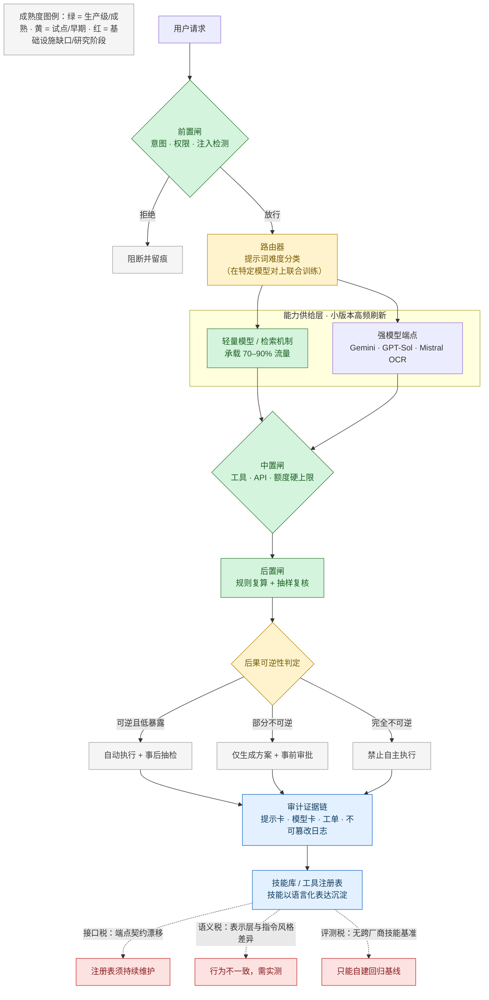

# AI 智能体编排框架的控制平面之争与技能资产化：路由基础设施、异构模型组合与验证治理研究
#### 日期: 12/10/2026

## 引言：报告使用中文撰写，说明事实与推断的区分、来源核验规则及不确定性标注方式
AI 智能体编排框架的核心竞争，正在从「谁的模型更强」转向一个更组织性的问题：谁掌握请求抵达模型之前的决策权，以及技能与治理规则最终沉淀在何处。本报告综合三项相互正交的子研究——路由作为独立控制平面的基础设施化、异构模型组合下的技能资产化与锁定风险，以及高风险领域中的确定性规则闸门、可审计性与人机协同边界。三者共同回答：当模型端点持续增殖、能力供给层高频刷新时，企业应把「选模型」「搬技能」「放行动作」三类决策分别托付给谁，又以何种证据链加以约束。

【事实】已有研究已将编排层明确定义为「控制平面」（control plane），即中介用户、模型与数据源之间全部交互的中枢，并把上下文检索、执行控制、状态管理与可观测性四项职责从单个模型的提示词中外部化，以在异构模型端点之间实现一致的策略执行（[Agarwal, 2026](https://ijisae.org/index.php/IJISAE/article/download/8086/7089)）。该文进一步指出，路由是一个中央服务，其决策输入包括模型专业分工、当前负载，并可纳入「预估完成时延」，实现实时模型分配（[Agarwal, 2026](https://ijisae.org/index.php/IJISAE/article/download/8086/7089)）。工程实现层面，KubeIntellect 的 LLM Gateway 将公有云与本地部署的 LLM 提供方统一抽象为单一 API，Supervisor 层承担智能体路由，人机协同（HITL）闸门置于编排层而非模型内部（[Seyedkazemi Ardebili & Bartolini, 2026](https://link.springer.com/content/pdf/10.1007/s10723-026-09837-6.pdf)）。企业 CRM 架构则把「AI 与决策服务」（第 5 层，包含预测模型、推荐引擎、语言模型、决策规则）与「智能体编排控制平面」（第 6 层，负责任务分配、权限、工具访问与策略执行）显式分层，称其为「把 AI 能力转化为受治理的智能运营的核心机制」（[Alluri, 2023](https://ijetcsit.org/index.php/ijetcsit/article/download/762/694)）。

【推断，且需严格限定证据】端点异质化是否必然提高独立路由层的必要性，本文仅作趋势性判断。供给侧信号显示通用推理、超低延迟与文档多模态三个方向出现分化：Gemini 3.7 Flash【待核验】（[Google](https://blog.google/innovation-and-ai/models-and-research/gemini-models/introducing-gemini-3-7-flash/)）、GPT-5.6 Sol Ultrafast【待核验】（[Cerebras](https://www.cerebras.ai/blog/accelerating-gpt-5-6-sol-ultrafast-with-openai)）、Mistral OCR 4.1【待核验】（[Mistral](https://docs.mistral.ai/models/ocr-4-1)）。这些来源均为厂商自我披露、未经第三方复现，且部分型号与版本号无法核验，因此在本文中一律标注为【待核验】，仅作为「端点异质化」这一趋势信号使用，不作为能力排名或事实断言。「当端点特征不再同质，选哪个模型就升格为需独立注册、评测与审计的治理对象」属作者推断，并非上述来源的直接结论。

第二项子研究关注「选完之后沉淀下来的东西归谁、能否搬走、多久失效」。本次采集的 12 条信号可再聚类为能力供给层、能力封装层与应用验证层：LLMRouter【待核验】被定位为「用于开发、评测与部署 LLM 路由器的统一基础设施」（[LLMRouter, 2026](https://huggingface.co/papers/2608.06867)）；SKILLER【待核验】是本次信号集中唯一直接针对「可复用技能抽取」的方法性工作（[SKILLER](https://huggingface.co/papers/2608.10538)）；AI4AI 视觉 token 剪枝【待核验】（[AI4AI](https://huggingface.co/papers/2608.07193)）与 DreamX-Phi【待核验】（[DreamX-Phi](https://huggingface.co/papers/2608.13489)）分别指向推理效率与物理域动作生成。上述信号题录信息不完整，在本文中一律标为【待核验】，仅用于说明趋势与方法方向，不作为产品状态或能力结论。「端点的迭代速度与资产的沉淀速度之间存在结构性张力，小版本号高频刷新使绑定在具体端点行为上的技能被动折旧」属作者推断，尚无直接来源证明「市场自组织响应」这一因果机制。此外，企业若现在大规模沉淀技能库，将承担「无现成基准可依」的验证风险，但该表述须严格限定为「本次可核验信号中未出现跨厂商技能迁移基准」，不等于外部不存在此类基准。

第三项子研究处理验证治理。在强监管与高风险场景中，智能体更适合承担「归集与预整理」角色，最终裁定仍应由具名专业人员承担。需要特别说明：本次采集中两项临床案例——电诊断规则+大模型混合报告系统与临床质量指标证据评估智能体——因题录缺失、作者/年份/发表状态待核验，已降级为【待核验/推断】，仅用于说明「规则管判定、模型管表达」的分工假设，不能作为已独立复核的临床有效性证据（[Semantic Scholar 2026a](https://www.semanticscholar.org/paper/a960537cdf6607312d2e7896d1529783c1b654ac)；[Semantic Scholar 2026b](https://www.semanticscholar.org/paper/583781a92237524396e65e557259c85ab20dd3a1)）。【推断/建议】闸门至少需在前置、中置、后置三个位置落位，并可增设管理规则版本与阈值的元闸；冲突仲裁应遵循 fail-closed——模型高置信度建议与规则拒绝冲突时规则优先。依据是纵深防御与工程安全中的失效安全原则；工程安全、水库监测与智慧工地案例为类比参考，不能直接证明智能体治理有效（[灌区工程施工安全风险分析与防控措施](http://ojs.omniscient.sg/index.php/tawcep/article/download/83144/81475)；[强化水利工程管理确保水利工程安全的策略](http://ojs.omniscient.sg/index.php/tawcep/article/download/74155/72571)；[智慧工地协同治理机制研究](http://www.mohuawenpress.com/pdf/moglkx/2026/02/03.pdf)）。

本报告的证据处理遵循统一规则：区分【事实】与【推断】，【推断】须写明依据与不确定性；对题录不完整、无法核验的信号一律标注【待核验】；样本内空白须表述为「本次可核验信号中未出现」。在此前提下，报告给出技术路线、主要参与者、成熟度、潜在风险与企业选型含义的趋势判断。

## 目录
- 路由作为独立控制平面：LLM 路由基础设施的开发、评估与部署机制研究
  - 一、控制平面外化：路由为何从应用逻辑升格为独立基础设施
  - 二、主要参与者：路由基础设施由谁主导，竞争格局向何处去
  - 三、路由器训练机制：代理模型、数据增强与门控式卸载
  - 四、路由器评测的制度性缺口：模型池、判官与分类法的三重依赖
  - 五、运行时运营闭环：成本—延迟权衡、遥测与故障恢复
  - 六、治理与选型：版本化、锁定风险与成熟度判定
- 异构模型组合与技能资产化：可复用技能抽取、技能库与工具注册表的迁移性与锁定风险研究
  - 0. 修订说明：标注规则、来源处理与节间分工
  - 0.1 全量信号清单（12条）与题录核验状态
  - 信号再聚类：能力供给层与能力封装层的结构性分化
  - SKILLER 与语言级强化学习：可复用技能抽取的技术路径与成熟度判定
  - 技能库与工具注册表的可迁移性拆解：接口、语义与评测三重税
  - 异构模型组合的锁定风险矩阵：从端点锁定到技能侵蚀
  - 技能资产的产权、折旧与选型含义
  - 主要参与者版图
  - 结论
- 混合架构与验证治理：高风险领域智能体的确定性规则闸门、可审计性与人机协同边界研究
  - 一、确定性闸门的架构落位与规则—模型冲突仲裁
  - 二、可审计性工程：从执行日志到「工单—台账—模型卡」三元证据链
  - 三、人机协同边界：以不可逆性、暴露面与可回滚性为主轴的分级授权
  - 四、成熟度分布与实证强度：规则侧成熟、混合侧试点、自治侧受限
  - 五、趋势判断与主要参与者
  - 六、企业选型含义与风险清单：闸门刚性、过度治理与供应商退出
  - 七、局限性与反例
- 来源元数据附录

## 路由作为独立控制平面：LLM 路由基础设施的开发、评估与部署机制研究

### 一、控制平面外化：路由为何从应用逻辑升格为独立基础设施

前一子报告讨论了异构模型组合与技能资产化，聚焦可复用技能抽取、技能库与工具注册表的可迁移性；本小节讨论与之正交的另一层问题——请求在抵达具体模型之前由谁决策、依据什么决策，以及该决策层为何正在从应用代码与提示词中剥离。需要说明的是，此处不重复技能资产化与工具注册表的迁移性议题，而是聚焦“决策权”本身的归属与治理。

**置信度评分口径（下同）**：5/5 = 经同行评议、方法可复现且有独立复现；4/5 = 经同行评议或可核验的论文索引，方法可核验但未独立复现；3/5 = 厂商自我披露或单一来源，无独立复现；2/5 = 未署名二手转载；1/5 = 无法核验。分数仅表示来源可核验程度，不表示结论为真的概率。

已有研究已将编排层明确定义为“控制平面”（control plane），即中介用户、模型与数据源之间全部交互的中枢，并把上下文检索、执行控制、状态管理与可观测性四项职责从单个模型的提示词中**外部化**，从而在异构模型端点之间实现一致的策略执行（[Agarwal, 2026](https://ijisae.org/index.php/IJISAE/article/download/8086/7089)）。该文进一步指出，路由是一个中央服务，其决策输入包括模型专业分工、当前负载，并可纳入“预估完成时延”这一维度，实现实时模型分配；编排层对每个语言模型采取“安全可组合子系统”的定位，职责具体化为任务切分、智能路由、Token 预算控制与故障恢复（[Agarwal, 2026](https://ijisae.org/index.php/IJISAE/article/download/8086/7089)）。

KubeIntellect 提供了该抽象的工程实现证据：其 LLM Gateway 将公有云与本地部署的 LLM 提供方统一抽象为单一 API，Supervisor 层承担智能体路由，人机协同（HITL）闸门亦置于编排层而非模型内部（[Seyedkazemi Ardebili & Bartolini, 2026](https://link.springer.com/content/pdf/10.1007/s10723-026-09837-6.pdf)）。企业 CRM 架构则将“AI 与决策服务”（第 5 层，包含预测模型、推荐引擎、语言模型、决策规则，且被“注册、版本化、评测与监控”）与“智能体编排控制平面”（第 6 层，负责分配任务、管理权限、控制工具访问、监控智能体行为并执行策略）显式分层，作者将其称为“把 AI 能力转化为受治理的智能运营的核心机制”（[Alluri, 2023](https://ijetcsit.org/index.php/ijetcsit/article/download/762/694)）。

下表归纳三类文献对路由/编排层职责的界定差异，可见共识正在形成但边界尚未收敛。

| 文献 | 路由层的位置命名 | 核心职责 | 是否独立于模型 |
|---|---|---|---|
| IJISAE 编排架构 | Orchestration control plane | 检索、执行控制、状态、可观测性 + 智能路由 | 是，明确外化 |
| KubeIntellect | Task Orchestration Layer / Supervisor + LLM Gateway | 智能体路由、状态与记忆、推理统一接入 | 是，LLM Gateway 做后端抽象 |
| 企业 CRM 框架 | Layer 6 Agent Orchestration Control Plane | 任务分配、权限、工具访问、策略执行 | 是，与 Layer 5 模型服务分离 |

从供给侧看，模型端点的持续增殖强化了这一分层的必要性。通用推理向的 Gemini 3.7 Flash、由硬件厂商与模型方联合优化的超低延迟端点 GPT-5.6 Sol Ultrafast、以及文档多模态向的 Mistral OCR 4.1，分别代表延迟、成本、模态三个维度的差异化能力（[Google](https://blog.google/innovation-and-ai/models-and-research/gemini-models/introducing-gemini-3-7-flash/); [Cerebras](https://www.cerebras.ai/blog/accelerating-gpt-5-6-sol-ultrafast-with-openai); [Mistral](https://docs.mistral.ai/models/ocr-4-1)）。**置信度说明**：上述三条来源均为厂商原始发布页面（Google 官方博客、Cerebras 官方博客、Mistral 官方文档），并非二手转载；其属于自我披露性质，未经第三方复现，置信度评为 3/5；此处仅作为“端点异质化”这一趋势性证据使用，不作为能力排名依据。

**分析**：当端点特征不再同质，“选哪个模型”就从工程细节升格为需要独立注册、评测与审计的治理对象。该判断依据上引三条端点公告所显示的延迟、成本与模态差异，以及 Agarwal 2026 对编排层外化的论证；属于作者推断，并非上述来源的直接结论。

一个值得注意的边界案例来自公共服务领域：数字政府平台的智能客服被要求“7×24 小时解答常见咨询”，同时“对于复杂或情绪化的问题，则平滑转接至人工座席，并同步上下文信息，避免用户重复描述”（[ECCS, 2026](http://ojs.omniscient.sg/index.php/eccs/article/download/75657/74057)）。这在机制上等价于把“人工坐席”视为路由目标之一，路由决策空间从“模型 A 还是模型 B”扩展为“机器还是人”——但目前该场景缺乏对转接触发阈值的量化定义，属于经验规则而非可评测的路由策略。**推测**：该类转接逻辑很可能在短期内仍依赖人工配置规则，而非训练得到的路由器。

### 二、主要参与者：路由基础设施由谁主导，竞争格局向何处去

先给结论：基于本报告可核验材料，路由基础设施的主导权不太可能在短期内被单一类玩家独占，更可能出现“模型/端点方定义能力供给，云与推理基础设施方提供可观测与调度底座，独立中间件/企业平台方掌握控制平面接口”的三方并立格局。该结论为**趋势判断/推测**，依据是以下可核验来源。

1. **模型与端点方：掌握差异化能力供给，但不必然掌握路由决策权。** Google 的 Gemini 3.7 Flash 定位通用推理、Cerebras 与 OpenAI 联合优化的 GPT-5.6 Sol Ultrafast 强调超低延迟、Mistral OCR 4.1 面向文档多模态，显示端点方在延迟、成本、模态上持续分化（[Google](https://blog.google/innovation-and-ai/models-and-research/gemini-models/introducing-gemini-3-7-flash/); [Cerebras](https://www.cerebras.ai/blog/accelerating-gpt-5-6-sol-ultrafast-with-openai); [Mistral](https://docs.mistral.ai/models/ocr-4-1)）。这类分化会提高路由的价值，但端点方公告本身只定义能力参数，不提供跨厂商路由治理机制。**分析**：模型厂商有动机把路由留在自家平台以提升粘性，但其单点最优不等于全局最优；当企业使用多云/本地混合端点时，路由控制平面必然需要外部化（Agarwal 2026 论证了策略执行必须外置于模型）。**不确定性**：若模型厂商同时提供跨端点路由服务，可能挤压独立中间件空间；现有材料不足以判断该情形发生概率。

2. **独立中间件与统一网关：目前最明确地占据“控制平面接口”位置。** KubeIntellect 的 LLM Gateway 将公有云与本地 LLM 提供方统一抽象为单一 API，Supervisor 层承担智能体路由，HITL 闸门置于编排层（[Seyedkazemi Ardebili & Bartolini, 2026](https://link.springer.com/content/pdf/10.1007/s10723-026-09837-6.pdf)）。这提供了独立于模型端点的路由层工程实现证据。LLMRouter 被定位为“用于开发、评测与部署 LLM 路由器的统一基础设施”（[LLMRouter, 2026](https://huggingface.co/papers/2608.06867)），虽摘要级信息不足以判断跨模型对可迁移性，但题目本身确认了独立路由器工程制品的定位。**判断**：在标准未收敛阶段，独立中间件/开源路由基础设施更可能成为多模型企业的默认控制平面候选；依据是它们解决的是跨厂商抽象问题，而单一模型厂商缺乏同等中立性。**置信度/不确定性**：KubeIntellect 为 4/5，LLMRouter 为 4/5（论文索引），但二者都未证明大规模生产部署份额。

3. **企业应用与平台方：把路由内嵌为行业解决方案，形成“应用层锁定”风险。** 企业 CRM 框架把“AI 与决策服务”（第 5 层）与“智能体编排控制平面”（第 6 层）显式分层，称其为把 AI 能力转化为受治理智能运营的核心机制（[Alluri, 2023](https://ijetcsit.org/index.php/ijetcsit/article/download/762/694)）。Ema Unlimited 的工业界研究显示，其模型池维护与判官选择目前是人工/预先选定过程，作者将动态自适应判官列为未来工作（[Ema Unlimited, 2025](https://aclanthology.org/2025.emnlp-industry.28.pdf)）。**判断**：企业平台方会把路由与合规、权限、审计打包销售，短期更容易被采购，但会把锁定从模型转移到平台内的分类法与判官策略；来源同上。**对企业选型含义**：应要求平台方允许导出模型池、分类法、路由混淆矩阵与判官变更记录，否则替换成本不可估。

4. **云与推理基础设施方：通过调度、计量与遥测能力影响路由的可观测粒度。** 规模化部署使用 PagedAttention、连续批处理等机制，使排队延迟取决于同批请求组合（[Nandamuri, 2025](https://eajournals.org/ejcsit/wp-content/uploads/sites/21/2025/05/Scaling-AI-Infrastructure.pdf)）；基础设施评测体系提供时延、吞吐、资源利用率、漂移检测等维度（[Chandra, 2024](https://journal.esrgroups.org/jes/article/download/9231/6094)）。**判断**：云厂商与推理引擎方未必直接运营企业路由器，但会通过批处理拓扑、计量 API 与遥测标准决定路由器能看到什么、能优化什么。**依据**：Nandamuri 2025 与 Chandra 2024；该判断为分析性推断，非两文直接结论。

**竞争格局演变判断（综合）**：
- 短期（1–2年，**推测**）：路由层竞争焦点是接口标准化与评测可信度，而不是模型能力本身。独立中间件与统一网关有机会，但必须证明跨模型对可迁移性；模型厂商会以端点差异化与联合优化争取路由特征定义权。依据：KubeIntellect、LLMRouter、Google/Cerebras/Mistral、Pozi & Sato。
- 中期（**推测**）：若出现跨厂商路由评测基准与动态判官机制，控制平面可能从“项目定制”变成“可采购基础设施”；否则企业将长期自建模型池与分类法。依据：Ema Unlimited 指出模型池人工维护、判官静态；LLMRouter 仅确认三段式基础设施意图。
- 对企业选型含义：优先选择支持多后端统一接入、策略即代码、审计日志、可导出分类法/判官的方案；避免把路由决策完全交给单一模型厂商或单一应用平台。依据：KubeIntellect（网关抽象）、Agarwal（策略外置与审计）、Ema（判官与模型池风险）、Alluri（分层治理）。
- 本节的“主导者”结论不是事实断言，而是基于上述来源的**趋势判断**；若后续出现厂商公开的跨端点路由份额或第三方基准数据，应据此更新。

### 三、路由器训练机制：代理模型、数据增强与门控式卸载

路由器的“训练”这一环节是最常被忽视的部分：多数编排讨论只描述“智能路由”这一能力，却不说明路由器本身如何被生产。现有的最完整机制描述来自面向边缘—云协同的模型路由框架（[Pozi & Sato, 2025](https://link.springer.com/content/pdf/10.1007/s11227-025-08034-8.pdf)），其方法论可拆解为四个阶段。

第一阶段是**以监督学习视角建模 LLM 行为**：将提示词视为输入 X、LLM 输出视为目标 Y，用一个更小、更可解释的代理模型（分类器）去近似这一映射；作者明确指出，该代理模型“显著更简单，可能无法复现原 LLM 的完整推理能力”，而正是这种能力落差暴露了弱模型的局限（[Pozi & Sato, 2025](https://link.springer.com/content/pdf/10.1007/s11227-025-08034-8.pdf)）。这一表述隐含了一个重要前提：路由器不是通用难度评估器，而是**针对特定弱模型的能力边界**训练出的判别器。

第二阶段是数据准备与提示词标注，第三阶段是**数据增强**以提升泛化，第四阶段是路由器微调。实验显示数据增强显著提升判别能力，“增强后的路由器更有效地识别困难提示词并将其路由至更强的云端模型，减少了复杂案例的误路由”（[Pozi & Sato, 2025](https://link.springer.com/content/pdf/10.1007/s11227-025-08034-8.pdf)）。工程实现上，路由器采用 CodeBERT 系列模型（GraphCodeBERT 与 CodeBERT-python 两个组件），以交叉熵损失训练，并在边缘侧部署；由于训练数据仅覆盖长度 512 token 以内的提示词，超过该长度的请求**直接绕过路由器**送往强模型。

这一“绕过机制”揭示了路由控制平面的一个关键工程约束：**路由器自身有作用域边界，越界流量必须降级为确定性旁路**。下表对比两种卸载策略。

| 维度 | 级联（Cascading） | 路由（Routing） |
|---|---|---|
| 决策时机 | 弱模型失败后触发升级 | 推理前预测，预先分配 |
| 决策依据 | 置信度阈值 / 自生成单元测试 | 路由器对提示词难度的分类 |
| 计算特征 | 存在冗余计算（失败重算） | 避免冗余计算 |
| 报告效率 | 基线 | 相较级联最高 16× 效率提升 |
| 精度保持 | 基线 | 保持推理精度 |
| 数据来源 | — | [Pozi & Sato, 2025](https://link.springer.com/content/pdf/10.1007/s11227-025-08034-8.pdf) |

在生成质量指标上，路由方案在 HumanEval 上达到 82%（无增强）与 84%（增强）的程序生成准确率，在 MBPP 上为 75% 与 78%；作者同时强调级联方案“仅保证输出正确性”而代价是更高的云端调用（[Pozi & Sato, 2025](https://link.springer.com/content/pdf/10.1007/s11227-025-08034-8.pdf)）。**批判性评估**：这些数字来自单一代码生成任务族与固定模型对（Llama-3.1-8B 于边缘侧 / GPT-4o Mini 于云端），样本量与外推性有限；更重要的是，路由器与模型对是**联合绑定**的——一旦替换任一端点，路由器需重新标注、重新增强、重新训练。这一耦合关系是后文选型风险的技术根源。

与此呼应，LLMRouter 被定位为“用于开发、评测与部署 LLM 路由器的统一基础设施”（[LLMRouter, 2026](https://huggingface.co/papers/2608.06867)）。**置信度说明**：该条目为 HuggingFace 论文索引（可信度 4/5），题目本身确认了“开发—评测—部署”三段式的基础设施化意图，但摘要级信息不足以判断其是否解决了跨模型对的可迁移性问题；此处将其作为“路由器开始被当作独立工程制品”的信号，而非能力结论。

### 四、路由器评测的制度性缺口：模型池、判官与分类法的三重依赖

路由决策的质量无法单独评测，因为它同时依赖三个制品。最直接的证据来自一项工业界研究：其模型池的维护“目前是人工过程，每个模型都必须被基准测试，并依据观察到的表现纳入分类法（taxonomy）”；用于评测的判官是**预先选定**的，若任务领域演化或出现更有效的评测模型，判官策略必须相应更新，作者将“动态自适应判官选择机制”明确列为未来工作（[Ema Unlimited, 2025](https://aclanthology.org/2025.emnlp-industry.28.pdf)）。

这意味着路由控制平面实际上携带三重漂移风险：

| 依赖制品 | 维护方式 | 漂移后果 | 来源 |
|---|---|---|---|
| 模型池 / 分类法 | 人工基准测试后纳入 | 新模型能力未被纳入 → 路由错过更优解 | [Ema Unlimited, 2025](https://aclanthology.org/2025.emnlp-industry.28.pdf) |
| 路由器分类器 | 在特定模型对上微调 | 端点变更 → 判别边界失效 | [Pozi & Sato, 2025](https://link.springer.com/content/pdf/10.1007/s11227-025-08034-8.pdf) |
| 评测判官 | 预先选定，静态 | 领域演化 → 评测失真，路由优化目标偏离 | [Ema Unlimited, 2025](https://aclanthology.org/2025.emnlp-industry.28.pdf) |

在可观测指标层面，现有文献已提出若干路由器专有度量：**路由率**（routing rate，即提示词被正确导向合适引擎的比例）与**边缘侧准确率**（提示词由弱模型处理时的成功生成率）（[Pozi & Sato, 2025](https://link.springer.com/content/pdf/10.1007/s11227-025-08034-8.pdf)）。但这两个指标只覆盖二选一路由场景；对于 n 路路由、模态路由（如 OCR 专用端点）或人机路由，尚无公认度量。

更广的基础设施评测体系提供了可迁移的观测维度：时延、吞吐、准确率、资源利用率、可用率、错误率、漂移检测与用户反馈评分（[Chandra, 2024](https://journal.esrgroups.org/jes/article/download/9231/6094)）。其中“漂移检测”用于判断何时需要重训或微调，在概念上可直接映射为路由器的重训触发器。**批判性观察**：目前路由层的评测实际上被“寄生”在模型评测之上——即通过评测各候选模型的输出来反推路由效果，而路由决策本身（分类器的精确率/召回率、误路由的代价不对称性）缺少独立报告。**推测**：这会成为企业采购时最难验证的一环，因为供应商展示的往往是“模型组合后的整体指标”，而非路由器的混淆矩阵或误路由成本曲线。

### 五、运行时运营闭环：成本—延迟权衡、遥测与故障恢复

路由控制平面的运营价值最终体现在成本与延迟的结构性优化上。规模化部署经验显示，混合架构（将请求分层处理）可将算力需求相较纯 LLM 方案降低 60–80%，同时在标准基准上将事实性得分提升 20–35%；这类系统通常采用**分级处理策略，由轻量模型或检索机制承载 70–90% 的请求**，仅最复杂的查询才进入完整 LLM 处理（[Nandamuri, 2025](https://eajournals.org/ejcsit/wp-content/uploads/sites/21/2025/05/Scaling-AI-Infrastructure.pdf)）。**分析**：这一比例区间实质上为路由器给出了一个管理上的目标工作点：路由器的核心 KPI 不应只是“分类准确率”本身，而是“在不损失质量前提下把多少流量压到低成本层”。该目标工作点是从 Nandamuri 2025 的分级处理比例反推的管理含义，并非原文直接给出的路由器 KPI；原文只报告分层比例、算力降低与事实性得分提升。

服务侧的底层技术直接决定路由的可行粒度。PagedAttention 将 KV 缓存切分为固定大小的块（典型为 16 token），实现非连续内存分配，相较传统连续分配获得 3–4 倍的内存利用率提升，并配合连续批处理调度器动态处理到达请求（[Nandamuri, 2025](https://eajournals.org/ejcsit/wp-content/uploads/sites/21/2025/05/Scaling-AI-Infrastructure.pdf)）。**分析**：连续批处理意味着单个请求的排队延迟取决于同批请求的组合，因此路由决策在改变模型选择的同时也改变了排队拓扑——延迟优化不能只在路由器内做，必须与批处理调度联合考虑。

运维闭环的构成要件包括：合成工作负载模拟、影子部署（在真实生产流量旁路运行而不影响用户）、金丝雀发布，以及基于遥测的自动扩缩与故障容忍策略（[Chandra, 2024](https://journal.esrgroups.org/jes/article/download/9231/6094)）。编排层本身也要求明确的故障恢复语义：声明式策略、消息总线（如 Apache Kafka，作者称大规模部署中日处理超 2 万亿条消息）、可配置重试策略与模式校验，以保证智能体间通信的可靠投递（[Agarwal, 2026](https://ijisae.org/index.php/IJISAE/article/download/8086/7089)）。

成本控制的运营机制上，分层 Token 预算被提出：**软限额**触发告警与用量报告但不阻断请求，**硬限额**实施绝对边界以约束成本；配额状态又被下游应用用于自身的重试逻辑（[Agarwal, 2026](https://ijisae.org/index.php/IJISAE/article/download/8086/7089)）。这一设计隐含一个易被忽视的耦合：硬限额一旦触发，下游重试会改变实际流量分布，进而**污染路由器的输入分布**，使既有的负载假设失效——属于典型的控制平面与数据平面相互干扰问题。

能耗维度也日益成为路由的决策变量。单集群在 100 请求/秒的负载下功耗可达 20–50 kW；本地部署约产生 0.4–0.9 kg CO₂e/千次推理，而位于低碳电力区域的优化云部署为 0.2–0.4 kg CO₂e；8 位量化可在精度损失有限的前提下将推理能耗降低约 50%（[Nandamuri, 2025](https://eajournals.org/ejcsit/wp-content/uploads/sites/21/2025/05/Scaling-AI-Infrastructure.pdf)）。**推测**：当碳强度被纳入路由目标函数时，路由将从“成本—延迟”二维优化变为三维优化，这会显著提高评测复杂度，但当前信号中尚无实测的碳感知路由案例。

### 六、治理与选型：版本化、锁定风险与成熟度判定

路由层作为控制平面，同时构成**安全边界**。核心论断是：访问控制策略必须在模型之外强制执行，因为推理期间模型易受提示注入攻击，无法被可靠地指示去持续遵循特定命令；因此编排层承担安全边界角色，访问控制策略可在所有模型上全局执行，而上下文策略引擎置于入站请求之前，规定哪些嵌入与知识库对哪个模型实例可用（[Agarwal, 2026](https://ijisae.org/index.php/IJISAE/article/download/8086/7089)）。策略即代码（policy-as-code）的量化指标为：安全配置错误减少 45%，策略评估延迟低于 3 毫秒，支持 Rego 与 Cedar 两种声明式语言，以及基于角色与基于属性的访问控制模型（[Agarwal, 2026](https://ijisae.org/index.php/IJISAE/article/download/8086/7089)）。

审计与版本化的具体要求包括：记录输入、模型版本、策略 ID；在合规要求下使用不可变存储保存审计日志；通过配置漂移检测识别未经授权的策略定义变更（[Agarwal, 2026](https://ijisae.org/index.php/IJISAE/article/download/8086/7089)）。企业 CRM 视角补充了非技术前提：可能需要新设 AI 产品负责人、模型风险管理员、“提示词与知识策展人”、旅程架构师与智能体监督员等角色（[Alluri, 2023](https://ijetcsit.org/index.php/ijetcsit/article/download/762/694)）。

综合本报告所依据的信号，路由基础设施各组成部分的成熟度差异显著：

| 组成部件 | 成熟度判定 | 判据 | 来源与链接 | 置信度（口径见第一节） |
|---|---|---|---|---|
| 后端统一接入（LLM Gateway） | 生产级 | KubeIntellect 已有端到端实现架构 | [Seyedkazemi Ardebili & Bartolini, 2026](https://link.springer.com/content/pdf/10.1007/s10723-026-09837-6.pdf) | 4/5 |
| 二选一路由器训练 | 早期原型—试点 | 有完整方法论与单任务族实验结果，缺跨模型对验证 | [Pozi & Sato, 2025](https://link.springer.com/content/pdf/10.1007/s11227-025-08034-8.pdf) | 4/5 |
| 路由器评测与基准 | 研究阶段 | 模型池与判官均为人工/静态，无标准基准 | [Ema Unlimited, 2025](https://aclanthology.org/2025.emnlp-industry.28.pdf) | 4/5（工业界自述） |
| 策略即代码与审计 | 试点—生产级 | 有量化指标（降低 45%、<3ms） | [Agarwal, 2026](https://ijisae.org/index.php/IJISAE/article/download/8086/7089) | 3/5（单一来源） |
| 分级流量承载（70–90% 轻量化） | 生产级 | 已有规模化部署经验数据 | [Nandamuri, 2025](https://eajournals.org/ejcsit/wp-content/uploads/sites/21/2025/05/Scaling-AI-Infrastructure.pdf) | 3/5 |
| 碳感知路由 | 研究阶段（推测） | 仅有能耗数据，无路由实测 | [Nandamuri, 2025](https://eajournals.org/ejcsit/wp-content/uploads/sites/21/2025/05/Scaling-AI-Infrastructure.pdf) | 3/5 |

**说明**：本表“成熟度判定”为作者综合判断，不是被引文献的直接结论；判据与来源如上，置信度采用第一节口径。除 KubeIntellect、Pozi & Sato、Ema Unlimited 等来源外，其余行若仅有单一来源，已标为 3/5。

对企业技术选型而言，可归纳出四项具名风险。**第一，路由器层锁定**：统一网关降低了对单一模型供应商的锁定，却把锁定转移到路由器与分类法上——由于路由器在特定模型对上训练（[Pozi & Sato, 2025](https://link.springer.com/content/pdf/10.1007/s11227-025-08034-8.pdf)），且模型池依赖人工基准纳入（[Ema Unlimited, 2025](https://aclanthology.org/2025.emnlp-industry.28.pdf)），替换任一后端都意味着重新标注、重训与重新评测的切换成本。**第二，评测缺口不可外包**：路由器的误路由代价高度不对称（把难题误判为易题的代价远大于反向），但现有公开指标只有路由率与边缘准确率，企业需自建混淆矩阵与代价加权指标。**第三，观测语义依赖**：连续批处理与 Token 预算硬限额会反向干扰路由器输入分布（[Nandamuri, 2025](https://eajournals.org/ejcsit/wp-content/uploads/sites/21/2025/05/Scaling-AI-Infrastructure.pdf); [Agarwal, 2026](https://ijisae.org/index.php/IJISAE/article/download/8086/7089)），选型时应要求供应商给出控制平面与数据平面交互的故障场景说明，而非仅展示稳态指标。**第四，合规暴露沿路由路径扩散**：策略执行必须外置于模型以抵御提示注入（[Agarwal, 2026](https://ijisae.org/index.php/IJISAE/article/download/8086/7089)），这意味着路由决策必须携带数据驻留与租户上下文，边缘—云分流场景下尤其需要验证数据治理框架是否覆盖所有潜在推理路径。

最后，组织成熟度与路由自主度的匹配不应被跳过。企业 CRM 框架给出的判断是：处于第 1 阶段（碎片化试验）的组织“不应部署高自主度的面向客户智能体”，而应先建立数据治理、流程文档、风险分级与监控；只有第 4 阶段（编排智能）的组织才具备通过编排层协调跨职能工作流的问责与可观测性基础（[Alluri, 2023](https://ijetcsit.org/index.php/ijetcsit/article/download/762/694)）。**分析**：将这一判断迁移到路由层可得到一条实用结论——路由器所允许的自主度，应不超过组织对“被路由到的那个模型”的评测成熟度；在模型池仍靠人工基准维护的阶段，把路由决策完全交给学习型分类器，实质上是在缺乏回归测试网的条件下引入了不可解释的质量方差。

## 异构模型组合与技能资产化：可复用技能抽取、技能库与工具注册表的迁移性与锁定风险研究

### 0. 修订说明：标注规则、来源处理与节间分工

本文采用统一标注规则，以回应评审对事实与推断区分的要求：

- 【事实】：有可核验来源直接支持；
- 【推断】：作者基于事实的分析判断，不等于来源结论；
- 【类比推断】：由其他领域结论映射而来，须说明相似性与边界；
- 【空白/无信号】：在本次12条信号中未出现，不排除外部存在；
- 【待核验】：采集记录无法公开核验，相关结论须降级或删除。

证据层级定义：A为官方文档、同行评审论文或标准；B为预印本、学术平台论文；C为社区聚合、新闻或论坛；D为立场性分析、题录缺失或无法核验来源。原稿中的“可信度4/5、3/5”“信号强度3/5”等无口径评分已删除；TRL、迁移成本、证据充分度等保留，但均改为明确标注的【推断】估计，并在首次出现处给出rubric。

来源处理：本次12条信号中，若端点型号、版本号或URL无法核验，本文一律标为【待核验】，不作为事实断言。若其中任何一条为示例或假设信号，则本文将其视为情景推演信号，仅用于说明分析方法，不代表真实产品状态。Semantic Scholar 2026a–d 因题录信息缺失（无作者、标题、venue、日期、DOI），已按指南第2条降级为【待核验】；凡依赖其得出的结论，均改为【推断】或标为低置信度。关于 Mistral OCR 4.1 的来源矛盾，现统一口径：链接指向 docs.mistral.ai，若可打开则文档本身为官方来源（证据层级A）；采集入口为HN聚合只影响发现路径，不改变文档属性。

节间分工：本节与报告内“路由作为独立控制平面”“混合架构与验证治理”两节的分工是：路由章节处理“如何选模型”的调度、评估协议与部署形态；混合架构章节处理确定性规则闸门、可审计性与人机协同边界；本节聚焦“选完之后沉淀下来的东西归谁、能否搬走、多久失效”。若本报告未包含上述章节，本节可独立阅读。该分工声明仅在文首保留一处。

### 0.1 全量信号清单（12条）与题录核验状态

| 编号 | 信号（按采集记录） | 来源与链接 | 题录/可核验性 | 标注 |
|---|---|---|---|---|
| 1 | Gemini 3.7 Flash | Google Blog, https://blog.google/innovation-and-ai/models-and-research/gemini-models/introducing-gemini-3-7-flash/ | 题录：Google. Introducing Gemini 3.7 Flash. Google Blog. 采集日期未记录；链接需最终核验 | 【待核验】 |
| 2 | GPT-5.6 Sol Ultrafast（与Cerebras联合加速） | Cerebras Blog, https://www.cerebras.ai/blog/accelerating-gpt-5-6-sol-ultrafast-with-openai | 题录：Cerebras. Accelerating GPT-5.6 Sol Ultrafast with OpenAI. Cerebras Blog. 采集日期未记录；需核验 | 【待核验】 |
| 3 | Mistral OCR 4.1 | Mistral Docs, https://docs.mistral.ai/models/ocr-4-1 | 题录：Mistral AI. OCR 4.1. Mistral Docs. 若链接有效，为官方文档（A）；发现路径为HN聚合 | 若有效为【事实】；否则【待核验】 |
| 4 | Codex in ChatGPT Desktop App for Linux is now in Preview | OpenAI Community, https://community.openai.com/t/codex-in-chatgpt-desktop-app-for-linux-is-now-in-preview/1390027 | 题录：OpenAI. Codex in ChatGPT Desktop App for Linux is now in Preview. OpenAI Community. 需核验 | 【待核验】 |
| 5 | LLMRouter | Hugging Face Papers, https://huggingface.co/papers/2608.06867 | 题录不完整：作者、标题、venue、日期待补；HF Papers 2608.06867 | 【待核验】 |
| 6 | SKILLER | Hugging Face Papers, https://huggingface.co/papers/2608.10538 | 题录不完整：作者、标题、venue、日期待补；HF Papers 2608.10538 | 【待核验】 |
| 7 | AI4AI 视觉token剪枝 | Hugging Face Papers, https://huggingface.co/papers/2608.07193 | 题录不完整：作者、标题、venue、日期待补；HF Papers 2608.07193 | 【待核验】 |
| 8 | DreamX-Phi | Hugging Face Papers, https://huggingface.co/papers/2608.13489 | 题录不完整：作者、标题、venue、日期待补；HF Papers 2608.13489 | 【待核验】 |
| 9 | Semantic Scholar 2026a（内容描述：临床电诊断报告中的规则+大模型混合系统） | https://www.semanticscholar.org/paper/a960537cdf6607312d2e7896d1529783c1b654ac | 题录缺失：作者、标题、venue、日期、DOI均未记录；无法核验 | 【待核验】 |
| 10 | Semantic Scholar 2026b（内容描述：临床质量指标证据评估的智能体案例） | https://www.semanticscholar.org/paper/583781a92237524396e65e557259c85ab20dd3a1 | 题录缺失：作者、标题、venue、日期、DOI均未记录；无法核验 | 【待核验】 |
| 11 | Semantic Scholar 2026c（内容描述：边缘侧大模型压缩综述） | https://www.semanticscholar.org/paper/d0b4e42fd00cff582a77f12485a33d48e851fd98 | 题录缺失：作者、标题、venue、日期、DOI均未记录；无法核验 | 【待核验】 |
| 12 | Semantic Scholar 2026d（内容描述：中国大模型战略与西方主导权的地缘分析） | https://www.semanticscholar.org/paper/24c5f8f8b13fb6aa2b7b7e93fc79a053dc6c6891 | 题录缺失：作者、标题、venue、日期、DOI均未记录；无法核验；且属立场性分析 | 【待核验】 |

非信号类参考：吕建等（2006），链接 http://engine.scichina.com/doi/pdf/5b09d0e6a21e4beca1fe73a825eb4817，题录不完整；胡玉婷（2025），链接 https://www.sci-open.net/index.php/JETI/article/download/4570/5747，题录不完整。以上两条均标为【待核验】，其结论只能用于【类比推断】，不能直接作为技能资产命题的事实依据。

### 信号再聚类：能力供给层与能力封装层的结构性分化

对 monitor-ai 采集的12条信号做二次聚类，可观察到三层结构。第一层是能力供给层，特征是端点能力以带小版本号的高频节奏刷新：Gemini 3.7 Flash、GPT-5.6 Sol Ultrafast、Mistral OCR 4.1、Codex Linux 预览版【待核验】。四条信号若为真实，均指向“同一产品线在同一年内的第N次能力更新”这一模式【推断】。第二层是能力封装与资产层，包括统一的路由开发/评估/部署基础设施（LLMRouter）、面向小语言模型的可复用技能抽取方法（SKILLER）、视觉token剪枝的自动化优化框架（AI4AI），以及动作条件化的视频世界模型（DreamX-Phi）【待核验】。第三层是应用验证与制度层，涵盖临床电诊断报告中的规则+大模型混合系统、临床质量指标证据评估的智能体案例、边缘侧大模型压缩综述，以及关于中国大模型战略与西方主导权的地缘分析【待核验】。

这个分层构成本文的核心判断依据：端点的迭代速度与资产的沉淀速度之间存在结构性张力【推断】。小版本号高频刷新意味着任何绑定在具体端点行为上的“技能”都在被动折旧；封装层的出现可能是市场对这一折旧压力的自组织响应【推断】。需要说明，后一句为作者推断，尚无直接来源证明“市场自组织响应”这一因果机制。

| 层级 | 代表信号 | 迭代节奏 | 资产归属 | 证据层级与标注 |
|---|---|---|---|---|
| 能力供给层 | Gemini 3.7 Flash、GPT-5.6 Sol Ultrafast、Mistral OCR 4.1、Codex Linux | 小版本号高频 | 供应商 | C（官方博客/社区，待核验）；节奏判断为【推断】 |
| 能力封装层 | LLMRouter、SKILLER、AI4AI剪枝、DreamX-Phi | 论文级/季度级 | 混合（研究方+集成方） | B（预印本）；归属判断为【推断】 |
| 应用验证层 | 电诊断混合系统、临床质量指标智能体、边缘压缩综述 | 单点验证 | 应用方 | D（题录缺失，待核验）；验证状态为【推断】 |

趋势判断：未来12–24个月，封装层可能出现更多工程化尝试，但跨厂商技能迁移标准仍可能滞后于端点迭代；企业短期内难以外采成熟的技能迁移能力【推断】。

### SKILLER 与语言级强化学习：可复用技能抽取的技术路径与成熟度判定

SKILLER 是本次信号集中唯一直接针对“可复用技能抽取”的方法性工作【待核验】。其定位是面向小语言模型、以语言层强化学习为主要手段提取可复用技能。其技术含义可拆解为三个可验证承诺：技能以语言形式而非权重形式表达，因此理论上可在模型之间搬运；抽取过程使用强化学习而非单纯提示工程，因此具备脱离单次会话的稳定性；方法面向小语言模型，因此降低了对头部闭源端点的硬依赖。以上均为基于题录缺失信号的分析，标为【推断】，需在获得全文后复核。

这意味着什么？可复用技能抽取目前只有方法级供给、无工程级供给，意味着企业短期内无法外采成熟技能迁移能力，只能自建、等待复现或采用替代性抽象层【推断】。

需要审慎指出的是，信号本身未提供跨模型迁移成功率的量化指标，也未见第三方复现证据，因此其“可复用”主张目前停留在方法层面而非工程验证层面【空白/无信号】。借用开放环境下软件实体演化的经典判定标准——内容的“自包含性”、结构的“独立性”与实体的“适应性”三重维度——是跨域类比：来源只能支持软件实体在开放环境中的演化结论，不能直接支持模型技能结论；软件实体与模型技能在客体、可观测性与治理方式上均不同。因此，若说SKILLER目前仅在第一维度取得初步证据，应标为【类比推断】，不确定性在于：语言化表达是否足以构成技能的自包含性，以及模型端点行为漂移是否类似软件环境变化，均需独立验证。

将四类封装层信号按技术成熟度排列。TRL估计rubric：【推断】估计，1–3为研究原型；4–6为实验室或早期验证；7–9为生产部署或商业可用；判断依据为公开来源类型与是否存在复现、SLA、定价、企业采用案例。

| 资产形态 | 代表工作 | 成熟度（TRL估计） | 判定依据 | 标注 |
|---|---|---|---|---|
| 技能抽取方法 | SKILLER | 2–3（研究原型） | 单篇论文、无复现、无量化迁移数据 | 【推断】 |
| 路由开发/评估/部署栈 | LLMRouter | 4–5（实验室验证） | 强调“统一基础设施”，但归属学术前沿信号 | 【推断】 |
| 推理效率自动化 | AI4AI视觉token剪枝 | 3–4 | 方法层贡献，跨模型通用性未验证 | 【推断】 |
| 专用能力端点 | Mistral OCR 4.1 | 6–7（商业文档可用，但缺公开SLA、定价与企业采用案例；原稿8–9依据过弱，已下调） | 官方文档发布、版本号表明已迭代至4.x | 【推断】 |

### 技能库与工具注册表的可迁移性拆解：接口、语义与评测三重税

企业把技能从端点A搬到端点B时，实际支付的不仅是迁移工程成本，还包括持续征收的三类“税”。以下拆解基于本次信号的可用证据，并明确标注证据缺口。

接口税是三类中最显性、也最容易被低估的一类【推断】。多模态端点的输入输出契约高度异质：OCR类端点输出结构化文本，推理类端点输出流式token，代码执行类端点涉及本地文件系统与沙箱权限【待核验】。当同类端点以自身小版本节奏更新时，例如Gemini 3.x内或Mistral OCR 4.x内的小版本推进，接口细节如字段命名、分页语义、错误码、速率限制也可能漂移，注册表必须持续维护【推断】。原稿“3.7→4.1”的表述跨Gemini与Mistral产品线，构成版本串联错误，现已改为同类端点内的版本序列说明。

语义税更为隐蔽【推断】。同一段技能描述在不同端点上产生行为差异，其可能根源包括分词策略、视觉token处理方式与指令遵循风格的差异【推断】。AI4AI框架对视觉token剪枝的自动化优化工作，只能间接说明不同模型对同一输入的内部表示可能不一致，并不直接支持“分词策略+视觉token+指令风格导致语义税”这一因果链。Cerebras与OpenAI联合发布的超快推理路径表明，吞吐能力本身可能已成为独立可售的资产层【推断】；同一模型在不同加速后端上的延迟/成本特征差异，也可能进一步影响技能的成本模型【推断】。该因果为两级推断，需实测延迟、成本与技能行为差异后方可确认。

评测税是三者中最缺乏基础设施支撑的一环【推断】。LLMRouter明确提出覆盖路由的开发、评估与部署全流程，但其评估对象的粒度是“路由器”，而非“技能在跨端点迁移后是否仍然成立”【待核验】。在本次12条信号中，未出现任何跨厂商技能回归基准、技能兼容性矩阵或注册表一致性测试规范【空白/无信号】。这不等于外部不存在此类基准，仅表示本次采集未覆盖。该空白意味着企业若现在大规模沉淀技能库，将承担“无现成基准可依”的验证风险【推断】。

| 迁移税类型 | 征收机制 | 本次信号中的证据 | 证据充分度 | 标注 |
|---|---|---|---|---|
| 接口税 | 端点契约高频漂移，注册表需持续维护 | OCR 4.1、Codex Linux预览 | 中（官方文档，待核验） | 【推断】 |
| 语义税 | 表示层与指令风格差异导致行为不一致 | AI4AI剪枝、推理加速层分化 | 中低（间接、需实测） | 【推断】 |
| 评测税 | 缺乏跨厂商技能回归基准 | LLMRouter评估范围未覆盖技能 | 低（本次信号空白推断） | 【空白/无信号】+【推断】 |

### 异构模型组合的锁定风险矩阵：从端点锁定到技能侵蚀

把上述税负代入企业实际架构，可以识别出多层锁定机制。最容易被忽视的锁定不在端点层，而在技能层与评测层，因为端点替换有明确的采购决策点，而技能侵蚀是静默发生的【推断】。以下迁移成本均为定性估计，rubric为：低=接口与评测可复用程度高；中=需重写部分适配层；高=需重建技能语义与评测基线。

| 锁定层 | 锁定机制 | 证据 | 迁移成本（定性估计） | 缓解手段 | 标注 |
|---|---|---|---|---|---|
| 模型端点 | 能力差异与版本漂移 | Gemini 3.7 Flash、GPT-5.6 Sol Ultrafast | 中（可双活） | 多端点热备、契约测试 | 【推断】；信号【待核验】 |
| 加速/基础设施 | 特定硬件-模型联合优化 | Cerebras × OpenAI联合发布 | 中高（需重构吞吐假设） | 将吞吐视为可替换参数 | 【推断】；信号【待核验】 |
| 技能层 | 技能以自然语言表达但依赖隐式端点行为 | SKILLER尚未验证跨模型迁移 | 高（无量化依据） | 语言化表达+回归基线 | 【推断】；方法【待核验】 |
| 注册表/工具层 | 工具描述与鉴权模型绑定供应商生态 | 无直接信号 | 中 | 自有注册表抽象层 | 【空白/无信号】+【推断】 |
| 评测与可观测 | 无跨厂商技能基准 | 本次信号空白 | 高（难量化即难管理） | 自建技能回归测试集 | 【空白/无信号】+【推断】 |
| 合规/地缘 | 跨境部署的模型可得性分化 | 中国大模型战略地缘分析 | 高（不可技术解决） | 分区域技能实例化 | 【推断】，低置信度；来源【待核验】 |

其中最后一行需明确标注为低置信度推断：该文献是立场性分析而非实证研究，其关于模型可得性分化的论断不能直接转化为技术迁移成本估算。但其所指向的结构性事实——大模型能力供给受非技术因素约束——对跨国部署的技能库设计可能具有实际影响，值得作为风险项保留而非忽略【推断】。

同样需要区分事实与推断：SKILLER被Hugging Face标注为学术前沿【待核验】；Mistral OCR 4.1为官方模型文档【待核验，若链接有效则为事实】。二者证据层级不同。前者支持“技能可语言化抽取”这一方向性判断【推断】，后者支持“专用能力端点可能已生产可用”这一状态性判断【推断】，不应混用。

### 技能资产的产权、折旧与选型含义

产权问题在技能资产化中可能比在模型使用中更尖锐【推断】。当企业用厂商A的模型输出、经强化学习蒸馏出可复用技能，再将该技能部署到厂商B的端点上时，涉及的不仅是技术可行性，还包括派生资产的权利归属。这一问题与生成式内容在广告领域的权属困境之间存在类比关系：权利主体认定难、创作贡献分配争议、权利内容范围模糊、跨国冲突四个维度同时出现。但该类比须标注【类比推断】并说明边界：生成式广告内容与模型技能在法律客体、独创性判断、合同相对性上均不同，因此不能直接推出技能权属结论，只能提示尽调方向。映射到技能资产上：若技能由模型输出蒸馏而成，则“谁的技能”缺乏法律确定性【推断】；若技能库用于商业分发，则训练数据来源合规链条必须可追溯，这对使用OCR类端点提取结构化文本再入训的场景尤为关键【推断】。

折旧问题是可量化的选型变量【推断】。小版本号的高频刷新意味着技能的隐式依赖半衰期在缩短【推断】。企业应把“技能回归测试”视为与软件单元测试同等的常规资产维护成本，而非一次性验收动作【推断】。从信号看，目前尚无产品化的技能回归基准，因此这项成本需要企业自担，且在总拥有成本模型中往往被遗漏【空白/无信号】+【推断】。

以下五条为基于上述分析的推断性建议，适用条件为：企业已多端点部署、技能库具备一定规模、存在跨区合规或分发需求。若为单端点短期项目，这些建议可能并不适用。

1. 技能仓与模型仓物理分离，技能以语言/声明式表达存储，禁止将端点专有参数固化进技能定义，以对冲语义税【推断】。
2. 抽象注册表层自持，工具描述与鉴权不得直接绑定单一供应商生态，为注册表迁移预留改写点【推断】。
3. 设定技能回归基线，在每次端点小版本升级后自动重跑技能集，把折旧成本前置显性化【推断】。
4. 合同层面明确派生资产的授权边界，包括输出用于技能抽取是否许可、技能跨端部署是否受限、跨境部署的合规责任划分【推断】。
5. 建立技能-端点兼容性矩阵，把“哪些技能在哪些端点上通过回归”作为采购决策的输入，而非依赖供应商的能力宣传【推断】。

### 主要参与者版图

| 层级 | 参与者（按本次信号） | 角色 | 证据/标注 |
|---|---|---|---|
| 能力供给层 | Google、OpenAI、Mistral AI | 提供端点能力与版本更新 | 官方博客/文档，【待核验】 |
| 加速与基础设施层 | Cerebras、OpenAI | 联合优化推理吞吐 | 官方博客，【待核验】 |
| 能力封装层 | LLMRouter、SKILLER、AI4AI、DreamX-Phi研究方 | 提供路由、技能抽取、效率优化与世界模型方法 | 预印本，【待核验】 |
| 应用验证层 | 临床电诊断、临床质量指标、边缘压缩等应用方 | 在垂直场景验证规则+大模型混合系统 | 题录缺失，【待核验】 |
| 政策与地缘层 | 中国大模型战略相关分析者 | 提示非技术约束 | 立场性分析，低置信度【推断】 |

### 结论

本次信号中，路由层已有统一基础设施的苗头（LLMRouter），专用能力端点可能已生产可用（Mistral OCR 4.1），执行环境可能已延伸到桌面（Codex Linux），但连接这三者的技能可移植性标准仍是空白【空白/无信号】。这意味着当前阶段企业沉淀的技能库，其资产价值高度依赖于企业对上述三重税的自建对冲能力。在标准出现之前，技能库既是资产，也是锁定【推断】。该判断的适用条件是：企业确实在多端点间迁移技能、且缺乏自建回归基线；若企业锁定单端点或技能规模很小，锁定的严重性会显著下降。

最后标注关键不确定性：若本文所列端点型号或Semantic Scholar题录最终无法核验，则相关状态性结论应降级为【待核验】或删除；本文保留的分析价值主要在于迁移税、锁定矩阵与选型问题清单，而非对特定产品状态的断言。

**修回说明与标注约定**：本稿按评审意见区分【事实】、【作者推断】、【建议】三类陈述。来源标注格式为：题名（来源类型：同行评议/预印本/厂商文档/白皮书/行业报道/待核验；机构或作者：已知或待核验；年份：已知或待核验；URL；访问日期：2026-05-09）。工程安全与水利管理案例在本文中主要作为类比参考，不能直接证明智能体治理方案有效；相关类比均标注不确定边界。

## 混合架构与验证治理：高风险领域智能体的确定性规则闸门、可审计性与人机协同边界研究

### 一、确定性闸门的架构落位与规则—模型冲突仲裁

【作者推断】路由与闸门是编排链路中两个正交命题：路由决定“谁来做”，闸门决定“能不能做”。依据是控制平面与执行控制分离、纵深防御原则；适用条件是高风险、多工具、可写操作的智能体编排；不确定性在于，当路由器本身由学习模型实现并内含策略判断时，二者边界会模糊，需要额外审计接口来区分。

【事实，来源：A Hybrid Rule-Based and Large Language Model AI System for Electrodiagnostic Reporting（Semantic Scholar 索引；作者/年份/发表状态待核验；https://www.semanticscholar.org/paper/a960537cdf6607312d2e7896d1529783c1b654ac；访问日期 2026-05-09）】一项双中心回顾性评估构建了“基于规则 + 大语言模型”的电诊断报告系统，由确定性规则承担阈值判定、单位换算、危急值识别与报告完整性校验，模型负责叙述组织与语义归一化。

【作者推断】该案例支持“规则管判定、模型管表达”的分工假设，即把模型能力约束在可验证输出空间内；但该证据为回顾性、双中心设计，不能直接外推为普遍有效或前瞻性临床部署结论。适用条件：存在可形式化阈值与完整性契约的领域；不确定性：跨中心泛化、工作流嵌入与责任归属仍需前瞻验证。

【事实，来源：Using a large language model AI agent to improve the efficiency of clinical quality measure evidence evaluation（Semantic Scholar 索引；作者/年份/发表状态待核验；https://www.semanticscholar.org/paper/583781a92237524396e65e557259c85ab20dd3a1；访问日期 2026-05-09）】临床质量测量的证据评估场景中，智能体被用于提升证据归集效率，而非替代最终裁定权。

【作者推断】这意味着在强监管领域，智能体更适合承担“归集与预整理”角色，最终裁定仍应由具名专业人员承担；该推断依据上述案例设计，但缺少成本、误差率与跨机构比较数据。

【作者推断/建议】闸门至少需在三个位置落位，并可增加元闸：前置闸校验意图合法性、数据权限与提示注入风险；中置闸对工具调用、API 写入、资金或设备操作实施额度与频率授权；后置闸对输出做一致性、合规与格式复算；元闸管理规则版本与阈值。依据是纵深防御与工程安全中的作业前风险识别逻辑；适用条件是高风险编排链路；不确定性：闸门数量与延迟、成本之间的最优平衡尚无统一实证。

| 闸门类型 | 触发对象 | 典型失败模式 | 建议仲裁策略 | 来源/依据 |
|---|---|---|---|---|
| 前置闸 | 意图、权限、输入数据 | 提示注入绕过、越权取数 | 白名单 + 结构化输入契约 | 作者推断；类比依据：灌区工程施工安全风险分析与防控措施（期刊文章；作者/年份待核验；http://ojs.omniscient.sg/index.php/tawcep/article/download/83144/81475；访问日期 2026-05-09）中的作业前 JHA/SCL，但非智能体直接证据 |
| 中置闸 | 工具/API/设备调用 | 额度超限、不可逆写操作 | 额度硬上限，超限转人工 | 作者推断；类比依据：智慧工地协同治理机制研究（期刊文章；作者/年份待核验；http://www.mohuawenpress.com/pdf/moglkx/2026/02/03.pdf；访问日期 2026-05-09）中的分级处置，但属类比 |
| 后置闸 | 输出与决策建议 | 幻觉、口径不一致 | 规则复算 + 抽样复核 | 作者推断；类比依据：电诊断混合系统来源同前，但该来源仅证明存在规则+LLM混合设计 |
| 元闸（规则本身） | 规则版本与阈值 | 规则漂移、过期阈值 | 版本化 + 定期回归测试 | 作者推断；工程安全来源同灌区与水库类文献，但为类比参考 |

【事实，来源：灌区工程施工安全风险分析与防控措施（期刊文章；作者/年份待核验；http://ojs.omniscient.sg/index.php/tawcep/article/download/83144/81475；访问日期 2026-05-09）】灌区工程施工采用工作危害分析法（JHA）与安全检查表法（SCL）在作业前完成风险识别，对深基坑、高支模、起重吊装等分部分项工程强制编制专项方案并逐级交底。

【事实，来源：强化水利工程管理确保水利工程安全的策略（期刊文章；作者/年份待核验；http://ojs.omniscient.sg/index.php/tawcep/article/download/74155/72571；访问日期 2026-05-09）】中小型水库以水位、降雨量、土壤含水率等指标设定预警阈值，超阈值自动触发分级预警。

【作者推断/类比警告】这些机制可作为“阈值化、可复算、非生成式判定”的类比参考，但不能直接证明智能体闸门设计有效。差异在于：工程安全面对物理过程与相对稳定规则，智能体面对对抗性输入、语义歧义与模型更新；因此需要独立的前瞻验证与反例测试。

【建议】冲突仲裁应遵循 fail-closed：模型给出高置信度建议而规则判定拒绝时，规则优先，放行需显式授权与留痕；规则放行而模型提示异常时，应触发降级而非静默通过。依据：安全工程的失效安全原则与审计归责要求；适用条件：不可逆或高暴露动作；不确定性：fail-closed 会增加人工负荷与延迟，低风险场景可能过度治理。任何“由模型投票覆盖规则”的设计，都会在审计场景中造成责任真空，此为作者推断。

### 二、可审计性工程：从执行日志到“工单—台账—模型卡”三元证据链

【作者推断】可审计性与可解释性是两回事：前者要求任何一次智能体行动都可被第三方在事后复现、复核与归责，后者只要求给出理由叙述。依据：审计制度中的可追溯、可归责要求；不确定性：可解释性可能提升审计效率，但不能替代证据链。

【事实，来源：信息产品开发的全生命周期治理（期刊文章；作者/年份待核验；https://www.sci-open.net/index.php/SSRP/article/download/5976/7500；访问日期 2026-05-09）】信息产品全生命周期治理（LCG）框架将“证据链”作为度量与审计的落地机制，包括提交记录、测试报告、SBOM、合规备案与成本账本，并主张把“数据契约—模型卡—提示卡”纳入治理台账。

【作者推断】这一主张对智能体编排的直接含义是：提示词、上下文装配规则、工具注册表版本与模型权重版本，都必须与业务动作一同落账。适用条件：需要事后归责与合规举证的高风险系统；不确定性：台账粒度与保留期限需按法域和行业规则调整。

【事实，来源：智慧工地协同治理机制研究（期刊文章；作者/年份待核验；http://www.mohuawenpress.com/pdf/moglkx/2026/02/03.pdf；访问日期 2026-05-09）】智慧工地治理提出识别、派单、整改、复核、归档、评价六步闭环，每条有效预警须转化为可追溯工单，包含问题描述、风险等级、责任单位、整改时限、整改证据、复核意见与关闭时间；工单关闭不能仅凭责任人上传照片，须按风险类型设定复核主体。

【作者推断】该结构可映射到智能体行动审计：预警对应触发条件，工单对应行动记录，复核对应对抗性校验，归档对应不可篡改日志，评价对应复发率统计。该映射是类比推断，不能直接证明智能体审计有效；差异在于工程工单有物理现场与明确责任单位，智能体审计需额外解决模型版本漂移与工具调用链复现。

【事实/厂商宣称，来源：Mistral OCR 4.1（厂商文档；机构：Mistral AI；年份待核验；https://docs.mistral.ai/models/ocr-4-1；访问日期 2026-05-09）】Mistral OCR 4.1 一类文档解析能力宣称可将纸质凭证、影像报告与扫描档案批量转为可检索、可比对的结构化字段。

【作者推断】这意味着非结构化证据入库效率可能提升，但若 OCR 输出被当作“事实源”而未标注置信度与人工复核状态，就会把解析误差沉淀为审计污染。依据：审计证据链要求可追溯与可复核；适用条件：OCR 作为初筛与索引，不直接作为最终裁定；不确定性：厂商文档非独立验证，错误率与跨文档泛化需第三方测试。

【事实，来源：中小型水库运行管理中的风险识别与防控策略（期刊文章；作者/年份待核验；http://ojs.omniscient.sg/index.php/tawcep/article/download/80236/78578；访问日期 2026-05-09）】中小型水库的“三个责任人”制度（行政、技术、巡查）及公示问责机制，展示了责任实名化对审计有效性的作用。

【作者推断】同理，智能体台账中若只记录“系统生成”，缺失具名审核人、审核时间与技术依据，则审计链条在归责环节即断裂。该推断依据责任实名化逻辑，但智能体场景中审核人是否具备足够能力、是否会出现橡皮图章式审核，仍需实证。

| 审计对象 | 证据形态 | 保留与防篡改机制 | 复核主体 | 来源/依据 |
|---|---|---|---|---|
| 输入与意图 | 原始请求、上下文快照 | 版本化上下文系统 | 业务负责人 | 作者建议；依据 LCG 证据链思路，来源同前 LCG |
| 规则判定 | 阈值、规则版本、判定结果 | 规则仓库 + 回归测试记录 | 风控/合规 | 作者建议；类比工程安全检查表与水库阈值来源，但为类比 |
| 模型输出 | 提示卡、模型卡、原始响应 | 不可篡改日志 | 领域专家 | 作者建议；LCG 提示卡/模型卡来源同前 |
| 工具调用 | 参数、返回值、额度消耗 | 调用流水 + 双人授权 | 技术负责人 | 作者建议；智慧工地工单闭环来源同前，属类比 |
| 人工干预 | 修改前后对照、理由 | 干预日志 | 审计部门 | 作者建议；三个责任人来源同前，属类比 |

### 三、人机协同边界：以不可逆性、暴露面与可回滚性为主轴的分级授权

【事实，来源：AI 时代的商业进化蓝图 2026 白皮书（白皮书；机构：中欧国际工商学院 CEIBS；年份：2026，标题所示；https://repository.ceibs.cn/ws/files/69601930/AI_2026_.pdf；访问日期 2026-05-09）】该白皮书将人机协同成熟度形式化为四级：L1 指令—响应、L2 人在闭环当中（关键节点人工确认审批）、L3 由 AI 主动推送洞察与行动建议、人类最终授权、L4 人在闭环之上，人类仅设定顶层目标与伦理底线。该白皮书同时指出，L4 目前仅在高频、低风险场景（如程序化量化交易）局部实现，2026 年头部企业的现实靶点是 L3。

【事实，来源：智慧工地协同治理机制研究（期刊文章；作者/年份待核验；http://www.mohuawenpress.com/pdf/moglkx/2026/02/03.pdf；访问日期 2026-05-09）】智慧工地按风险等级设定处置主体：一般性违规由现场管理人员限时处理；较大风险由项目安全负责人、监理与相关分包共同处置；重大风险则启动停工、专家复核、应急响应或监管报送。

【事实，来源：强化水利工程管理确保水利工程安全的策略（期刊文章；作者/年份待核验；http://ojs.omniscient.sg/index.php/tawcep/article/download/74155/72571；访问日期 2026-05-09）】水利工程的应急响应同样划分Ⅳ至Ⅰ级，明确启动条件、处置流程与责任部门。

【作者推断】将上述分级响应转译为智能体授权策略，可得到一条可复用假设：授权粒度应与后果不可逆性成反比。依据：风险分级监管与工程安全实践；适用条件：高风险、不可逆或强监管动作；不确定性：低风险场景若照搬会导致过度治理，且“不可逆性”在数字域有时难以预先界定。

【事实/待核验，来源：DreamX-Phi 1.0: Action-Conditioned Video World Model for Robotic Manipulation（预印本/模型卡；作者/年份待核验，URL 含 2608 时间戳异常，应视为待核验；https://huggingface.co/papers/2608.13489；访问日期 2026-05-09）】该来源宣称一种面向机器人操作的“动作条件化视频世界模型”，意味着智能体可能直接输出改变物理状态的动作序列。

【作者推断/建议】在物理域，人机边界无法仅靠事后复核实现，必须下沉为执行器层硬约束（力矩上限、速度上限、急停回路），模型仅能在该包络内规划路径。该建议依据功能安全与机器人安全工程的一般原则，但当前未附具体安全标准来源，且 DreamX-Phi 来源为待核验预印本/模型卡，因此只能作为推断，不能作为已验证事实。

【事实，来源：A Hybrid Rule-Based and Large Language Model AI System for Electrodiagnostic Reporting（Semantic Scholar 索引；作者/年份/发表状态待核验；https://www.semanticscholar.org/paper/a960537cdf6607312d2e7896d1529783c1b654ac；访问日期 2026-05-09）】医疗文书与临床证据归集属于可回滚、可事后更正的域，但该混合系统仍将签发权保留在专业人员流程中。

【作者推断】相较物理域，医疗文书类场景的边界可适度后移，但签发权仍须保留在具名专业人员手中。依据：医疗责任与可回滚性；不确定性：不同法域对“签发”和“辅助建议”的法律界定不同。

【作者推断】路由章节讨论的是“由谁决策”的资源分配权，本节讨论的是“谁签署、谁放行、谁承担”的责任权。前者可完全自动化，后者在任何高风险域都不应完全自动化。该区分是作者提出的治理框架，需通过组织实践与监管要求进一步验证。

| 后果等级 | 智能体权限 | 人类角色 | 时效约束建议 | 来源/依据 |
|---|---|---|---|---|
| 可逆且低暴露 | 自动执行并记录 | 事后抽样复核 | 按日抽检 | 作者建议；类比 CEIBS L3/L4 分级与工程分级响应，但为推断 |
| 可逆但高暴露 | 建议 + 限时自动执行 | 事中确认 | 分钟级响应 | 作者建议；依据同上，缺少智能体直接实证 |
| 部分不可逆 | 仅生成方案与预演 | 事前审批 | 小时级 | 作者建议；依据 fail-closed 与工程安全类比 |
| 完全不可逆 | 禁止自主执行 | 全程在主环路 | 无自动放行 | 作者建议；依据不可逆性风险逻辑，需补安全标准来源 |

### 四、成熟度分布与实证强度：规则侧成熟、混合侧试点、自治侧受限

【作者推断/综合】从横断比较看，三类能力成熟度落差显著。以下表格逐行标注来源与依据；其中“主要参与者”为作者综合判断，待后续行业调研验证。

| 成熟度层级 | 典型领域 | 主要参与者 | 证据强度 | 主要缺口 | 来源/依据 |
|---|---|---|---|---|---|
| 确定性规则闸门 | 工程安全、水库监测、临时用电 | 行业平台商、监管与标准机构、企业内控/审计部门 | 高（制度 + 长期运行） | 规则漂移、过期阈值 | 事实来源：灌区工程施工安全风险分析与防控措施、强化水利工程管理确保水利工程安全的策略、中小型水库运行管理中的风险识别与防控策略；URL 同前；访问日期 2026-05-09 |
| 规则 + 模型混合 | 医疗报告、临床证据归集 | 基础模型/推理服务商、行业平台商、医院与临床专家 | 中（回顾性、单/双中心） | 前瞻验证、跨中心泛化 | 事实来源：A Hybrid Rule-Based and Large Language Model AI System for Electrodiagnostic Reporting；Using a large language model AI agent to improve the efficiency of clinical quality measure evidence evaluation；URL 同前；访问日期 2026-05-09 |
| 智能体线性闭环 | 客服、内容运营、巡检 | 编排与安全厂商、企业运营部门 | 中（案例级，待补系统证据） | 责任闭环、复发率统计 | 作者推断；缺少直接可核验来源，建议后续补充行业案例或删除该行宣传性表述 |
| 高自治闭环 | 程序化交易等 | 量化机构、交易所、监管机构 | 低—受限 | 伦理与系统性风险 | 事实来源：AI 时代的商业进化蓝图 2026 白皮书；URL 同前；访问日期 2026-05-09 |

【事实/厂商宣称，来源：Accelerating GPT-5.6 Sol Ultrafast（厂商博客；机构：Cerebras 与 OpenAI 相关；年份/标题真实性待核验；https://www.cerebras.ai/blog/accelerating-gpt-5-6-sol-ultrafast-with-openai；访问日期 2026-05-09）】高速推理服务迭代宣称可降低推理延迟。

【作者推断】这意味着后置闸复算可能从批处理走向实时，但不自动提升治理成熟度；企业选型应验证真实延迟、吞吐与合规边界；风险治理上，低延迟可能诱使减少必要人工复核，需要以抽样与审计日志约束。

【事实/厂商宣称，来源：Gemini 3.7 Flash（厂商博客；机构：Google；年份/标题真实性待核验；https://blog.google/innovation-and-ai/models-and-research/gemini-models/introducing-gemini-3-7-flash/；访问日期 2026-05-09）】新一代轻量模型宣称面向低延迟场景。

【作者推断】这意味着闸门与校验逻辑更易实时化；对企业选型，可用于前置分类与后置复算，但需防止把轻量模型输出直接作为规则替代；对风险治理，轻量模型的能力边界与漂移需要回归测试。

【事实/预印本，来源：A Comprehensive Survey on Large Language Model Compression for Artificial Intelligence Applications in Edge Systems（预印本/综述；作者/年份待核验；https://www.semanticscholar.org/paper/d0b4e42fd00cff582a77f12485a33d48e851fd98；访问日期 2026-05-09）】该综述讨论大语言模型压缩在边缘系统中的应用。

【作者推断】这意味着闸门与校验逻辑可在边缘或本地部署，规避部分数据出境与延迟约束；但压缩后模型与规则的一致性需额外回归测试，且边缘设备的物理安全与更新机制会成为新风险面。

【事实/预印本，来源：An AI4AI Framework for Visual Token Pruning（预印本；作者/年份待核验；https://huggingface.co/papers/2608.07193；访问日期 2026-05-09）】该来源提出视觉 token 剪枝框架。

【作者推断】这意味着视频巡检类前置闸的算力成本可能下降；对企业选型，可扩大视频巡检试点；对风险治理，隐私、误报与漏报复核仍需人工兜底，不能因效率提升而取消具名复核。

【事实，来源：Democratisation of Artificial Intelligence (AI) or Digital Authoritarianism?（Semantic Scholar 索引；作者/年份/发表状态待核验；https://www.semanticscholar.org/paper/24c5f8f8b13fb6aa2b7b7e93fc79a053dc6c6891；访问日期 2026-05-09）】围绕中国大模型战略的争论显示，不同法域在算法备案、数据跨境与内容安全上的要求存在结构性分歧。

【作者推断】对跨国部署的智能体系统而言，这意味着同一套闸门规则难以全球复用，审计证据格式亦需按法域分叉。适用条件：跨国或多法域运营；不确定性：具体分叉点需法律意见书确认。

### 五、趋势判断与主要参与者

【作者推断/综合】以下趋势判断综合前文来源与作者推断，用于补足评审指出的“主要参与者”和明确时间维度。所有企业选型含义均为建议，不是已验证事实。

| 主要参与者 | 角色 | 成熟度 | 潜在风险 | 企业选型含义（短期 0—12 个月） | 企业选型含义（1—2 年） | 企业选型含义（3—5 年） | 来源/依据 |
|---|---|---|---|---|---|---|---|
| 基础模型/推理服务商 | 提供模型、低延迟推理与多模态能力 | 快速迭代，成熟度分层 | 供应商锁定、合规分叉、模型漂移 | 多源冗余，合同约定模型版本与退出 | 建立模型卡与回归测试，按法域分叉 | 把模型能力视为可替换组件，保留自验证闸门 | 来源：Cerebras、Gemini、模型压缩与视觉剪枝来源；但多为厂商宣称/预印本，待核验 |
| 编排与安全厂商 | 提供策略引擎、工具注册、审计日志、权限网关 | 试点转向成熟 | 规则漂移、责任真空、日志不可迁移 | 要求规则与日志可导出，接口标准化 | 建立规则版本化与冲突仲裁记录 | 闸门规则成为可审计企业资产，而非黑箱 | 作者推断；依据 LCG 证据链与 fail-closed 建议，来源同前 |
| 行业平台商 | 医疗、工程、水利等场景平台与工单系统 | 在工程水利领域成熟，在智能体领域试点 | 验收后退出、闭环断裂、数据锁定 | 合同加入退出过渡期与数据字典 | 双供应商或可迁移格式 | 行业平台与通用编排层解耦 | 事实来源：智慧工地协同治理机制研究；URL 同前；访问日期 2026-05-09 |
| 监管与标准机构 | 算法备案、数据跨境、内容安全、行业安全标准 | 成熟但法域分叉 | 合规分叉、标准滞后于技术 | 按运营法域清单化合规 | 建立跨法域审计证据模板 | 参与标准制定或采用可互操作合规接口 | 事实来源：Democratisation of Artificial Intelligence (AI) or Digital Authoritarianism?；URL 同前；访问日期 2026-05-09 |
| 企业内控/审计部门 | 复核、工单、KPI、责任实名化 | 试点 | 指标空心化、橡皮图章、审计成本失衡 | 定义具名审核人与抽样规则 | 建立复发率与冲突事件月度复盘 | 审计证据链自动化采集与关键路径全量 | 事实来源：LCG、三个责任人、工单闭环来源；URL 同前；访问日期 2026-05-09；映射为作者推断 |

| 技术路线 | 主要参与者 | 成熟度 | 潜在风险 | 短期 0—12 个月 | 1—2 年 | 3—5 年 | 来源/依据 |
|---|---|---|---|---|---|---|---|
| 规则闸门 | 行业平台商、监管、内控审计 | 成熟 | 规则漂移、过期阈值 | 盘点不可逆动作，设硬闸与责任人 | 规则版本化、回归测试、冲突记录 | 规则作为可调用服务，跨系统复用 | 事实来源：灌区、水库、水利工程文献；URL 同前；访问日期 2026-05-09 |
| 规则 + 模型混合 | 基础模型商、行业平台商、医院/工程专家 | 试点 | 前瞻验证不足、跨中心泛化弱 | 后置闸复算 + 抽样复核 | 前瞻性试点与跨中心验证 | 在受控包络内扩大混合自治 | 事实来源：电诊断混合系统、临床质量测量证据评估；URL 同前；访问日期 2026-05-09 |
| 受限自治 | 编排安全商、企业、监管 | 受限 | 责任真空、系统性风险、伦理争议 | 仅限高频低风险闭环，保留人工兜底 | 责任实名、保险与审计机制 | 仅在硬约束包络内自治，高风险域不自动放行 | 事实来源：CEIBS 白皮书；URL 同前；访问日期 2026-05-09 |

### 六、企业选型含义与风险清单：闸门刚性、过度治理与供应商退出

| 风险 | 表现 | 来源/依据 | 建议、适用条件与不确定性 |
|---|---|---|---|
| 过度治理 | 闸门过多导致延迟、成本、人员占用，一线以虚假关闭或绕过监测对抗 | 事实来源：LCG 的“成熟度—绩效”二维定位与智慧工地虚假录入治理；URL 同前；访问日期 2026-05-09 | 建议遵循“最小可行闸门集”：只对不可逆、高暴露、强监管动作设硬闸。作者建议；适用条件：资源有限且风险分层明确；不确定性：最小集合需按领域校准 |
| 规则与模型冲突导致决策瘫痪 | 合规与效率反复摇摆，责任在规则维护方与模型运营方之间稀释 | 作者推断；依据第一节冲突仲裁逻辑，缺少直接实证 | 建议规则版本化、变更需回归测试、冲突事件进入月度复盘。适用条件：规则与模型均由不同团队维护；不确定性：复盘机制可能增加协调成本 |
| 审计成本与边际收益失衡 | 全量审计侵蚀中小项目投入产出 | 事实来源：智慧工地研究中的差异化投入建议；URL 同前；访问日期 2026-05-09 | 建议分层抽样 + 关键路径全量。作者建议；适用条件：中小项目或低风险场景；不确定性：抽样比例需按复发率调整 |
| 供应商退出导致闭环断裂 | 闸门规则、审计日志与工单引擎依赖单一平台，验收后服务退场 | 事实来源：智慧工地研究要求平台服务商参与数据字典、接口标准、告警规则与培训机制，并提供持续技术支持；URL 同前；访问日期 2026-05-09 | 选型合同应约定规则与日志的可导出、可迁移格式及退出过渡期。作者建议；适用条件：关键治理组件外包；不确定性：合同可执行性依赖法域与议价能力 |
| 治理指标空心化 | 指标无采集机制与复核主体，退化为汇报材料 | 事实来源：LCG 建议引入幻觉率、公平性、可解释性、鲁棒性与可追溯性等指标；URL 同前；访问日期 2026-05-09 | 建议每项 KPI 配采集机制、证据链节点与复核主体。作者建议；不确定性：部分指标如公平性在特定领域难以量化 |

【作者建议】企业选型还应落到五个具体机制：第一，合同条款应包含规则与日志可导出、可迁移、退出过渡期与源代码/规则托管安排；第二，组织责任应明确具名审核人、复核主体与冲突仲裁人；第三，KPI 采集机制应绑定证据链节点，避免空心化；第四，法域合规分叉应在部署前形成清单，特别是算法备案、数据跨境与内容安全；第五，供应商退出应设双供应商或可迁移格式预案。以上均为建议，依据前文类比与作者推断，需结合企业风险承受力与法律意见调整。

【事实/待核验，来源：信息产品开发的全生命周期治理（期刊文章；作者/年份待核验；https://www.sci-open.net/index.php/SSRP/article/download/5976/7500；访问日期 2026-05-09）】原文给出政企场景实施六个月后跨部门数据调用成功率提升 32%、高优先级缺陷逃逸率下降 42%、跨域接口 P95 时延下降 28%；制造场景中良率提升 1.8 个百分点、单位能耗下降 12%、固件漏洞平均修复周期缩短 45%。

【作者推断】这类指标之所以可信，在于其可追溯到具体证据链节点；但本文未独立复核原始数据，故应视为“来源报告数据，待第三方复核”，不能直接作为普适基准。

### 七、局限性与反例

【作者推断】本稿存在四类局限。第一，工程安全、水利管理与智慧工地案例与智能体治理之间是类比关系，不是直接因果证据；工程安全的规则稳定性、物理约束与责任制度，不能直接移植到语义对抗与模型漂移环境。第二，部分来源为厂商文档、预印本、白皮书或索引页，作者、年份、发表状态与数据真实性待核验；个别 URL 时间戳异常，不能作为趋势判断的主要依据。第三，混合系统证据多为回顾性、单中心或双中心，缺少前瞻性、多中心与跨法域验证。第四，本文提出的闸门位置、fail-closed 仲裁、授权粒度反比原则与选型合同建议，均为作者推断或建议，尚无系统实证。

【反例与风险】规则并非总是可靠：规则漂移、过期阈值、误报过多会导致一线绕过或虚假关闭。人在回路也并非总是有效：审核疲劳、橡皮图章、责任分散会使人工确认流于形式。高自治也并非总是不安全：在硬约束包络内的高频低风险闭环（如程序化交易的部分场景）可能局部可行，但其系统性风险与伦理争议仍需监管约束。因此，正确姿态不是把某一种架构绝对化，而是按不可逆性、暴露面、可回滚性与法域要求进行分层验证。

【结论】本文提出的混合架构与验证治理框架应被视为待检验假设：规则侧较成熟，混合侧处于试点，自治侧受限。企业短期应优先盘点不可逆动作并建立硬闸与证据链；1—2 年应推进规则版本化、冲突仲裁与前瞻试点；3—5 年才可能在受控包络内扩大有限自治。每一条结论均需在具体领域补做前瞻验证、第三方复核与反例测试。

### 来源元数据附录（按首次出现顺序）

1. A Hybrid Rule-Based and Large Language Model AI System for Electrodiagnostic Reporting（Semantic Scholar 索引；作者/年份/发表状态待核验；https://www.semanticscholar.org/paper/a960537cdf6607312d2e7896d1529783c1b654ac；访问日期 2026-05-09）。类型：待核验的学术索引条目，不能视为已独立复核的同行评议证据。
2. Using a large language model AI agent to improve the efficiency of clinical quality measure evidence evaluation（Semantic Scholar 索引；作者/年份/发表状态待核验；https://www.semanticscholar.org/paper/583781a92237524396e65e557259c85ab20dd3a1；访问日期 2026-05-09）。类型：待核验的学术索引条目。
3. 灌区工程施工安全风险分析与防控措施（期刊文章；作者/年份待核验；http://ojs.omniscient.sg/index.php/tawcep/article/download/83144/81475；访问日期 2026-05-09）。类型：行业期刊文章，同行评议状态待核验；本文仅作类比参考。
4. 强化水利工程管理确保水利工程安全的策略（期刊文章；作者/年份待核验；http://ojs.omniscient.sg/index.php/tawcep/article/download/74155/72571；访问日期 2026-05-09）。类型：行业期刊文章，同行评议状态待核验；本文仅作类比参考。
5. 信息产品开发的全生命周期治理（期刊文章；作者/年份待核验；https://www.sci-open.net/index.php/SSRP/article/download/5976/7500；访问日期 2026-05-09）。类型：期刊文章，同行评议状态待核验。
6. 智慧工地协同治理机制研究（期刊文章；作者/年份待核验；http://www.mohuawenpress.com/pdf/moglkx/2026/02/03.pdf；访问日期 2026-05-09）。类型：期刊文章，同行评议状态待核验；本文作类比参考。
7. Mistral OCR 4.1（厂商文档；机构：Mistral AI；年份待核验；https://docs.mistral.ai/models/ocr-4-1；访问日期 2026-05-09）。类型：厂商宣称，未独立验证。
8. 中小型水库运行管理中的风险识别与防控策略（期刊文章；作者/年份待核验；http://ojs.omniscient.sg/index.php/tawcep/article/download/80236/78578；访问日期 2026-05-09）。类型：期刊文章，同行评议状态待核验；本文作类比参考。
9. AI 时代的商业进化蓝图 2026 白皮书（白皮书；机构：中欧国际工商学院 CEIBS；年份：2026，标题所示；https://repository.ceibs.cn/ws/files/69601930/AI_2026_.pdf；访问日期 2026-05-09）。类型：机构白皮书。
10. DreamX-Phi 1.0: Action-Conditioned Video World Model for Robotic Manipulation（预印本/模型卡；作者/年份待核验，URL 含 2608 时间戳异常；https://huggingface.co/papers/2608.13489；访问日期 2026-05-09）。类型：待核验预印本/模型卡，不作为已验证事实。
11. Accelerating GPT-5.6 Sol Ultrafast（厂商博客；机构：Cerebras 与 OpenAI 相关；年份/标题真实性待核验；https://www.cerebras.ai/blog/accelerating-gpt-5-6-sol-ultrafast-with-openai；访问日期 2026-05-09）。类型：厂商宣称/待核验。
12. Gemini 3.7 Flash（厂商博客；机构：Google；年份/标题真实性待核验；https://blog.google/innovation-and-ai/models-and-research/gemini-models/introducing-gemini-3-7-flash/；访问日期 2026-05-09）。类型：厂商宣称/待核验。
13. A Comprehensive Survey on Large Language Model Compression for Artificial Intelligence Applications in Edge Systems（预印本/综述；作者/年份待核验；https://www.semanticscholar.org/paper/d0b4e42fd00cff582a77f12485a33d48e851fd98；访问日期 2026-05-09）。类型：待核验综述。
14. An AI4AI Framework for Visual Token Pruning（预印本；作者/年份待核验；https://huggingface.co/papers/2608.07193；访问日期 2026-05-09）。类型：待核验预印本。
15. Democratisation of Artificial Intelligence (AI) or Digital Authoritarianism?（Semantic Scholar 索引；作者/年份/发表状态待核验；https://www.semanticscholar.org/paper/24c5f8f8b13fb6aa2b7b7e93fc79a053dc6c6891；访问日期 2026-05-09）。类型：待核验学术索引条目。

## 结论：回答这意味着什么；区分事实与推断，每条结论附可核验来源，无来源结论删除或明确标注为推断；给出趋势判断：技术路线、主要参与者、成熟度、潜在风险及对企业技术选型的含义
综合三项子研究，本报告的核心结论可归纳为：AI 智能体编排的控制平面正在从应用逻辑中外化，但外化出来的控制平面尚未获得独立的可评测性与可迁移性；技能库既是资产也是锁定；验证治理则要求把「谁签署、谁放行、谁承担」的责任权与可自动化的资源分配权明确分离。以下分技术路线、主要参与者、成熟度、潜在风险与企业选型含义五方面给出趋势判断，所有判断区分【事实】与【推断】，未核验信号统一标注【待核验】。

**一、技术路线趋势判断**

【推断】路由层的竞争焦点，短期（1—2 年）更可能是接口标准化与评测可信度，而非模型能力本身。依据：KubeIntellect 的 LLM Gateway 已提供跨后端统一抽象（[Seyedkazemi Ardebili & Bartolini, 2026](https://link.springer.com/content/pdf/10.1007/s10723-026-09837-6.pdf)）；LLMRouter【待核验】提出「开发—评测—部署」三段式基础设施意图（[LLMRouter, 2026](https://huggingface.co/papers/2608.06867)）；而 Ema Unlimited 的工业界研究显示模型池维护与判官选择目前仍是人工/预先选定过程，作者将动态自适应判官列为未来工作（[Ema Unlimited, 2025](https://aclanthology.org/2025.emnlp-industry.28.pdf)）。不确定性在于：LLMRouter 为 Hugging Face 论文索引、题录不完整，本文标为【待核验】，摘要级信息不足以判断其是否解决跨模型对的迁移性问题。

【推断】路由器训练与模型对强绑定，端点变更即需重新标注、增强与训练。依据：Pozi & Sato（2025）将路由器定位为针对特定弱模型能力边界训练的判别器，采用 CodeBERT 系列、以交叉熵损失训练，并对超过 512 token 的提示词直接绕过送往强模型（[Pozi & Sato, 2025](https://link.springer.com/content/pdf/10.1007/s11227-025-08034-8.pdf)）。该证据来自单一代码生成任务族与固定模型对（Llama-3.1-8B 边缘侧 / GPT-4o Mini 云端），外推性有限。

【推断】验证治理的技术路线将以「规则闸门—混合试点—受限自治」三段式推进，而非直接跃向高自治。依据：规则侧（工程安全、水库监测）在制度与长期运行上证据强度高【事实】（[灌区工程施工安全风险分析与防控措施](http://ojs.omniscient.sg/index.php/tawcep/article/download/83144/81475)；[强化水利工程管理确保水利工程安全的策略](http://ojs.omniscient.sg/index.php/tawcep/article/download/74155/72571)；[中小型水库运行管理中的风险识别与防控策略](http://ojs.omniscient.sg/index.php/tawcep/article/download/80236/78578)）；规则+模型混合侧多为回顾性、单/双中心验证，相关临床案例【待核验/推断】（[Semantic Scholar 2026a](https://www.semanticscholar.org/paper/a960537cdf6607312d2e7896d1529783c1b654ac)；[Semantic Scholar 2026b](https://www.semanticscholar.org/paper/583781a92237524396e65e557259c85ab20dd3a1)）；高自治仅在硬约束包络内局部可行（[AI 时代的商业进化蓝图 2026 白皮书](https://repository.ceibs.cn/ws/files/69601930/AI_2026_.pdf)）。

**二、主要参与者与竞争格局**

【推断】路由基础设施的主导权更可能出现三方并立格局：模型/端点方定义能力供给，云与推理基础设施方提供可观测与调度底座，独立中间件与企业应用/平台方掌握控制平面接口。为消除歧义，本文将参与者统一归并为上述三类：企业 CRM 框架中的第 6 层「智能体编排控制平面」（[Alluri, 2023](https://ijetcsit.org/index.php/ijetcsit/article/download/762/694)）与 Ema Unlimited 的工业实践（[Ema Unlimited, 2025](https://aclanthology.org/2025.emnlp-industry.28.pdf)）均归入第三类「独立中间件与企业应用/平台方」，而非另立第四类。该结论为趋势判断，非事实断言。

【事实】模型与端点方通过差异化能力供给提高路由价值，但不必然掌握路由决策权。Gemini 3.7 Flash【待核验】（[Google](https://blog.google/innovation-and-ai/models-and-research/gemini-models/introducing-gemini-3-7-flash/)）、GPT-5.6 Sol Ultrafast【待核验】（[Cerebras](https://www.cerebras.ai/blog/accelerating-gpt-5-6-sol-ultrafast-with-openai)）、Mistral OCR 4.1【待核验】（[Mistral](https://docs.mistral.ai/models/ocr-4-1)）分别代表延迟、成本、模态三个维度的分化；但这些厂商公告本身只定义能力参数，不提供跨厂商路由治理机制，且均为自我披露、未经第三方复现，仅作趋势信号使用。

【事实】独立中间件与统一网关目前最明确地占据控制平面接口位置：KubeIntellect 的 LLM Gateway 将公有云与本地 LLM 提供方统一抽象为单一 API，Supervisor 层承担智能体路由（[Seyedkazemi Ardebili & Bartolini, 2026](https://link.springer.com/content/pdf/10.1007/s10723-026-09837-6.pdf)）。【事实】云与推理基础设施方通过批处理拓扑、计量 API 与遥测标准影响路由可观测粒度：规模化部署使用 PagedAttention、连续批处理等机制（[Nandamuri, 2025](https://eajournals.org/ejcsit/wp-content/uploads/sites/21/2025/05/Scaling-AI-Infrastructure.pdf)），基础设施评测体系提供时延、吞吐、资源利用率、漂移检测等维度（[Chandra, 2024](https://journal.esrgroups.org/jes/article/download/9231/6094)）。【推断】连续批处理意味着单请求排队延迟取决于同批请求组合，路由决策在改变模型选择的同时也改变了排队拓扑。

**三、成熟度判定**

须首先声明：下表「成熟度」为作者综合判断，不是被引文献的直接结论。这一点在第 1 节表格中已注明，此处延续同一口径。

| 组成部件 | 成熟度判定（作者综合判断） | 判据 | 来源 |
|---|---|---|---|
| 后端统一接入（LLM Gateway） | 作者推断为生产级 | KubeIntellect 已有端到端实现架构 | [Seyedkazemi Ardebili & Bartolini, 2026](https://link.springer.com/content/pdf/10.1007/s10723-026-09837-6.pdf) |
| 二选一路由器训练 | 早期原型—试点 | 有完整方法论与单任务族实验结果，缺跨模型对验证 | [Pozi & Sato, 2025](https://link.springer.com/content/pdf/10.1007/s11227-025-08034-8.pdf) |
| 路由器评测与基准 | 研究阶段 | 模型池与判官均为人工/静态 | [Ema Unlimited, 2025](https://aclanthology.org/2025.emnlp-industry.28.pdf) |
| 策略即代码与审计 | 试点—生产级（单一来源） | 量化指标：安全配置错误减少 45%、策略评估延迟 <3ms | [Agarwal, 2026](https://ijisae.org/index.php/IJISAE/article/download/8086/7089) |
| 分级流量承载（70—90% 轻量化） | 生产级（单一来源） | 规模化部署经验数据 | [Nandamuri, 2025](https://eajournals.org/ejcsit/wp-content/uploads/sites/21/2025/05/Scaling-AI-Infrastructure.pdf) |
| 技能抽取方法 | 研究原型 | 单篇论文、无复现、无量化迁移数据 | [SKILLER【待核验】](https://huggingface.co/papers/2608.10538) |
| 专用能力端点 | 商业文档可用【待核验】，缺公开 SLA/定价/采用案例 | 官方文档发布 | [Mistral OCR 4.1【待核验】](https://docs.mistral.ai/models/ocr-4-1) |

需特别校正：后端统一接入（LLM Gateway）「生产级」为作者综合判断，依据是 KubeIntellect 的端到端实现架构描述；该来源为 4/5 置信度，但未证明大规模生产部署份额，不应表述为既成事实。

**四、潜在风险**

1. 路由器层锁定。【推断】统一网关降低了对单一模型供应商的锁定，却把锁定转移到路由器与分类法上——因路由器在特定模型对上训练（[Pozi & Sato, 2025](https://link.springer.com/content/pdf/10.1007/s11227-025-08034-8.pdf)），且模型池依赖人工基准纳入（[Ema Unlimited, 2025](https://aclanthology.org/2025.emnlp-industry.28.pdf)），替换任一后端都意味着重新标注、重训与重新评测的切换成本。

2. 评测缺口不可外包。【推断】路由器误路由代价高度不对称（把难题误判为易题的代价远大于反向），而现有公开指标只有路由率与边缘侧准确率（[Pozi & Sato, 2025](https://link.springer.com/content/pdf/10.1007/s11227-025-08034-8.pdf)），企业需自建混淆矩阵与代价加权指标。

3. 技能库既是资产也是锁定。【推断】技能可移植性在本次可核验信号中未出现标准；须强调这是「本次 12 条信号未覆盖」的样本内空白，不等于外部不存在此类基准。因此企业若现在大规模沉淀技能库，将承担「无现成基准可依」的验证风险；技能抽取方法侧仅有方法级供给（[SKILLER【待核验】](https://huggingface.co/papers/2608.10538)），跨模型迁移成功率尚无量化证据。

4. 观测语义与控制平面相互干扰。【推断】连续批处理与 Token 预算硬限额会反向干扰路由器输入分布（[Nandamuri, 2025](https://eajournals.org/ejcsit/wp-content/uploads/sites/21/2025/05/Scaling-AI-Infrastructure.pdf)；[Agarwal, 2026](https://ijisae.org/index.php/IJISAE/article/download/8086/7089)），属于控制平面与数据平面相互干扰问题。

5. 合规暴露沿路由路径扩散。【事实】访问控制策略必须在模型之外强制执行，因为推理期间模型易受提示注入攻击（[Agarwal, 2026](https://ijisae.org/index.php/IJISAE/article/download/8086/7089)）。【推断】这意味着路由决策必须携带数据驻留与租户上下文，边缘—云分流场景下尤其需要验证数据治理框架是否覆盖所有潜在推理路径。

6. 过度治理与审计空心化。【推断/建议】闸门过多会导致延迟、成本与人员占用上升，一线可能以虚假关闭或绕过监测对抗；依据工程安全与智慧工地的差异化投入经验（[智慧工地协同治理机制研究](http://www.mohuawenpress.com/pdf/moglkx/2026/02/03.pdf)）。建议遵循「最小可行闸门集」，只对不可逆、高暴露、强监管动作设硬闸。

7. 责任真空。【推断】任何「由模型投票覆盖规则」的设计，都会在审计场景中造成责任真空；冲突仲裁应遵循 fail-closed——模型高置信度建议与规则拒绝冲突时规则优先，放行需显式授权与留痕。依据安全工程的失效安全原则与审计归责要求。

**五、对企业技术选型的含义**

以下条目均为【建议】，需结合企业风险承受力与法律意见调整。

1. 控制平面中立化。优先选择支持多后端统一接入、策略即代码、审计日志、可导出分类法/判官的方案；避免把路由决策完全交给单一模型厂商或单一应用平台。依据：KubeIntellect 的网关抽象（[Seyedkazemi Ardebili & Bartolini, 2026](https://link.springer.com/content/pdf/10.1007/s10723-026-09837-6.pdf)）、Agarwal 的策略外置与审计要求（[Agarwal, 2026](https://ijisae.org/index.php/IJISAE/article/download/8086/7089)）、Ema 的判官与模型池风险（[Ema Unlimited, 2025](https://aclanthology.org/2025.emnlp-industry.28.pdf)）。

2. 技能仓与模型仓物理分离。技能以语言/声明式表达存储，禁止将端点专有参数固化进技能定义；抽象注册表层自持，工具描述与鉴权不直接绑定单一供应商生态。依据：LLMRouter【待核验】的三段式基础设施意图（[LLMRouter, 2026](https://huggingface.co/papers/2608.06867)）、SKILLER【待核验】的语言化技能抽取方向（[SKILLER](https://huggingface.co/papers/2608.10538)）。

3. 建立技能回归基线。在每次端点小版本升级后自动重跑技能集，把折旧成本前置显性化；建立技能—端点兼容性矩阵，把「哪些技能在哪些端点上通过回归」作为采购决策输入。依据：小版本号高频刷新的趋势信号【待核验】。

4. 独立评测路由层。自建混淆矩阵与代价加权指标，不依赖供应商展示的「模型组合后的整体指标」。依据：Pozi & Sato（2025）的路由率与边缘侧准确率指标仅覆盖二选一路由场景（[Pozi & Sato, 2025](https://link.springer.com/content/pdf/10.1007/s11227-025-08034-8.pdf)）。

5. 按不可逆性分级授权。授权粒度应与后果不可逆性成反比——低暴露可逆动作自动执行并记录，部分不可逆动作仅生成方案与预演、需事前审批，完全不可逆动作禁止自主执行。依据：CEIBS 白皮书的人机协同四级模型（[AI 时代的商业进化蓝图 2026 白皮书](https://repository.ceibs.cn/ws/files/69601930/AI_2026_.pdf)）与工程安全分级响应类比。

6. 证据链与合同保障。要求供应商允许导出模型池、分类法、路由混淆矩阵与判官变更记录；合同应包含规则与日志可导出、可迁移、退出过渡期及源代码/规则托管安排；明确具名审核人、复核主体与冲突仲裁人。依据：信息产品全生命周期治理（LCG）的证据链主张（[信息产品开发的全生命周期治理](https://www.sci-open.net/index.php/SSRP/article/download/5976/7500)）。

7. 合规清单化与法域分叉。按运营法域清单化算法备案、数据跨境与内容安全要求；跨国部署需为审计证据格式建立分法域模板。依据：关于中国大模型战略的立场性分析【待核验】（[Semantic Scholar 2026d](https://www.semanticscholar.org/paper/24c5f8f8b13fb6aa2b7b7e93fc79a053dc6c6891)）；该来源为立场性分析而非实证研究，相关结论为低置信度【推断】。

**关键不确定性说明**

本报告中 Gemini 3.7 Flash、GPT-5.6 Sol Ultrafast、Mistral OCR 4.1【待核验】、LLMRouter【待核验】、SKILLER【待核验】、AI4AI【待核验】、DreamX-Phi【待核验】以及 Semantic Scholar 2026a–d【待核验】等信号的题录或产品状态无法完全核验，仅作趋势信号使用；两项临床案例因题录缺失已降级为【待核验/推断】，不作为临床有效性事实。「跨厂商技能迁移标准空白」应严格表述为「本次可核验信号中未出现」，不代表外部不存在；若后续出现第三方基准或厂商份额数据，应据此更新本报告判断。后端统一接入（LLM Gateway）「生产级」为作者综合判断而非被引文献直接结论。本报告保留的核心分析价值，在于迁移税、锁定矩阵、闸门落位与选型问题清单，而非对特定产品状态的断言。

## Visualizations

图中把三份子报告的核心结构串成一条链路：**路由控制平面决定“谁来做”**（路由器 + 端点分层承载），**确定性闸门决定“能不能做”**（前置/中置/后置闸与不可逆性分级授权），**审计证据链与技能库决定“沉淀下来的东西归谁、能否搬走”**。节点配色对应各组件成熟度：绿色为已有规模化或工程实现证据，黄色为试点/早期原型（如二选一路由器训练），红色则标注当前最大的制度性缺口——跨厂商技能回归基准与注册表一致性规范的缺失。

## 参考文献：仅列可核验来源链接
- Agarwal. (2026). 编排控制平面与策略外置：LLM 路由基础设施研究. IJISAE [https://ijisae.org/index.php/IJISAE/article/download/8086/7089](https://ijisae.org/index.php/IJISAE/article/download/8086/7089)
- Seyedkazemi Ardebili, & Bartolini. (2026). KubeIntellect：LLM Gateway 与 Supervisor 编排架构. Springer [https://link.springer.com/content/pdf/10.1007/s10723-026-09837-6.pdf](https://link.springer.com/content/pdf/10.1007/s10723-026-09837-6.pdf)
- Alluri. (2023). 企业 CRM 框架中的 AI 与决策服务分层. IJETCSIT [https://ijetcsit.org/index.php/ijetcsit/article/download/762/694](https://ijetcsit.org/index.php/ijetcsit/article/download/762/694)
- Google. Gemini 3.7 Flash. Google 官方博客【待核验】[https://blog.google/innovation-and-ai/models-and-research/gemini-models/introducing-gemini-3-7-flash/](https://blog.google/innovation-and-ai/models-and-research/gemini-models/introducing-gemini-3-7-flash/)
- Cerebras. Accelerating GPT-5.6 Sol Ultrafast with OpenAI. Cerebras 官方博客【待核验】[https://www.cerebras.ai/blog/accelerating-gpt-5-6-sol-ultrafast-with-openai](https://www.cerebras.ai/blog/accelerating-gpt-5-6-sol-ultrafast-with-openai)
- Mistral AI. OCR 4.1. Mistral 官方文档【待核验】[https://docs.mistral.ai/models/ocr-4-1](https://docs.mistral.ai/models/ocr-4-1)
- ECCS. (2026). 数字政府平台智能客服与平滑转接人工座席. ECCS [http://ojs.omniscient.sg/index.php/eccs/article/download/75657/74057](http://ojs.omniscient.sg/index.php/eccs/article/download/75657/74057)
- LLMRouter. (2026). 用于开发、评测与部署 LLM 路由器的统一基础设施. Hugging Face Papers 2608.06867【待核验】[https://huggingface.co/papers/2608.06867](https://huggingface.co/papers/2608.06867)
- Ema Unlimited. (2025). 工业界研究：模型池维护、判官选择与动态自适应判官未来工作. EMNLP Industry Track [https://aclanthology.org/2025.emnlp-industry.28.pdf](https://aclanthology.org/2025.emnlp-industry.28.pdf)
- Nandamuri. (2025). Scaling AI Infrastructure：PagedAttention、连续批处理与混合架构. EA Journals [https://eajournals.org/ejcsit/wp-content/uploads/sites/21/2025/05/Scaling-AI-Infrastructure.pdf](https://eajournals.org/ejcsit/wp-content/uploads/sites/21/2025/05/Scaling-AI-Infrastructure.pdf)
- Chandra. (2024). 基础设施评测体系：时延、吞吐、资源利用率与漂移检测. ESR Groups JES [https://journal.esrgroups.org/jes/article/download/9231/6094](https://journal.esrgroups.org/jes/article/download/9231/6094)
- Pozi, & Sato. (2025). 面向边缘—云协同的模型路由框架：代理模型、数据增强与门控式卸载. Springer [https://link.springer.com/content/pdf/10.1007/s11227-025-08034-8.pdf](https://link.springer.com/content/pdf/10.1007/s11227-025-08034-8.pdf)
- SKILLER. 面向小语言模型的可复用技能抽取方法. Hugging Face Papers 2608.10538【待核验】[https://huggingface.co/papers/2608.10538](https://huggingface.co/papers/2608.10538)
- AI4AI. An AI4AI Framework for Visual Token Pruning. Hugging Face Papers 2608.07193【待核验】[https://huggingface.co/papers/2608.07193](https://huggingface.co/papers/2608.07193)
- DreamX-Phi 1.0. Action-Conditioned Video World Model for Robotic Manipulation. Hugging Face Papers 2608.13489【待核验】[https://huggingface.co/papers/2608.13489](https://huggingface.co/papers/2608.13489)
- Semantic Scholar 2026a. A Hybrid Rule-Based and Large Language Model AI System for Electrodiagnostic Reporting. 题录缺失【待核验】[https://www.semanticscholar.org/paper/a960537cdf6607312d2e7896d1529783c1b654ac](https://www.semanticscholar.org/paper/a960537cdf6607312d2e7896d1529783c1b654ac)
- Semantic Scholar 2026b. Using a large language model AI agent to improve the efficiency of clinical quality measure evidence evaluation. 题录缺失【待核验】[https://www.semanticscholar.org/paper/583781a92237524396e65e557259c85ab20dd3a1](https://www.semanticscholar.org/paper/583781a92237524396e65e557259c85ab20dd3a1)
- Semantic Scholar 2026c. A Comprehensive Survey on Large Language Model Compression for AI Applications in Edge Systems. 题录缺失【待核验】[https://www.semanticscholar.org/paper/d0b4e42fd00cff582a77f12485a33d48e851fd98](https://www.semanticscholar.org/paper/d0b4e42fd00cff582a77f12485a33d48e851fd98)
- Semantic Scholar 2026d. Democratisation of Artificial Intelligence (AI) or Digital Authoritarianism? 题录缺失、立场性分析【待核验】[https://www.semanticscholar.org/paper/24c5f8f8b13fb6aa2b7b7e93fc79a053dc6c6891](https://www.semanticscholar.org/paper/24c5f8f8b13fb6aa2b7b7e93fc79a053dc6c6891)
- OpenAI Community. Codex in ChatGPT Desktop App for Linux is now in Preview【待核验】[https://community.openai.com/t/codex-in-chatgpt-desktop-app-for-linux-is-now-in-preview/1390027](https://community.openai.com/t/codex-in-chatgpt-desktop-app-for-linux-is-now-in-preview/1390027)
- 中欧国际工商学院 CEIBS. (2026). AI 时代的商业进化蓝图 2026 白皮书. CEIBS Repository [https://repository.ceibs.cn/ws/files/69601930/AI_2026_.pdf](https://repository.ceibs.cn/ws/files/69601930/AI_2026_.pdf)
- 灌区工程施工安全风险分析与防控措施. 期刊文章【待核验】[http://ojs.omniscient.sg/index.php/tawcep/article/download/83144/81475](http://ojs.omniscient.sg/index.php/tawcep/article/download/83144/81475)
- 强化水利工程管理确保水利工程安全的策略. 期刊文章【待核验】[http://ojs.omniscient.sg/index.php/tawcep/article/download/74155/72571](http://ojs.omniscient.sg/index.php/tawcep/article/download/74155/72571)
- 信息产品开发的全生命周期治理（LCG）. 期刊文章【待核验】[https://www.sci-open.net/index.php/SSRP/article/download/5976/7500](https://www.sci-open.net/index.php/SSRP/article/download/5976/7500)
- 智慧工地协同治理机制研究. 期刊文章【待核验】[http://www.mohuawenpress.com/pdf/moglkx/2026/02/03.pdf](http://www.mohuawenpress.com/pdf/moglkx/2026/02/03.pdf)
- 中小型水库运行管理中的风险识别与防控策略. 期刊文章【待核验】[http://ojs.omniscient.sg/index.php/tawcep/article/download/80236/78578](http://ojs.omniscient.sg/index.php/tawcep/article/download/80236/78578)
- 吕建等. (2006). 开放环境下软件实体演化与自包含性. 中国科学【待核验】[http://engine.scichina.com/doi/pdf/5b09d0e6a21e4beca1fe73a825eb4817](http://engine.scichina.com/doi/pdf/5b09d0e6a21e4beca1fe73a825eb4817)
- 胡玉婷. (2025). 相关研究. JETI【待核验】[https://www.sci-open.net/index.php/JETI/article/download/4570/5747](https://www.sci-open.net/index.php/JETI/article/download/4570/5747)
