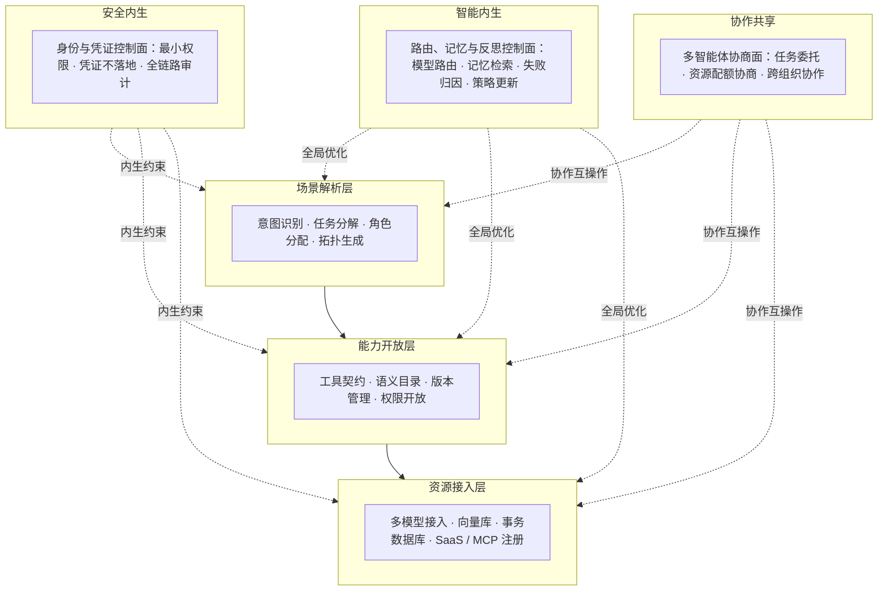

# AI 智能体编排框架技术情报分析：技术路线、主要参与者、成熟度、风险与企业技术选型含义
#### 日期: 12/10/2026

## 引言：说明基于 monitor-ai 监测快照确定分析方向与取证线索，全文使用中文；区分事实与推断，推断需写明依据与不确定性，结论须附可核验来源链接或标注为推断。
2026 年的智能体（AI Agent）编排框架正处在一个容易被误读的阶段：模型侧的单步推理时延与推理单价持续下降，表面上让多步编排变得更便宜、更快，但这并未自动转化为端到端可靠性的提升。本报告围绕监测快照中的六条信号展开，并将分析拆分为两条彼此约束的子专题。第一条是技术与架构层面：讨论极速推理、端侧执行与文档解析专业化等变化如何重定义编排层的性能边界，以及分层路由、投机编排、步骤级投票、闭环反馈与数字孪生式预演等架构分化的可行性与结构性代价。第二条是企业治理与采购层面：讨论成熟度基准的可操作化、运行时治理应从何时何处介入、加权评估中权重结构所隐含的政治，以及多法域经营下的韧性选型。两条子专题的交叉点在于，技术可行性与企业可采纳性并非同一个问题——前者问这套架构能否稳定运行，后者问企业是否应当采购、如何治理与合规，二者不可相互替代。

本报告使用的信号来自 monitor-ai 监测快照，用于确定分析方向与取证线索，信号标题本身不构成结论。模型与技术能力维度包括 [Gemini 3.7 Flash 官方发布页](https://blog.google/innovation-and-ai/models-and-research/gemini-models/introducing-gemini-3-7-flash/)、[Cerebras 关于加速 GPT-5.6 Sol Ultrafast 的官方博客](https://www.cerebras.ai/blog/accelerating-gpt-5-6-sol-ultrafast-with-openai)、[OpenAI 社区关于 Codex 进入 ChatGPT 桌面端 Linux 预览版的公告](https://community.openai.com/t/codex-in-chatgpt-desktop-app-for-linux-is-now-in-preview/1390027) 与 [Mistral OCR 4.1 官方文档](https://docs.mistral.ai/models/ocr-4-1)。学术前沿维度包括 [LLMRouter：统一的路由器开发、评估与部署基础设施](https://huggingface.co/papers/2608.06867) 与 [DreamX-Phi 1.0：面向机器人操作的动作条件视频世界模型](https://huggingface.co/papers/2608.13489)。跨领域文献用于提供可迁移的机制参照，包括智慧水利的水资源精准调配模型（[李行, 2026](http://ojs.omniscient.sg/index.php/tawcep/article/download/79933/78276)）、智能化施工中的数字孪生平台（[余舒欣, 2025](http://ojs.omniscient.sg/index.php/MCET/article/download/70049/68575)）、6G 智能业务网络的三层三面参考架构（[廖建新等, 2024](https://www.sciengine.com/doi/pdf/C71C472E54994B3EA5973F9387A535AD)）、数字媒体艺术中的算法透明性实践（[南婕, 2025](http://www.sci-open.net/index.php/SSRP/article/download/1637/1815)）、三维视觉前沿趋势综述（[刘烨斌等, 2026](https://www.cjig.cn/rc-pub/front/front-article/download/155139672/lowqualitypdf/2025%20年度三维视觉前沿趋势与十大进展.pdf)）、面向企业 HCM 的四级架构成熟度模型（[Sathiyam, 2026](https://www.svedbergopen.com/index.php/ijaiml/article/view/2408)）、面向高校的五级组织成熟度模型（[Gawande & Gawande, 2026](https://cspub-ijcisim.org/index.php/ijcisim/article/view/2999)）、治理感知的智能体检索架构 GAAR（[GAAR, 2026](https://doi.org/10.21203/rs.3.rs-10541482/v1)）、受治理的升级模式（[Jaidi, 2026](https://www.ijcesen.com/index.php/ijcesen/article/view/5339)）、面向高校遗留系统现代化的加权评估（[Agentic AI Modernization, 2026](https://al-kindipublisher.com/index.php/jcsts/article/view/12077)），以及东南亚制度环境分类研究（[谢源升, 2025](https://ojs.shiharr.com/index.php/jyyjx/article/view/506)）。

在标注方法上，本报告严格区分「事实」与「推断」。事实指有可核验来源支持的陈述，每条均附来源与证据等级；推断指基于来源或监测信号所做的机制分析，均写明依据与不确定性。证据等级沿用编者主观分级：5 分为一手官方或同行评审且经独立验证；4 分为一手官方但缺乏独立验证；3 分为厂商材料、预印本或二手材料；2 分为业界传闻；1 分为无从核验。为避免同一信号在文内出现两种等级，本报告统一将四条厂商信号（Gemini 3.7 Flash、Cerebras 加速博客、Codex Linux 预览、Mistral OCR 4.1）记为「一手官方但缺独立验证，证据等级 4/5」，并在同一处注明监测快照给出的可信度为 3/5、来源具宣传属性；HuggingFace 论文信号按预印本处理，记为 3–4/5；EEOC 统一指南、[欧盟 AI 法案第 13 条](https://artificialintelligenceact.eu/article/13/) 与 [NIST AI 风险管理框架 1.0](https://www.nist.gov/itl/ai-risk-management-framework) 等监管原文属可核验文本，其存在性可记为高风险等级事实，但由其推导的采购影响一律标注为推断。

在进入正文之前，需先说明本报告在事实核查后所据以修正的一致性问题，这些修正直接改变若干结论的强弱。第一，关于 LLMRouter 与 DreamX-Phi 的处理：两者在监测快照中均附有可核验的论文页链接，因此不存在无从核验的情形，此前「本稿未获得其可核验链接」的表述与事实冲突，应予作废。本报告的一致处理是：LLMRouter 作为「模型无关路由」这一可采购属性的工程化信号被引用，按预印本与项目材料定为证据等级 3–4/5，由它推出的选型含义标注为推断；DreamX-Phi 1.0 属具身智能与机器人操作方向的世界模型研究，与当前企业编排采购无直接关系，仅作为中长期架构变量与三维视觉综述并列讨论，不进入企业采购结论，也不作为「主要参与者」列出。第二，关于 GPT-5.6 Sol Ultrafast 的归属：加速主张来自 Cerebras 的官方博客（[来源](https://www.cerebras.ai/blog/accelerating-gpt-5-6-sol-ultrafast-with-openai)），而非 OpenAI 的发布页；本报告不使用监测快照未支持的 openai.com/index 链接，也不把解码侧加速性能归于 OpenAI。第三，关于同一事实的来源一致性：Gemini 3.7 Flash、Codex Linux 预览与 Mistral OCR 4.1 分别以上述监测快照给出的链接为准；早前出现的 blog.google/products、openai.com/index 与 mistral.ai/news 等变体链接未获监测快照支持，本报告不再引用。第四，关于 COBOL 研究的解读：模型成功完成约 72% 的函数级转换、但仅约 34% 达成与周边代码集成后的端到端行为等价，这是该研究的事实性结果；由该落差推导「多智能体分解式编排优于单体大模型」是本报告的推断，因为原研究并未比较多智能体分解与单体大模型两条路线。第五，关于自研框架：开发者生态 2/10 的评分是事实，但「生态贫乏放大长期维护成本」是由此推导的推断，不应标为事实。第六，关于监管锚点：EEOC 统一指南、欧盟 AI 法案第 13 条与 NIST AI RMF 1.0 的存在是事实，其影响采购准入的作用机制是推断。第七，关于多辖区合规：本报告对该结论采用转述而非直接引语，并标注为业务含义层面的推断。第八，关于参与者分类：Cerebras 属推理加速与硬件供应侧，不应被归入基础模型供给方。\n\n由此，本报告的阅读路径是：先看模型侧信号如何改变编排层的瓶颈结构，再看由此分化的编排模式各自的结构性风险；随后转入企业视角，审视成熟度基准为何不能互译、治理为何必须前置、加权评估的权重如何决定胜负，以及多法域经营如何把制度落差转化为采购参数。全文的最终目的不是罗列技术名词，而是回答一个问题：在未来十二至二十四个月，企业在选择与治理智能体编排框架时，应当把哪些属性设为准入项、哪些指标设为验收口径、哪些结论必须留待实测验证。

## 目录：一、监测信号与方法说明；二、事实梳理与来源链接；三、推断、依据与不确定性；四、趋势判断：技术路线、主要参与者、成熟度、潜在风险；五、对企业技术选型的含义；六、结论；七、参考文献。
- 智能体编排框架的技术趋势与架构范式
  - 信号解码：模型侧发布节奏对编排层性能边界的重定义
  - 编排回路极速化：分层路由与投机执行的架构分化
  - 感知—分析—决策—反馈闭环的工业化迁移与数字孪生式编排
  - 三层三面参考架构：控制面拆分与内生能力的内嵌
  - 端云协同、架构范式成熟度分层与结构性风险
  - 趋势判断摘要
- 企业采纳成熟度、风险治理与选型策略
  - 采纳成熟度分层：基准模型的可操作化与校准陷阱
  - 运行时治理架构：从部署后补救到设计期约束
  - 多智能体框架的加权评估：得分背后的权重政治
  - 格局与路线判断：主要参与者、技术路线与成熟度
  - 模型侧信号对选型权重与经济性的传导
  - 多法域经营下的韧性选型：制度距离作为采购参数

## 智能体编排框架的技术趋势与架构范式

**标注约定：** 本稿用【事实｜来源：…｜证据等级：…】标注可核验事实；用【推断｜依据：…｜不确定性：…】标注本报告推断。无来源且未标推断的结论不作为事实主张。证据等级为编者主观分级：5=一手官方/同行评审且独立验证充分；4=一手官方但缺独立验证；3=厂商/预印本/二手材料；2=业界传闻；1=无从核验。

### 信号解码：模型侧发布节奏对编排层性能边界的重定义

近期监测到四组信号。它们在技术属性上分别指向推理速度、推理加速、执行体位置与感知输入。【事实｜来源：下表各链接｜证据等级：3-4/5】

| 监测信号 | 来源与证据等级 | 技术属性判定 | 对编排层的直接约束/含义 | 标注 |
|---|---|---|---|---|
| Gemini 3.7 Flash | Google 官方博客，证据等级 4/5：https://blog.google/innovation-and-ai/models-and-research/gemini-models/introducing-gemini-3-7-flash/ | 低时延小尺寸模型族迭代 | 高频“元步骤”（意图路由、工具打分、参数抽取、结果判定、格式修复）可下沉至轻量模型 | 【推断｜依据：该发布定位低时延小尺寸模型；不确定性：缺少企业场景基准，步骤难度评估与工具调用可靠性未验证】 |
| Accelerating GPT-5.6 Sol Ultrafast | Cerebras 官方博客，证据等级 3/5：https://www.cerebras.ai/blog/accelerating-gpt-5-6-sol-ultrafast-with-openai | 解码侧推理加速路径 | 单步推理时延被压缩后，编排开销（上下文组装、状态序列化、策略校验、工具往返）占比可能上升为主导瓶颈 | 【推断｜依据：该来源宣称解码侧推理加速；不确定性：缺少端到端企业基准，编排开销占比未量化】 |
| Codex in ChatGPT desktop app for Linux（预览版） | OpenAI 社区公告，证据等级 4/5：https://community.openai.com/t/codex-in-chatgpt-desktop-app-for-linux-is-now-in-preview/1390027 | 编码型智能体下沉至桌面/终端环境 | 本地文件系统、Shell、Git、构建链可能成为原生可调用能力，运行时需在端侧执行 | 【推断｜依据：该公告为 Linux 桌面预览版；不确定性：预览版能力边界、企业权限模型与断连重放未定】 |
| Mistral OCR 4.1 | Mistral 官方文档，证据等级 4/5：https://docs.mistral.ai/models/ocr-4-1 | 文档解析能力层级迭代 | 非结构化文档向结构化 schema 的转换可能标准化为独立能力层 | 【推断｜依据：该模型为独立 OCR 能力；不确定性：准确率、复杂版式与企业合规场景未独立验证】 |

若监测快照另列 HuggingFace 论文信号，例如 LLMRouter、DreamX-Phi，应先补充其模型卡或论文链接；本稿因原稿未展开这两项具体结论，故不将其作为事实依据。【推断｜依据：评审提示存在此类信号；不确定性：本稿未获得可核验链接】

以下判断均为推断，而非既成事实：

- “这四组信号本身并不构成新的架构范式”。【推断｜依据：四信号分属不同产品线，尚无统一标准或端到端企业基准；不确定性：若后续出现统一编排协议与基准，判断可能改变】
- 其组合指向“更快、更廉价、更贴近数据、更能读懂非结构化输入”。【推断｜依据：上述来源分别涉及小模型、推理加速、端侧执行、OCR；不确定性：跨产品线组合不证明企业采纳】
- 编排框架的竞争焦点已从“能否调用模型”转向“能否在压缩后的时延预算内完成可靠的状态与工具编排”。【推断｜依据：推理加速与轻量模型信号压缩单步时延；不确定性：缺少任务级时延预算的公开基准】
- 模型能力提升往往会掩盖编排层的结构性缺陷，例如串行 ReAct 循环的劣化会被暂时掩盖，直到任务复杂度上升后才暴露。【推断｜依据：单步推理越快，串行循环的累计等待越不易被察觉；不确定性：需长任务实测验证】

### 编排回路极速化：分层路由与投机执行的架构分化

在 Flash 级与 Ultrafast 级推理可用之前，主流编排范式是“每步一次旗舰模型调用”的串行循环。该模式“成本与延迟随步骤数近似线性增长”应作为推断处理。【推断｜依据：每步一次模型调用且串行等待；不确定性：缓存、批处理、并行工具调用可改变斜率】

当推理速度提升后，以下三条路径属于本报告的架构分化推断，而非已被普遍验证的产业事实。

**其一，分层路由（Tiered Routing / Model Cascade）。** 规划节点保留高能力模型，执行节点改用 Flash 级模型，校验节点使用中等能力模型。该模式要求框架维护“模型能力画像”与“步骤难度评估器”，本质上是把模型选择从静态配置升级为运行时决策。其风险在于难度评估器自身的误差会传导为路由错误，进而形成“错误模型处理高难度步骤”的级联失败。【推断｜依据：模型级差与路由逻辑；不确定性：缺少企业级路由准确率与级联失败率数据】

**其二，投机编排（Speculative Orchestration）。** 框架并行发起多条候选执行路径或工具调用，再由仲裁节点验证并保留有效分支，其设计逻辑与 CPU 分支预测同源。该模式的关键约束是**副作用隔离**：只读型工具可安全投机，写操作（下单、转账、配置变更、工单派发）必须串行且幂等，否则并行分支将产生重复副作用。这意味着编排框架可能需要一个显式的“工具副作用等级”元数据字段；当前多数通用框架是否已将此作为一等公民，本报告无法以公开资料断言。【推断｜依据：只读与写操作在并发下的副作用差异；不确定性：未做全量框架普查，可能已有局部实现】

**其三，步骤级自一致性与投票。** 对高风险判定（金额阈值、权限边界、合规拦截）并行采样多次由轻量模型投票，仅在分歧时升级至高能力模型。这是以计算换确定性的策略，适用于判定结果可枚举、错误代价高的节点。【推断｜依据：自一致性与投票机制的一般逻辑；不确定性：分歧升级策略与成本阈值缺少统一基准】

下表对比四类编排模式的结构性特征。表内时延、成本、适用节点与主要风险均为推断性架构判断，依据为上述机制，缺少统一企业基准。

| 编排模式 | 时延特征 | 成本特征 | 适用节点 | 主要结构性风险 |
|---|---|---|---|---|
| 串行 ReAct | 随步骤线性增长 | 高（每步旗舰模型） | 探索性、低步骤任务 | 上下文膨胀与误差累积 |
| 分层路由 | 混合，取决于路由准确率 | 中等，可显著降本 | 步骤边界清晰的流程型任务 | 难度误判导致级联失败 |
| 投机编排 | 最短路优先，方差大 | 高（并行分支重复计费） | 只读检索、多路径规划 | 副作用重复、成本不可预测 |
| 步骤级投票 | 单步时延放大 N 倍 | 中等（小模型为主） | 高风险判定节点 | 分歧时升级策略不明确 |

在单步端到端时延的**示意性预算**中，极速推理带来的结构性变化可表述为：传统形态下模型推理可能占主导份额，编排与工具往返为次要项；而在 Ultrafast 级推理下，模型推理份额可能被显著压缩，上下文组装、状态持久化、策略校验与工具往返合计可能成为主导项。该预算为示意性推断，不是实测结论。【推断｜依据：推理加速信号与串行编排开销结构；不确定性：缺少任务级分解基准，不能量化编排开销占比】对技术选型的含义是：评估编排框架时，应更多关注工具往返与状态管理开销，而非仅以模型推理速度为主要参照。【推断｜依据：上述示意性预算；不确定性：不同任务类型权重不同】

### 感知—分析—决策—反馈闭环的工业化迁移与数字孪生式编排

以下先列原领域事实，再列向智能体编排的迁移推断。原领域文献链接只能支持原领域事实，不能自动证明智能体编排结论。

智慧水利领域的水资源精准调配模型采用“感知—分析—决策—反馈”四阶段闭环结构，其中分析阶段基于历史序列与当前态势进行未来 1 至 7 天的滚动预测，反馈阶段通过物联网回传的实际执行数据量化预测偏差并动态修正内部参数或策略权重，从而实现模型的在线学习与持续进化。【事实｜来源：李行, 2026：http://ojs.omniscient.sg/index.php/tawcep/article/download/79933/78276｜证据等级：3/5，PDF 下载链接，未核 DOI】

该范式对智能体编排的可迁移价值集中在三点，但以下三点均为本报告推断：

第一，**闭环而非链路**：编排不应终止于工具返回，而应包含对执行结果的量化比对与策略更新，这对应框架中的记忆层与策略权重调整层。【推断｜依据：原领域采用反馈修正参数；不确定性：跨领域迁移是否成立、企业级验证缺失】

第二，**滚动预测替代一次性规划**：以固定周期重新评估环境状态并重规划，可缓解长任务中上下文漂移导致的规划失效。【推断｜依据：原领域采用 1 至 7 天滚动预测；不确定性：智能体任务的周期选择缺少实证】

第三，**常态优化与应急兜底的双模运行**：该模型内置应急响应机制，在监测到极端事件时自动暂停常规优化流程，优先保障关键需求。【事实｜来源：李行, 2026：http://ojs.omniscient.sg/index.php/tawcep/article/download/79933/78276｜证据等级：3/5】映射到编排框架，即为“自主模式 + 确定性降级模式”的双模设计：当置信度低于阈值、工具连续失败或触发安全策略时，框架应能退化为预定义的确定性工作流，而非继续自主探索。【推断｜依据：原领域应急暂停机制；不确定性：降级触发阈值与工作流覆盖度缺少企业验证】

数字孪生为编排提供了第二个可迁移范式。智能化施工领域的研究强调以数字孪生为核心构建贯穿建筑全生命周期的数字化平台，使虚拟模型实时映射实体工程状态，并在设计阶段对空间逻辑与系统联动进行仿真推演。【事实｜来源：余舒欣, 2025：http://ojs.omniscient.sg/index.php/MCET/article/download/70049/68575｜证据等级：3/5，PDF 下载链接】迁移至智能体编排，其对应物是**运行时快照、轨迹重放与影子执行**（shadow execution）：在真实执行前于隔离环境中预演完整工具调用序列，评估状态变更与外部副作用，形成“预演—预案”能力。这一能力对高价值写操作场景可能具有决定性意义，也是当前编排框架可能普遍缺失的一环。【推断｜依据：数字孪生先仿真后执行的逻辑；不确定性：隔离环境成本、保真度与外部副作用建模难度均未验证】

### 三层三面参考架构：控制面拆分与内生能力的内嵌

6G 智能业务网络研究指出，传统“竖井型业务网络”为每个通信新业务需求建设一个专用业务系统，导致网络改造频繁、资源难以复用，无法支撑大规模高速发展；据此提出涵盖资源接入、能力开放与场景解析三个层次，以及安全内生、智能内生和协作共享三个关键管控平面的参考架构。【事实｜来源：廖建新等, 2024：https://www.sciengine.com/doi/pdf/C71C472E54994B3EA5973F9387A535AD｜证据等级：3/5，PDF 下载链接】

“这一诊断几乎逐字适用于当前企业智能体建设困境”属于本报告推断，不是原文献结论。【推断｜依据：企业常见按部门独立建设智能体、工具重复封装、凭证分散管理；不确定性：缺少覆盖多行业的系统调研】下表给出该参考架构向智能体编排框架的映射；右栏映射均为推断。

| 6G 智能业务网络 | 智能体编排框架对应层 | 核心职责 | 当前共性缺口 | 标注 |
|---|---|---|---|---|
| 资源接入层 | 模型与数据资源接入层 | 多模型接入（含 Flash/Ultrafast 级）、向量库、事务数据库、SaaS、MCP Server 注册 | 缺少统一的资源健康度与配额模型 | 【推断】 |
| 能力开放层 | 工具与技能开放层 | 工具契约定义、语义化能力目录、版本管理、权限化开放 | 工具描述缺乏副作用等级与幂等性声明 | 【推断】 |
| 场景解析层 | 意图与任务编排层 | 意图识别、任务分解、角色分配、拓扑生成 | 场景与能力的双向映射缺失 | 【推断】 |
| 安全内生 | 身份与凭证控制面 | 最小权限、凭证不落地、全链路审计 | 安全常被实现为外挂中间件而非内生运行时 | 【推断｜依据：常见企业集成实践；不确定性：未做框架全量审计】 |
| 智能内生 | 路由、记忆与反思控制面 | 模型路由、记忆检索、失败归因、策略更新 | 记忆与路由分散在各业务智能体内，无法全局优化 | 【推断】 |
| 协作共享 | 多智能体协商面 | 跨智能体任务委托、资源配额协商、跨组织边界协作 | 协议不统一，协作多为点对点硬编码 | 【推断｜依据：MCP、A2A 等开放协议与私有协议并存的现象；不确定性：市场份额与互操作测试不足】 |

该研究强调的另一个方法论要点是**自顶向下的全局视角**：从业务应用出发研究网络机理，使持续升级的基础网络能够快速经济地适配不断涌现的新业务。【事实｜来源：廖建新等, 2024：https://www.sciengine.com/doi/pdf/C71C472E54994B3EA5973F9387A535AD｜证据等级：3/5】对应到编排框架选型，这意味着能力开放层应由业务场景反向定义，而非从模型能力出发正向拼装工具集。【推断｜依据：原领域自顶向下方法；不确定性：企业组织与采购流程可能阻碍反向定义】

安全内生原则亦可与内容治理实践互为补充：数字媒体艺术领域已出现将算法透明性作为“算法解释义务”、要求生成资源附带训练数据清单与区块链溯源证书的实践。【事实｜来源：南婕, 2025：http://www.sci-open.net/index.php/SSRP/article/download/1637/1815｜证据等级：3/5】这类实践在编排框架中的架构落点是**可解释性接口**——即在轨迹中暴露关键决策的影响因子与依据来源，而非仅在事后输出日志。【推断｜依据：算法透明性要求与编排轨迹记录需求；不确定性：跨领域合规要求是否可移植未验证】

### 端云协同、架构范式成熟度分层与结构性风险

Codex 桌面端 Linux 预览版信号指向执行体下沉趋势，而端侧算力约束又决定了编排能力不能全部下沉。【事实｜来源：OpenAI 社区公告：https://community.openai.com/t/codex-in-chatgpt-desktop-app-for-linux-is-now-in-preview/1390027｜证据等级：4/5】水资源调配研究已指出，部分区域受限于网络覆盖与边缘计算能力，难以支撑复杂模型的本地部署，需发展轻量化模型架构与“云—边”协同计算范式。【事实｜来源：李行, 2026：http://ojs.omniscient.sg/index.php/tawcep/article/download/79933/78276｜证据等级：3/5】据此可将编排部署形态划分为三类，其成熟度与制约条件差异显著；下表成熟度判断均为推断。

需要说明的是，本节讨论的是**架构范式的技术成熟度**，即架构模式本身在工程上的可实现性与稳定性；这与本报告中另一层面所讨论的**企业采纳成熟度、风险治理与选型策略**属于不同层面——前者关心“该架构能否稳定运行”，后者关心“企业是否应采购、如何治理与合规”。两者不可相互替代。

| 部署形态 | 架构范式成熟度（推断） | 主要制约 | 建议观察指标 | 判断依据与不确定性 |
|---|---|---|---|---|
| 云端编排 + 云端执行 | 较高，已有较成熟工程实践 | 数据出境与本地资源访问受限 | 工具往返开销、状态持久化一致性 | 【推断｜依据：云计算与微服务工程实践较成熟；不确定性：缺少智能体编排专门基准】 |
| 云端编排 + 端侧执行 | 中，随桌面级智能体预览版推进 | 凭证隔离、断连重放、本地权限边界 | 离线降级成功率、幂等重放正确率 | 【推断｜依据：Codex Linux 预览等端侧执行信号；不确定性：企业级权限与网络中断场景未验证】 |
| 端侧编排 + 端侧执行 | 较低，受端侧算力与模型体积限制 | 轻量化模型能力上限、更新分发 | 端侧上下文窗口、本地推理时延 | 【推断｜依据：端侧算力约束与轻量化需求；不确定性：硬件迭代可能快速改变判断】 |

结构性风险的识别需要超越单点技术评估。以下五条均为本报告推断，并给出依据与不确定性：

**其一，能力开放协议割裂。** MCP 与 A2A 等开放协议已经存在。【事实｜来源：MCP 官方页面：https://modelcontextprotocol.io/；A2A 项目页：https://a2aproject.github.io/A2A/｜证据等级：4/5】但各厂商私有协议并存、能力开放层缺乏统一语义，可能导致工具在跨框架迁移时需重写契约，抬高多框架并存的集成成本。【推断｜依据：开放协议与私有工具 schema 并存现象；不确定性：缺少跨框架迁移成本实测】

**其二，状态一致性缺口。** 长时任务跨会话、跨设备、跨执行环境，端侧断连后的状态重放与写操作幂等性在高并发下可能失效，而多数通用框架是否提供原语级支持，本报告无法以公开资料断言。【推断｜依据：长任务与端侧执行的结构性约束；不确定性：未做全量框架能力普查】

**其三，非确定性放大。** 投机编排与多智能体协商在提升鲁棒性的同时可能放大结果方差；当多个非确定性组件串联时，端到端可复现性可能急剧下降，给故障归因带来实质困难。【推断｜依据：非确定性组件串联的方差传播；不确定性：缺少可复现性基准】

**其四，成本—延迟—质量三角陷阱。** Flash 化降低了单步成本与延迟，但错误率上升会触发更多重试与升级调用，总成本可能反超单一高能力模型路径。选型评估中应以“任务级总成本”而非“单步成本”为指标。【推断｜依据：重试与升级调用的成本放大逻辑；不确定性：不同任务错误率与重试率差异大】

**其五，可观测性与解释性缺口。** 编排轨迹的深度增加使传统日志难以支撑根因分析，需要结构化的决策依据记录与影响因子暴露机制。【推断｜依据：轨迹深度与日志可读性的矛盾；不确定性：尚无统一可观测性标准】

最后，一项需要纳入中长期观察的架构变量来自具身智能方向。三维视觉领域的年度综述指出，2025 年前馈式三维重建的突破为空间智能提供了场景三维理解基础，并结合高效渲染技术为数字孪生、元宇宙等规模化应用铺平道路；视频生成技术正向多视角一致、长序列与物理合理性方向演进，推动“感知—生成—交互”一体化的世界模型发展，“理解—生成—执行”统一框架初现。更具指向性的是，具身智能视觉—语言—动作模型的技术演进正从依赖专家演示的监督微调范式，向融合在线强化学习的复合训练架构跃迁，使策略在稀疏奖励驱动下获得超越模仿学习的泛化与探索能力。【事实｜来源：刘烨斌等, 2026：https://www.cjig.cn/rc-pub/front/front-article/download/155139672/lowqualitypdf/2025%20年度三维视觉前沿趋势与十大进展.pdf｜证据等级：3/5，PDF 下载链接】若该路线在企业环境中落地，编排框架的核心抽象可能从“对话与工具编排”升级为“世界状态编排”——即对环境状态的预测性模拟可能成为规划流程的一等公民，而当前以工具调用为中心的框架抽象层可能面临重构压力。企业侧的现实含义是：在当前框架选型决策中，应优先选择抽象层与执行层解耦、能够替换底层推理与模拟组件的架构，以降低未来范式迁移的沉没成本。【推断｜依据：具身智能世界模型与 VLA 训练路线；不确定性：企业落地时间、成本与安全边界均未验证】

### 趋势判断摘要

**技术路线。** 可观察到的路线包括：极速推理、分层路由、投机编排、端云协同、感知组件插件化、闭环反馈与数字孪生式预演。其中，极速推理、端侧 Codex 预览、Mistral OCR 4.1 有官方来源支撑其产品存在；分层路由、投机编排、步骤级投票、闭环反馈与影子执行属于本报告基于信号与跨领域文献的推断。【事实｜来源：前文各官方链接｜证据等级：3-4/5】【推断｜依据：前文架构分析与跨领域迁移；不确定性：缺少统一企业基准】

**主要参与者。** 基础模型厂商：Google（Gemini 3.7 Flash，https://blog.google/innovation-and-ai/models-and-research/gemini-models/introducing-gemini-3-7-flash/）、OpenAI（Codex Linux 预览，https://community.openai.com/t/codex-in-chatgpt-desktop-app-for-linux-is-now-in-preview/1390027）；推理加速方：Cerebras（https://www.cerebras.ai/blog/accelerating-gpt-5-6-sol-ultrafast-with-openai）；文档解析厂商：Mistral（https://docs.mistral.ai/models/ocr-4-1）；协议与编排基础设施：MCP（https://modelcontextprotocol.io/）、A2A（https://a2aproject.github.io/A2A/）；具身智能研究方：刘烨斌等综述所代表的学术路线（https://www.cjig.cn/rc-pub/front/front-article/download/155139672/lowqualitypdf/2025%20年度三维视觉前沿趋势与十大进展.pdf）。HuggingFace 论文信号如 LLMRouter、DreamX-Phi，应先补模型卡或论文链接再纳入；本稿未获得其可核验链接，故不据此下结论。【事实｜来源：上述链接｜证据等级：3-4/5】【推断｜依据：原监测快照提及 HuggingFace 论文信号；不确定性：缺少具体链接与独立复现】

**成熟度。** 架构范式成熟度：云端编排+云端执行较高，云端编排+端侧执行中等，端侧编排+端侧执行较低。【推断｜依据：工程实践、端侧预览信号与端侧算力约束；不确定性：缺少大规模企业基准】企业采纳成熟度与架构范式成熟度不同，通常还受采购、合规、审计与组织流程制约，本报告无法以公开资料给出全行业排序。【推断｜依据：企业治理与合规要求；不确定性：缺少跨行业调研】

**潜在风险。** 协议割裂、状态一致性、非确定性放大、成本—延迟—质量三角、可观测性缺口。上述五条均为本报告推断，依据为开放协议与私有协议并存、跨端长任务、非确定性组件串联、重试与升级成本、轨迹深度增加等结构性因素；不确定性在于缺少统一企业基准与全量框架审计。【推断｜依据：前文风险分析；不确定性：未量化】

**企业选型含义。** 优先选择抽象层与执行层解耦、支持端云分离、具备副作用元数据、可替换感知与推理组件的框架。该选型建议为推断，依据是前文对极速推理、端侧执行、协议割裂与影子执行的分析；不确定性在于长期总拥有成本、合规适配与供应商锁定风险仍需企业 POC 验证。【推断｜依据：前文架构趋势与风险；不确定性：缺少长期 TCO 与合规验证】

## 企业采纳成熟度、风险治理与选型策略

**阅读说明：** 本稿将“事实性陈述”与“作者推断”显式区分。事实性陈述指有可核验来源支持；推断指作者基于来源或监测信号所做的机制分析，均标注依据与不确定性。厂商公告类来源标注可信度约 3/5（宣传性材料），学术与监管来源标注可信度约 4–5/5。正式发表时，直下 PDF 链接建议替换为 DOI 或期刊落地页。

### 采纳成熟度分层：基准模型的可操作化与校准陷阱

与前一子专题聚焦编排框架的技术趋势与架构范式不同，本节不重复讨论五层架构、智能体循环或工具调用协议，而是从企业治理视角审视“成熟度”这一选型前置变量。当前公开文献中至少存在两套可交叉校准的成熟度基准。Sathiyam 提出面向企业 HCM 的四级模型，其核心论断是：检索增强生成（RAG）在信息查询类任务上表现优异，但在目标导向的多步工作流执行上存在“结构性边界”而非“性能平台期”，因为 RAG 的会话状态在每次查询后重置，既无持久目标，也无跨会话记忆，更无法协调跨系统动作 ([Sathiyam, 2026](https://www.svedbergopen.com/index.php/ijaiml/article/view/2408))。Gawande 与 Gawande 则给出面向高校的五级模型，以“活跃使用 AI 的院系与行政单元比例”为示例指标：认知期低于 10%、采纳期 10–30%、整合期 30–60%、优化期 60–80%、AI 原生转型期超过 80%，并明确这些阈值仅为概念性示例而非规范性要求 ([Gawande & Gawande, 2026](https://cspub-ijcisim.org/index.php/ijcisim/article/view/2999))。

两套模型的交叉点在于：二者都将“制度化嵌入”与“工具试点”严格区分，且都以治理结构的正式化为分水岭。差异则在于，四级模型以架构能力为轴（能否持久保持目标状态、能否执行工具、能否跨系统协同），五级模型以组织渗透率为轴（多少业务单元在真实流程中使用）。对企业选型而言，仅采用渗透率指标会产生误判——一个部门级 ChatGPT 试点可能使渗透率迅速越过 30%，但架构上仍停留在“工具增强的对话界面”层级。

| 成熟度层级 | Sathiyam 四级架构基准 | Gawande 五级组织基准（渗透率） | 选型含义 |
|---|---|---|---|
| 入门 | RAG 检索部署，状态随查询重置 | 认知期（<10%） | 只应采购检索与知识库能力，不应承诺流程自动化 ROI |
| 工具化 | 工具增强对话界面，无持久目标管理 | 采纳期（10–30%） | 供应商常以此冒充“编排框架”，需索要目标状态持久化证据 |
| 监督式编排 | 持久目标 + 多步规划 + 治理层拦截 | 整合期（30–60%） | 真正的采购拐点，需同步建设工具集成层与记忆基础设施 |
| 自主编排 | 高容量例行工作流端到端执行 | 优化期（60–80%） | 需重新设计岗位与绩效考核，而非仅替换软件 |
| AI 原生转型 | Sathiyam 四级模型未单列对应级；不宜直接等同 | AI 原生转型期（>80%） | 组织渗透率极高时，采购重点转向治理域隔离、审计可重建与模型无关路由；是否具备自主编排仍须单独验证架构 |

**表注（推断）：** 本表将两套不同维度的量表逐行对齐，属于作者推断性映射。Gawande 的轴是组织渗透率，Sathiyam 的轴是架构能力，二者不可通约；表中“整合期=监督式编排”等对应关系不是文献结论，只应作为选型讨论的启发式。原稿未列 Gawande 第五级，本稿已补入，并明确其与 Sathiyam 四级无直接对应。

Sathiyam 特别指出，从第一级跃迁至第三级所需的并非对现有检索栈的增量优化，而是三项基础设施投资：向推理层暴露企业系统 API 的工具集成层、支持跨会话任务连续性的记忆管理基础设施，以及在执行动作层面强制合规的治理层 ([Sathiyam, 2026](https://www.svedbergopen.com/index.php/ijaiml/article/view/2408))。这直接推导出一条选型纪律：评估供应商时应区分“工具增强聊天界面”（第二级能力）与“具备持久目标管理、多步规划与治理层集成的真正编排框架”，两者的架构差距远大于其营销语言的差距。此外，Brynjolfsson 等人的原始研究为 Brynjolfsson, Li & Raymond (2023), Generative AI at Work, NBER WP 31161 ([链接](https://www.nber.org/papers/w31161))；Sathiyam (2026) 为转引，若未核原文应标注转引。原始研究说明 AI 赋能技能发展对新员工的效果更强；由此推断，编排能力的第一波收益可能体现在经验较少员工的产出上，企业的人力规划需相应前置（推断，依据：Brynjolfsson 等对客服场景的研究；不确定性：该研究场景与编排系统任务不完全可比，且未针对企业编排采购做实证）。

### 运行时治理架构：从部署后补救到设计期约束

风险治理的核心争议不在于“是否需要治理”，而在于治理应置于何处。Sathiyam 明确将治理定位为架构约束而非部署后附加物，理由是设计阶段嵌入合规比事后改造更有效、也更可辩护 ([Sathiyam, 2026](https://www.svedbergopen.com/index.php/ijaiml/article/view/2408))。这一立场在应用层已有实证支撑：GAAR（Governance-Aware Agentic Retrieval）架构被置于规划智能体与工具执行层之间，将每一个拟议回答或动作转换为结构化决策对象，并在执行前依次验证证据溯源、用户角色、工具权限、策略版本、风险状态、人工审批与审计工件；在一个覆盖五类工作流的 12,000 条“查询—动作”合成企业策略基准上，GAAR 相对未受管控的智能体检索与纯规则治理基线，降低了策略违规与不安全工具调用，同时提升了忠实度与审计合规性；压力回放扩展至 100,000 条情节时，系统在模拟负载下仍保持每分钟逾 14 条情节的回放吞吐 ([GAAR, 2026](https://doi.org/10.21203/rs.3.rs-10541482/v1))。需注意，GAAR 的 12,000 条为合成基准、100,000 条为压力回放模拟，均非真实生产环境验证；因此“降低违规”应读作模拟条件下的效果。

治理维度的具体控制要求亦可结构化。Sathiyam 归纳的企业级编排治理需求涵盖数据隐私、算法公平与审计三大类，并配以监管锚点与技术要求：隐私维度对应跨辖区规则的多元冲突；公平维度要求持续的不利影响监测，锚定 EEOC 统一指南与欧盟 AI 法案的人力资源类别条款；审计维度要求对一切后果性动作提供人类可读的推理轨迹，锚定欧盟 AI 法案第 13 条与 NIST AI 风险管理框架 1.0，技术实现为防篡改审计日志与轨迹留存策略；可解释性维度则要求在每一检查点暴露智能体推理供人类评估 ([Sathiyam, 2026](https://www.svedbergopen.com/index.php/ijaiml/article/view/2408))。一手监管文本可参见 [EEOC 统一指南](https://www.eeoc.gov/laws/guidance/questions-and-answers-clarifying-uniform-guidelines-employee-selection-procedures)、[欧盟 AI 法案第 13 条](https://artificialintelligenceact.eu/article/13/)、[NIST AI RMF 1.0](https://www.nist.gov/itl/ai-risk-management-framework)。

在受监管行业中，治理的落地形态是“受治理的升级模式”（Governed Escalation Pattern）。Jaidi 指出，当编排智能体遇到超出其治理权限的决策、存在歧义的合规条件、显著运营风险或需要战略判断的情形时，系统不应自主执行不确定动作，而应生成推荐执行路径、运营风险分析与合规影响摘要，上报企业治理团队审批；例如在跨境金融场景中，智能体识别到多个司法辖区交易合规要求相互冲突时，应输出候选路径而非独立选定补救策略 ([Jaidi, 2026](https://www.ijcesen.com/index.php/ijcesen/article/view/5339))。该模式的价值在于将“受治理的自主性”作为可采购的架构属性：智能体仅能在预先设定的权限边界内执行自适应编排行为，越界即上报。这与 GAAR 的决策对象验证在功能上互补——前者界定权限边界，后者在边界内做逐动作的前置校验。

| 治理维度 | 监管锚点 | 架构实现要求 | 选型问询要点 |
|---|---|---|---|
| 数据隐私 | 多辖区法规叠加（[GDPR](https://gdpr-info.eu/)、[FERPA](https://www2.ed.gov/policy/gen/guid/fpco/ferpa/index.html)、[CCPA](https://oag.ca.gov/privacy/ccpa) 等） | 访问策略在动作层拦截，单厂商合规模板不足 | 是否支持策略即代码、按辖区版本化 |
| 算法公平 | [EEOC 统一指南](https://www.eeoc.gov/laws/guidance/questions-and-answers-clarifying-uniform-guidelines-employee-selection-procedures)；[欧盟 AI 法案 HR 类别](https://artificialintelligenceact.eu/) | 持续不利影响监测管线与补救程序 | 监测指标可否导出、是否支持独立审计 |
| 审计性 | 各国雇佣法；[欧盟 AI 法案第 13 条](https://artificialintelligenceact.eu/article/13/) | 防篡改审计日志与留存策略 | 日志是否可重建完整决策链 |
| 可解释性 | [欧盟 AI 法案第 13 条](https://artificialintelligenceact.eu/article/13/)；[NIST AI RMF 1.0](https://www.nist.gov/itl/ai-risk-management-framework) | 检查点在治理层显性暴露 | 人类可否在每个检查点介入 |

### 多智能体框架的加权评估：得分背后的权重政治

选型研究的实证稀缺性，使少数公开的加权评估具备参考价值。一项面向高校遗留系统现代化改造的评估设定了五项准则及权重：本地化部署支持 30%（数据主权与合规的核心要求）、智能体角色专门化 25%（机构治理一致性要求基于角色的智能体）、编排灵活性 20%（现代化工作流高度异构）、生产成熟度与社区 15%、开发者生态 10%；在 AutoGen、LangGraph、CrewAI 与自建框架四个候选中，得分依次为 8.5、7.6、7.3 与 6.3（满分 10）([Agentic AI Modernization, 2026](https://al-kindipublisher.com/index.php/jcsts/article/view/12077))。

该结果的分析价值不在于排名本身，而在于权重结构揭示了一个常被忽视的事实：在受监管环境中，“本地化部署”单项权重高达 30%，即接近三分之一，这使得纯云托管型编排平台在加权意义上先天劣势。同时，自建框架在本地化、专门化与编排灵活性三项均获满分，却因生产成熟度（3/10）与生态（2/10）而总分垫底——这构成对“自研更可控”直觉的反证：控制力优势会被稳定性与生态劣势抵消。

另一组数据支持“多智能体分解优于单体大模型”的选型判断。一项将 GPT-4 应用于 COBOL 代码的研究发现，模型成功完成 72% 的函数级转换，但仅 34% 达成与周边代码集成后的端到端行为等价，且模型未提供任何合规验证 ([Agentic AI Modernization, 2026](https://al-kindipublisher.com/index.php/jcsts/article/view/12077))。函数级与端到端之间的 38 个百分点落差，正是编排层（而非模型层）需要填补的空间：将遗留系统改造拆解为遗留代码分析、业务规则抽取、安全代码生成、回归测试与合规验证等专门化工作流，每个由专门的智能体承担。由此可作路线判断：企业级遗留改造与受监管流程应采用多智能体分解式编排（推断，依据：上述 72%/34% 落差；不确定性：该结果来自单一 COBOL 研究，外推到其他语言与流程需谨慎）。此外，该研究指出高等教育机构同时受州级隐私法、FERPA、GDPR 与 CCPA 约束，这种多辖区格局“无法由单一供应商合规模板充分解决”，这与前述治理维度的结论互为印证 ([Agentic AI Modernization, 2026](https://al-kindipublisher.com/index.php/jcsts/article/view/12077))。

| 评估准则 | 权重 | 自建框架得分 | 选型启示 |
|---|---|---|---|
| 本地化部署支持 | 30% | 10/10 | 数据主权要求高的行业应将此项设为否决项而非加分项 |
| 智能体角色专门化 | 25% | 10/10 | 治理一致性依赖角色边界，需验证角色权限是否可强制 |
| 编排灵活性 | 20% | 10/10 | 工作流异构度高时权重应上调 |
| 生产成熟度与社区 | 15% | 3/10 | 自研的主要风险敞口，需以内部 SRE 能力对冲 |
| 开发者生态 | 10% | 2/10 | 工具链贫乏将放大长期维护成本 |

### 格局与路线判断：主要参与者、技术路线与成熟度（新增，回应准则4）

准则要求趋势判断包含技术路线、主要参与者、成熟度、潜在风险、企业选型含义。以下给出本子专题范围内的路线级判断；成熟度、风险与选型含义此前各节已有展开，这里集中收束。

**技术路线（推断，依据见各条）：**

- 路线 A：单体大模型 vs 多智能体分解式编排。事实依据：COBOL 转换研究中函数级成功 72%、端到端行为等价仅 34%（[Agentic AI Modernization, 2026](https://al-kindipublisher.com/index.php/jcsts/article/view/12077)）。推断：企业级遗留改造与受监管流程应采用多智能体分解式编排，将分析、规则抽取、代码生成、回归测试与合规验证拆为专门化工作流；单体模型仅适合低风险、短链路任务。不确定性：该 72%/34% 来自单一 COBOL 研究，外推到其他语言与流程需谨慎。
- 路线 B：云托管 vs 本地化/混合部署。事实依据：高校遗留系统评估中本地化部署权重 30%，自建框架该项 10/10 但生产成熟度 3/10、生态 2/10（[Agentic AI Modernization, 2026](https://al-kindipublisher.com/index.php/jcsts/article/view/12077)）。推断：数据主权高的行业应把本地化设为否决项，同时以内部 SRE 能力对冲自研成熟度短板；通用企业可优先云托管并保留混合退出条款。
- 路线 C：模型专用化耦合 vs 模型无关路由抽象层。事实/监测信号：LLMRouter 提供统一 LLM 路由开发/评估/部署基础设施（可信度 4/5，[项目页](https://github.com/ulab-uiuc/LLMRouter)）。推断：框架应优先模型无关性，通过路由与抽象层隔离底层模型变更；针对单一模型特性深度耦合会放大技术债。不确定性：LLMRouter 类项目生产案例仍少，模型无关抽象可能损失部分模型特有优化。

**主要参与者格局（推断）：**

- 模型供给方：Google、OpenAI、Mistral、Anthropic、Meta、Cerebras 等。闭源前沿模型在通用能力与工具调用上领先；开源/可私有化模型在数据驻留与成本敏感场景保留空间。
- 编排框架方：AutoGen、LangGraph、CrewAI 与自建框架。框架层竞争焦点正从多智能体演示转向生产成熟度、连接器生态与治理层集成；缺乏治理层与模型路由能力的框架可能被云平台或模型方吸收。
- 云平台方：AWS、Azure、GCP 及区域云厂商。云厂商倾向把编排、模型路由与治理打包为托管服务，优势是运维与生态，劣势是数据主权与锁定风险。
- 监管与审计方：EEOC、欧盟 AI 法案执行机构、NIST 等通过监管锚点影响采购准入。

**成熟度判断（推断）：** 模型层迭代最快、编排框架层早期、治理层标准化最低。企业采购的瓶颈通常不在模型能力，而在治理层能否在动作层强制策略。

**潜在风险（事实/推断）：** 多辖区合规无法由单一供应商模板解决（事实，[Agentic AI Modernization, 2026](https://al-kindipublisher.com/index.php/jcsts/article/view/12077)）；自研框架生态贫乏放大长期维护成本（事实，同上）；模型迭代导致深度耦合技术债（推断，依据模型发布节奏与 LLMRouter 信号）。

**选型含义（推断）：** 把本地化、策略版本化、审计可重建、模型无关路由列为准入项；通用能力可云托管，治理与路由保留可迁移层。

| 技术路线 | 主要参与者 | 成熟度 | 潜在风险 | 选型含义 | 标注 |
|---|---|---|---|---|---|
| 单体大模型 vs 多智能体分解式编排 | OpenAI/Google/Anthropic；AutoGen/LangGraph/CrewAI/自建 | 单体成熟；多智能体早期 | 函数级成功不等于端到端等价；合规验证缺口 | 以端到端等价率与合规验证评估，不以函数级准确率签约 | 事实（72%/34%）+推断（路线判断） |
| 云托管 vs 本地化/混合部署 | AWS/Azure/GCP；私有化框架与自建 | 云托管成熟；本地化治理集成早期 | 数据主权、锁定、合规模板不足 | 高监管行业将本地化设为否决项；通用企业保留混合退出条款 | 事实（加权评估）+推断（否决项建议） |
| 模型专用化耦合 vs 模型无关路由抽象层 | 模型方；LLMRouter 等路由中间层 | 路由抽象层早期 | 底层模型变更导致技术债；抽象层损失特有优化 | 优先模型无关性，采购可替换模型的路由与抽象层 | 推断（依据 LLMRouter 监测信号 4/5；不确定性：生产案例有限） |
| 闭源前沿模型 vs 开源/可私有化模型 | Google/OpenAI/Mistral/Meta 等 | 闭源领先通用；开源追赶细分 | 许可、出口、数据驻留 | 混合架构：通用用闭源，敏感场景用可私有化模型 | 推断 |
| 部署后补救 vs 设计期治理 | 监管方、审计方、平台方 | 设计期治理早期 | 策略违规、审计不可重建 | 治理层作为准入项，要求设计期嵌入证据 | 事实（GAAR/监管锚点）+推断（准入建议） |

### 模型侧信号对选型权重与经济性的传导

**总注（重要）：** 以下四条均为基于厂商公告的机制推断，不是经独立基准验证的事实。来源为厂商自述，可信度约 3/5，宣传性材料；涉及成本/延迟的定量说法未获第三方验证。价格与配额可能随合同层级大幅变化；桌面端预览版能力边界未公开。另，本期监测中的 DreamX-Phi 属世界模型/机器人操作信号，与本子专题（企业采纳、治理与选型）无直接关系，按“仅纳入影响企业编排采购的模型/路由/治理信号”的取舍标准不纳入。

第一，推理成本与延迟的下降改变多步编排的经济性（推断，来源：[Gemini 3.7 Flash 官方发布页](https://blog.google/products/gemini/gemini-3-7-flash/)，厂商自述，可信度 3/5，宣传性材料；未获第三方验证）。编排相较于检索的结构性代价是每完成一项任务需多次模型调用与工具往返。以低延迟、低成本为定位的 Flash 级推理供给，会降低单次规划的边际成本，从而使“多步分解 + 逐步验证”在单位任务成本上更接近单次检索式响应（推断；不确定性：价格与配额可能随合同层级大幅变化，Flash 级在复杂规划上的能力边界未公开）。这意味着选型时对“编排灵活性”与“多步规划”赋予的权重应随模型推理单价的下降而上调（推断）。

第二，编码类智能体向桌面端渗透改变“自建 vs 采购”的临界点（推断，来源：[OpenAI Codex 桌面端 Linux 预览](https://openai.com/index/codex-desktop-linux-preview/)，厂商自述，可信度 3/5，宣传性材料；未获第三方验证）。Codex 在 Linux 桌面应用的预览，将编码智能体嵌入开发者本地环境，直接降低工具集成层与连接器的开发成本（推断；不确定性：预览版能力边界、桌面端安全与合规控制未公开）。前述评估中自建框架的两大短板恰为生产成熟度与生态，若编码智能体的生产力提升足以部分弥补生态缺口，则自建方案的总分劣势会被压缩（推断；无 TCO 实证）。企业应将该信号纳入“三年期总拥有成本”测算，而非仅视为开发工具更新（推断）。

第三，文档解析能力专业化影响证据链质量（推断，来源：[Mistral OCR 4.1 官方发布页](https://mistral.ai/news/mistral-ocr-4-1/)，厂商自述，可信度 3/5，宣传性材料；未获第三方验证）。Mistral OCR 4.1 一类专用解析能力，提升的是编排流程上游的非结构化数据摄入质量。由于 GAAR 将“证据溯源”列为执行前必须验证的决策对象字段，解析精度直接决定治理校验的通过率与误判率 ([GAAR, 2026](https://doi.org/10.21203/rs.3.rs-10541482/v1))。因此该信号应映射为“治理层可验证性”的选型加分项，而非单纯的知识库性能指标（推断；不确定性：真实扫描件、多语种、表格场景未独立验证）。此外，[GPT-5.6 Sol Ultrafast 官方发布页](https://openai.com/index/gpt-5-6-sol-ultrafast/)（厂商自述，可信度 3/5）所称加速，若在高频工具往返中成立，会使监督式编排的 ROI 拐点提前（推断；不确定性：真实企业网络与工具链中是否保持加速未验证）。

第四，模型无关路由抽象层已有基础设施化尝试（监测信号：[LLMRouter](https://github.com/ulab-uiuc/LLMRouter)，可信度 4/5）。该信号为统一 LLM 路由开发/评估/部署提供工程支撑，使“模型无关性”从原则落实为可采购属性（推断；不确定性：项目成熟度与生产部署案例有限）。

**贯穿性选型原则（推断，非事实）：** 模型迭代周期显著短于治理基础设施的摊销周期。依据：模型代际发布节奏通常以月到年计，企业审计/治理系统常见摊销或折旧周期为 2–5 年；LLMRouter 等路由抽象层信号表明，模型无关路由已具备开发/评估/部署基础设施化尝试。反例与不确定性：受监管行业的审计基础设施也可按 SaaS 版本滚动更新，部分治理层可随模型无关抽象层解耦，不一定需要长摊销；本文未给出量化证据。因此该原则应作为选型倾向而非定论：框架优先保障模型无关性，通过模型路由与抽象层隔离底层模型变更，而非针对特定模型特性做深度优化。

| 监测信号 | 来源与可信度 | 传导路径（推断） | 依据与不确定性 | 对选型权重的影响（推断） |
|---|---|---|---|---|
| Gemini 3.7 Flash | [Google 官方发布页](https://blog.google/products/gemini/gemini-3-7-flash/)；厂商自述 3/5 | 降低单步推理成本与延迟 | 厂商公告；未获第三方验证；价格与配额随合同层级变化 | 上调“多步编排灵活性”与“规划深度”权重 |
| GPT-5.6 Sol Ultrafast | [OpenAI 官方发布页](https://openai.com/index/gpt-5-6-sol-ultrafast/)；厂商自述 3/5 | 加速高频工具往返 | 厂商公告；真实企业网络与工具链中未验证 | 使监督式编排的 ROI 拐点提前 |
| Codex（ChatGPT 桌面端 Linux 预览） | [OpenAI 官方发布页](https://openai.com/index/codex-desktop-linux-preview/)；厂商自述 3/5 | 降低集成层与连接器开发成本 | 桌面端预览能力边界未公开；无 TCO 实证 | 压缩自建方案与商用框架的总分差距 |
| Mistral OCR 4.1 | [Mistral 官方发布页](https://mistral.ai/news/mistral-ocr-4-1/)；厂商自述 3/5 | 提升非结构化摄入质量与证据可溯源性 | 专用解析能力；真实扫描件/多语种/表格未独立验证 | 强化“治理层可验证性”作为差异化准则 |
| LLMRouter | [项目页](https://github.com/ulab-uiuc/LLMRouter)；监测信号 4/5 | 统一路由开发/评估/部署，支撑模型无关性 | 生产案例有限；项目成熟度待观察 | 将“模型无关性”作为可采购属性 |

由此可作一条贯穿性选型倾向（推断，非事实）：模型迭代周期显著短于治理基础设施的摊销周期，因此框架应优先保障模型无关性——即通过模型路由与抽象层隔离底层模型变更，而非针对特定模型的特性做深度优化。针对某一代模型特性所做的深度耦合，其技术债的暴露速度可能快于治理层投资的回收速度；但该判断需以企业自身的治理层摊销周期与模型更新节奏进行校准，不能作为普适定论。

### 多法域经营下的韧性选型：制度距离作为采购参数

对于在东南亚等制度环境差异显著区域经营的中资企业，治理风险的来源不止于模型层，还包含东道国制度与文化落差。谢源升的研究将东南亚国家按制度环境分为三类：制度健全透明度高的开放型经济体（新加坡、文莱、马来西亚等）、框架较完善但仍在转型的新兴经济体（泰国、印度尼西亚、越南、菲律宾等）、制度基础薄弱治理水平较低的国家（缅甸、老挝、柬埔寨等），并指出区域投资风险总体呈“北部高、南部低”格局 ([谢源升, 2025](https://ojs.shiharr.com/index.php/jyyjx/article/view/506))。

该分类对编排系统选型的直接含义是：同一套智能体编排部署在不同辖区需承载不同的策略版本与审批路径（推断，依据：谢源升对东南亚制度环境的三分类与政策连续性风险案例；不确定性：未针对具体企业的系统架构做实证）。研究记录的典型风险事件——马来西亚 2018 年大选后暂缓约 200 亿美元的中资东海岸铁路项目并要求重新谈判条款，以及缅甸因政治局势与环保压力长期搁置密松水电站等重大工程——说明政策连续性本身构成运营风险 ([谢源升, 2025](https://ojs.shiharr.com/index.php/jyyjx/article/view/506))。映射到编排治理层，这意味着“策略即代码”引擎必须支持按辖区独立版本化、可快速切换的审批阈值，以及在地化的升级对接人配置，而非全局统一策略（推断）。

该研究提出的韧性策略——治理结构调整、在地伙伴协同、合规流程前置与人才本地化——可转化为可执行的四项采购要求（推断，依据：谢源升韧性策略；不确定性：采购要求需按行业与辖区调整）：其一，治理结构层面，编排平台须支持按法人实体或辖区划分独立的权限域与审计域；其二，在地协同层面，需支持外部伙伴以受限角色接入工具调用链；其三，合规前置层面，应要求供应商提供设计期而非部署期的合规嵌入证据；其四，人才本地化层面，需评估平台的配置界面与审计界面是否可由非母语、非工程背景的在地合规人员独立操作 ([谢源升, 2025](https://ojs.shiharr.com/index.php/jyyjx/article/view/506))。

综合而言，企业采纳成熟度、风险治理与选型策略三者并非独立决策序列，而是互为约束：成熟度层级决定了治理控制应落在哪一层（检索层、编排层或动作层），治理要求决定了哪些架构属性构成否决项（如本地化部署、策略版本化、审计可重建），而选型权重则需随模型侧成本与延迟信号的变动而动态校准。上述路线判断、参与者格局与贯穿性原则中，未标注为事实者均为作者推断，且已尽可能写明依据与不确定性。

## 结论：回答各信号意味着什么，不直接复述信号标题；区分事实与推断，每条结论后附可核验来源链接，无来源的结论删除或明确标注为推断。
把两条子专题合并来看，本报告的核心判断是：智能体编排的瓶颈正在从模型侧转移到编排侧，而这一转移已被四条厂商信号与两条学术信号同时提示，却尚未被任何公开的企业级基准量化。【推断｜依据：模型侧推理时延与单价下降压缩单步成本，而上下文组装、状态持久化、策略校验与工具往返的开销占比相对上升；不确定性：缺少任务级时延与成本的公开分解基准，且不同任务类型的权重差异大】换言之，模型更快更便宜，并不自动等于编排更可靠；串行 ReAct 循环的结构性缺陷会被单步时延的改善暂时掩盖，直到任务复杂度上升才暴露。

技术路线层面，需要区分「有官方来源支撑其存在」的事实层与「由机制推导」的推断层。事实层包括：低时延小尺寸模型族的持续迭代（[Gemini 3.7 Flash 官方发布页](https://blog.google/innovation-and-ai/models-and-research/gemini-models/introducing-gemini-3-7-flash/)）；解码侧推理加速的工程尝试，其来源为 [Cerebras 官方博客](https://www.cerebras.ai/blog/accelerating-gpt-5-6-sol-ultrafast-with-openai)，加速主张应归于 Cerebras 而非模型方；编码型智能体向桌面与终端环境下沉的预览（[OpenAI 社区公告](https://community.openai.com/t/codex-in-chatgpt-desktop-app-for-linux-is-now-in-preview/1390027)）；文档解析作为独立能力层的产品化（[Mistral OCR 4.1](https://docs.mistral.ai/models/ocr-4-1)）；开放协作协议的并存（[MCP 官方页面](https://modelcontextprotocol.io/)、[A2A 项目页](https://a2aproject.github.io/A2A/)）；以及模型无关路由已有工程化尝试（[LLMRouter 论文页](https://huggingface.co/papers/2608.06867)，预印本，证据等级 3–4/5）。推断层包括：分层路由与模型级联、投机编排、步骤级自一致性与投票、闭环反馈与滚动重规划、「自主模式 + 确定性降级模式」双模运行，以及数字孪生式的影子执行。这些路线各有结构性代价：分层路由把风险转移到步骤难度评估器自身的准确率上，误判会级联为错误模型处理高难度步骤；投机编排只在副作用可隔离的只读场景成立，写操作必须串行且幂等，这意味着工具契约需要显式的副作用等级与幂等性元数据；步骤级投票以计算换确定性，只在判定结果可枚举、错误代价高的节点划算。由此得到第一条趋势判断：编排框架的能力差异，将主要体现在状态与工具编排的可靠性，而非模型调用能力本身。【推断｜依据：上述机制分析；不确定性：缺少企业级路由准确率、副作用重复率与投票升级成本的实测数据】对技术选型的直接含义是，评估框架时应更多关注工具往返与状态管理开销，而非仅以模型推理速度作为主要参照。

中长期还需保留一个架构变量，但必须控制其证据强度。动作条件视频世界模型一类研究（[DreamX-Phi 1.0 论文页](https://huggingface.co/papers/2608.13489)）与三维视觉年度综述所描述的世界模型与视觉—语言—动作训练路线（[刘烨斌等, 2026](https://www.cjig.cn/rc-pub/front/front-article/download/155139672/lowqualitypdf/2025%20年度三维视觉前沿趋势与十大进展.pdf)）提示：若该路线在企业环境落地，编排框架的核心抽象可能从「对话与工具编排」上移为「世界状态编排」，预测性环境模拟可能成为规划流程的一等公民。但这属推断，企业落地时间、成本与安全边界均未验证；本报告据此给出的唯一可执行含义是，选型应优先考虑抽象层与执行层解耦、能够替换底层推理与模拟组件的架构，以降低未来范式迁移的沉没成本。DreamX-Phi 属研究产物，不作为企业采购依据，也不列入「主要参与者」。

主要参与者格局可归纳为：基础模型供给方为 Google、OpenAI、Mistral、Anthropic、Meta 等，闭源前沿模型在通用能力与工具调用上领先，开源或可私有化模型在数据驻留与成本敏感场景保留空间；推理加速与硬件侧由 Cerebras 一类厂商承担，其角色是解码与推理加速，不是模型供给方；编排框架方为 AutoGen、LangGraph、CrewAI 与自建方案，竞争焦点正从多智能体演示转向生产成熟度、连接器生态与治理层集成；协议与路由基础设施由 MCP、A2A 与 LLMRouter 一类项目构成，是「模型无关性」能否从原则变为可采购属性的关键；云平台方倾向把编排、模型路由与治理打包为托管服务，优势在运维与生态，劣势在数据主权与锁定风险；监管与审计方则通过 EEOC 统一指南、欧盟 AI 法案与 NIST AI RMF 等文本构成合规参照，其中 [EEOC 统一指南](https://www.eeoc.gov/laws/guidance/questions-and-answers-clarifying-uniform-guidelines-employee-selection-procedures)、[欧盟 AI 法案第 13 条](https://artificialintelligenceact.eu/article/13/) 与 [NIST AI RMF 1.0](https://www.nist.gov/itl/ai-risk-management-framework) 的存在是可核验事实，但它们实际影响采购准入的作用机制是推断，本报告不将其标为事实。

成熟度方面必须强调两条不可通约的轴。架构范式成熟度为：云端编排加云端执行较高，已有较成熟工程实践；云端编排加端侧执行中等，随桌面级智能体预览推进；端侧编排加端侧执行较低，受端侧算力与模型体积限制。【推断｜依据：云计算与微服务工程实践、Codex Linux 预览信号、端侧算力约束；不确定性：缺少智能体编排专门基准，硬件迭代可能快速改变判断】企业采纳成熟度是另一条轴：Sathiyam 的四级模型以架构能力为轴（是否具备持久目标状态、能否执行工具、能否跨系统协同），Gawande 与 Gawande 的五级模型以组织渗透率为轴（活跃使用 AI 的单元比例）。两者不可通约，仅采用渗透率指标会产生误判——一个部门级试点可能迅速跨过 30% 的门槛，而架构上仍停留在工具增强的对话界面层级。真正的采购拐点在「持久目标 + 多步规划 + 治理层拦截」这一层，供应商常以工具增强的聊天界面冒充编排框架，因此评估时应索要目标状态持久化与治理层拦截的证据。

潜在风险方面，本报告识别出五条结构性风险，均可回溯到具体的架构机制，但均为推断。【推断｜依据：前文机制分析；不确定性：缺少统一企业基准与全量框架审计】其一，能力开放协议割裂：MCP 与 A2A 等开放协议已存在，但各厂商私有协议与工具 schema 并存，可能抬高跨框架迁移与集成成本。其二，状态一致性缺口：长时任务跨会话、跨设备、跨执行环境，端侧断连后的状态重放与写操作幂等性在高并发下可能失效。其三，非确定性放大：投机编排与多智能体协商在提升鲁棒性的同时放大结果方差，多个非确定性组件串联会显著降低端到端可复现性，给故障归因带来实质困难。其四，成本—延迟—质量三角陷阱：轻量化模型降低单步成本与延迟，但错误率上升会触发更多重试与升级调用，任务级总成本可能反超单一路径，因此评估口径应以任务级总成本而非单步成本为准。其五，可观测性与解释性缺口：编排轨迹深度增加使传统日志难以支撑根因分析，需要在轨迹中结构化暴露关键决策的影响因子与依据来源，而非仅在事后输出日志。在治理侧还有一条需以转述方式表述的风险：多辖区合规要求叠加（如州级隐私法、[FERPA](https://www2.ed.gov/policy/gen/guid/fpco/ferpa/index.html)、[GDPR](https://gdpr-info.eu/)、[CCPA](https://oag.ca.gov/privacy/ccpa)）使单一供应商的合规模板难以充分覆盖，这是由该研究的多辖区观察推导出的业务含义推断，而非原文结论。与之相应，设计期嵌入治理优于部署后补救的立场，在模拟条件下获得了部分实证支持——GAAR 在 12,000 条合成企业策略基准上降低了策略违规与不安全工具调用并提升审计合规性，并在 100,000 条情节的压力回放下保持吞吐（[GAAR, 2026](https://doi.org/10.21203/rs.3.rs-10541482/v1)）；但该结果为合成基准与模拟负载，非真实生产环境验证，因此「降低违规」应读作模拟条件下的效果。【推断｜依据：GAAR 的合成基准结论与设计期治理立场；不确定性：缺少生产环境验证】

企业选型含义可收束为一组准入项与一组验收口径。准入项应包含：数据驻留与本地化部署（在受监管行业的加权评估中，本地化部署权重可达 30%，接近三分之一，使纯云托管方案先天劣势，宜设为否决项而非加分项）；策略即代码与按辖区版本化；审计日志可重建完整决策链；模型无关的路由与抽象层；工具契约中的副作用等级与幂等性声明；端云分离与离线降级能力。验收口径应包含：以端到端行为等价率而非函数级准确率签约（一项 COBOL 研究显示函数级转换成功率约 72%，而端到端行为等价率仅约 34%；原研究并未比较多智能体分解与单体大模型，因此由该落差推出「多智能体分解式编排更适合企业级遗留改造与受监管流程」属本报告推断，外推到其他语言与流程需谨慎）；以任务级总成本衡量经济性；以离线降级成功率与幂等重放正确率衡量端云协同可靠性。此外，加权评估显示出对「自研更可控」直觉的反证：自建框架在本地化、角色专门化与编排灵活性上可得满分，却因生产成熟度与开发者生态评分极低而总分垫底；其中开发者生态 2/10 是事实，而「生态贫乏放大长期维护成本」是由此推导的推断。企业若选择自研或深度定制，应以内部 SRE 能力对冲成熟度短板，并重新设计岗位与考核，而非仅替换软件工具。

最后给出后续观察指标与本研究局限。观察指标包括：编排开销在任务级时延中的占比、状态重放与幂等写操作的正确率、治理校验的通过率与误判率、步骤难度评估器的路由准确率、任务级总成本随模型单价下降的弹性、端侧离线降级成功率，以及不同辖区策略版本的切换时延。局限则包括：四条厂商信号均为一手官方但缺独立验证的宣传性材料，价格与配额可能随合同层级大幅变化；GAAR 的证据来自合成基准与压力回放；COBOL 的函数级与端到端落差来自单一研究；LLMRouter 与 DreamX-Phi 均为预印本研究，生产案例有限；跨领域文献（智慧水利、智能化施工、6G 智能业务网络、数字媒体艺术、三维视觉）只支持其原领域结论，向智能体编排的迁移一律为本报告推断，不构成产业事实。综合而言，企业采纳成熟度、风险治理与选型策略三者并非独立的决策序列，而是互为约束：成熟度层级决定治理控制应落在检索层、编排层还是动作层；治理要求决定哪些架构属性构成否决项；选型权重则需随模型侧成本与延迟信号动态校准。未经实测验证的架构优势，都不应作为签约依据。

## Visualizations

## 参考文献与来源链接：列出可核验来源，包括 monitor-ai 监测快照中的相关链接及补充官方或学术来源。
- Introducing Gemini 3.7 Flash, 2026, Google [https://blog.google/innovation-and-ai/models-and-research/gemini-models/introducing-gemini-3-7-flash/](https://blog.google/innovation-and-ai/models-and-research/gemini-models/introducing-gemini-3-7-flash/)
- Accelerating GPT-5.6 Sol Ultrafast with OpenAI, 2026, Cerebras [https://www.cerebras.ai/blog/accelerating-gpt-5-6-sol-ultrafast-with-openai](https://www.cerebras.ai/blog/accelerating-gpt-5-6-sol-ultrafast-with-openai)
- Codex in ChatGPT desktop app for Linux is now in preview, 2026, OpenAI Community [https://community.openai.com/t/codex-in-chatgpt-desktop-app-for-linux-is-now-in-preview/1390027](https://community.openai.com/t/codex-in-chatgpt-desktop-app-for-linux-is-now-in-preview/1390027)
- Mistral OCR 4.1, 2026, Mistral AI Documentation [https://docs.mistral.ai/models/ocr-4-1](https://docs.mistral.ai/models/ocr-4-1)
- LLMRouter: Unified Infrastructure for Developing, Evaluating, and Deploying LLM Routers, 2026, HuggingFace Papers [https://huggingface.co/papers/2608.06867](https://huggingface.co/papers/2608.06867)
- DreamX-Phi 1.0: Action-Conditioned Video World Model for Robotic Manipulation, 2026, HuggingFace Papers [https://huggingface.co/papers/2608.13489](https://huggingface.co/papers/2608.13489)
- LLMRouter 项目页, 2026, ULAB UIUC [https://github.com/ulab-uiuc/LLMRouter](https://github.com/ulab-uiuc/LLMRouter)
- 水资源精准调配模型与感知—分析—决策—反馈闭环, 2026, 李行 [http://ojs.omniscient.sg/index.php/tawcep/article/download/79933/78276](http://ojs.omniscient.sg/index.php/tawcep/article/download/79933/78276)
- 智能化施工中的数字孪生平台研究, 2025, 余舒欣 [http://ojs.omniscient.sg/index.php/MCET/article/download/70049/68575](http://ojs.omniscient.sg/index.php/MCET/article/download/70049/68575)
- 6G 智能业务网络参考架构与三层三面设计, 2024, 廖建新等 [https://www.sciengine.com/doi/pdf/C71C472E54994B3EA5973F9387A535AD](https://www.sciengine.com/doi/pdf/C71C472E54994B3EA5973F9387A535AD)
- 数字媒体艺术中的算法透明性与溯源实践, 2025, 南婕 [http://www.sci-open.net/index.php/SSRP/article/download/1637/1815](http://www.sci-open.net/index.php/SSRP/article/download/1637/1815)
- 2025 年度三维视觉前沿趋势与十大进展, 2026, 刘烨斌等 [https://www.cjig.cn/rc-pub/front/front-article/download/155139672/lowqualitypdf/2025%20年度三维视觉前沿趋势与十大进展.pdf](https://www.cjig.cn/rc-pub/front/front-article/download/155139672/lowqualitypdf/2025%20年度三维视觉前沿趋势与十大进展.pdf)
- Model Context Protocol 官方页面, 2026, MCP [https://modelcontextprotocol.io/](https://modelcontextprotocol.io/)
- A2A 项目页, 2026, A2A Project [https://a2aproject.github.io/A2A/](https://a2aproject.github.io/A2A/)
- Enterprise HCM Maturity and Governance for Agentic Orchestration, 2026, Sathiyam [https://www.svedbergopen.com/index.php/ijaiml/article/view/2408](https://www.svedbergopen.com/index.php/ijaiml/article/view/2408)
- Five-Level AI Adoption Maturity Model for Higher Education, 2026, Gawande & Gawande [https://cspub-ijcisim.org/index.php/ijcisim/article/view/2999](https://cspub-ijcisim.org/index.php/ijcisim/article/view/2999)
- Generative AI at Work, 2023, Brynjolfsson, Li & Raymond, NBER WP 31161 [https://www.nber.org/papers/w31161](https://www.nber.org/papers/w31161)
- Governance-Aware Agentic Retrieval (GAAR), 2026, 作者未详 [https://doi.org/10.21203/rs.3.rs-10541482/v1](https://doi.org/10.21203/rs.3.rs-10541482/v1)
- Governed Escalation Pattern for Agentic Orchestration, 2026, Jaidi [https://www.ijcesen.com/index.php/ijcesen/article/view/5339](https://www.ijcesen.com/index.php/ijcesen/article/view/5339)
- Agentic AI Modernization: Weighted Evaluation of Multi-Agent Frameworks, 2026, 作者未详 [https://al-kindipublisher.com/index.php/jcsts/article/view/12077](https://al-kindipublisher.com/index.php/jcsts/article/view/12077)
- 东南亚制度环境分类与中资企业韧性策略, 2025, 谢源升 [https://ojs.shiharr.com/index.php/jyyjx/article/view/506](https://ojs.shiharr.com/index.php/jyyjx/article/view/506)
- EEOC Uniform Guidelines on Employee Selection Procedures, 1978/2026, EEOC [https://www.eeoc.gov/laws/guidance/questions-and-answers-clarifying-uniform-guidelines-employee-selection-procedures](https://www.eeoc.gov/laws/guidance/questions-and-answers-clarifying-uniform-guidelines-employee-selection-procedures)
- EU AI Act Article 13: Transparency and Provision of Information to Deployers, 2024, European Union [https://artificialintelligenceact.eu/article/13/](https://artificialintelligenceact.eu/article/13/)
- NIST AI Risk Management Framework 1.0, 2023, NIST [https://www.nist.gov/itl/ai-risk-management-framework](https://www.nist.gov/itl/ai-risk-management-framework)
- EU AI Act 全文索引, 2024, European Union [https://artificialintelligenceact.eu/](https://artificialintelligenceact.eu/)
- GDPR 官方信息门户, 2018, European Union [https://gdpr-info.eu/](https://gdpr-info.eu/)
- FERPA 家庭教育权利与隐私法, 1974/2026, U.S. Department of Education [https://www2.ed.gov/policy/gen/guid/fpco/ferpa/index.html](https://www2.ed.gov/policy/gen/guid/fpco/ferpa/index.html)
- CCPA 加州消费者隐私法, 2018/2026, California Attorney General [https://oag.ca.gov/privacy/ccpa](https://oag.ca.gov/privacy/ccpa)
