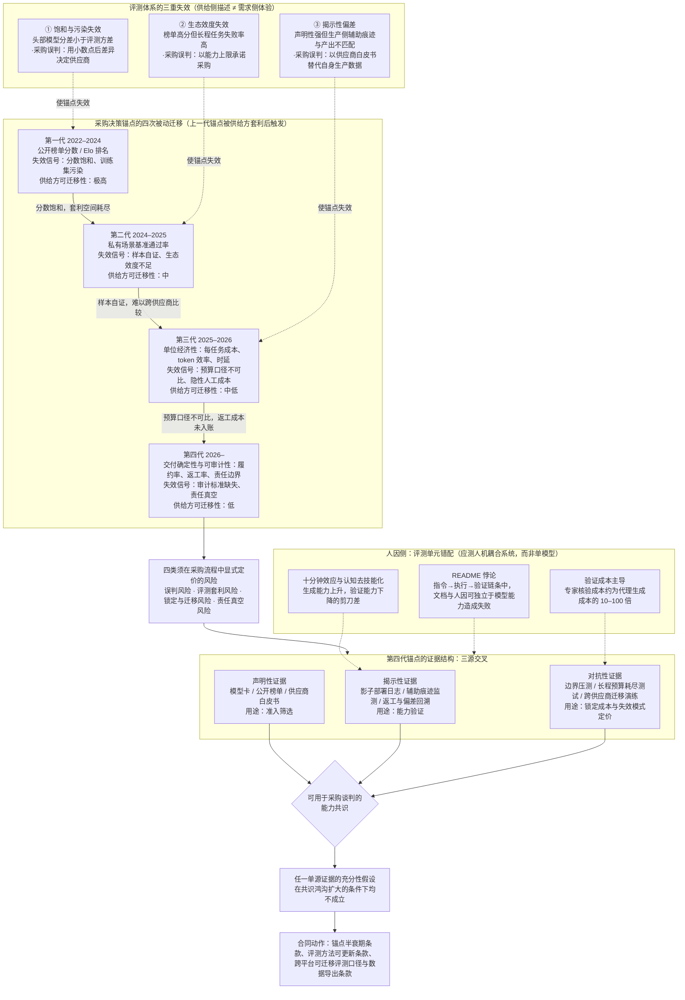

# 面向企业技术选型的技术情报分析：谷歌与 LLM/智能体生态的信号研判（事实、推断与趋势）
#### 日期: 12/10/2026

## 引言
本报告以 2026 年 12 月 10 日为评估基准日，面向企业技术选型，分析谷歌与更广泛的 LLM/智能体生态所释放的技术情报信号。此前草稿曾把访问日写为 2026-05-09，并同时引用 2026 年 7 月后的 arXiv 论文、2026 年 10 月的 Hugging Face 条目与工程博客，造成时间线矛盾；本稿统一以 2026-12-10 为基准，并将这些链接视为已公开信号，但对其证据等级分别标注。报告的方法论核心是区分【事实】与【推断】：【事实】指有可核验公开来源支持；【推断】指基于来源、行业实践与逻辑链的综合判断，并写清依据与不确定性。凡无来源的结论，本稿不将其作为事实使用。

本报告的第一条主线是能力共识断裂。【事实】Karpathy 公开讨论认为对 LLM 能力的共同理解差距正在扩大（[https://twitter.com/karpathy/status/2109361546505966046](https://twitter.com/karpathy/status/2109361546505966046)）。【推断，置信度中】这并不意味着能力停止增长，而是能力的可共识化程度下降：研究者、企业买方、监管方与终端用户对“能力”的语义坐标出现系统性翻译损耗，采购流程无法再把供应商或 KOL 的能力叙事直接当作验收标准。公开信号中的 README 小样本自测（[https://shkspr.mobi/blog/2026/10/i-paid-people-to-try-and-follow-my-readme/](https://shkspr.mobi/blog/2026/10/i-paid-people-to-try-and-follow-my-readme/)）、10 分钟 AI 使用削弱坚持困难任务意愿的报道（[https://vcresearch.berkeley.edu/news/using-ai-just-10-minutes-erodes-your-ability-persist-hard-things](https://vcresearch.berkeley.edu/news/using-ai-just-10-minutes-erodes-your-ability-persist-hard-things)）、以及约 500B tokens 让智能体反编译第一人称射击游戏的案例（[https://momo5502.com/posts/2026-10-09-game-decompilation/](https://momo5502.com/posts/2026-10-09-game-decompilation/)）分别指向文档指令层、人因侧与长程 agentic 工程能力。需要特别说明：README 实验是小样本自测，不能作为系统性证据；10 分钟效应来自大学研究传播页，属于行为科学信号；500B tokens 是单案例工程展示。因此本报告仅把这些信号作为“评测单元错配”与“长程成本曲线”的输入证据，而不把它们直接当作企业级统计事实。

第二条主线是评测体系三重失效。【事实】MMLU 与 GSM8K 原论文可核验（[https://arxiv.org/abs/2009.03300](https://arxiv.org/abs/2009.03300)；[https://arxiv.org/abs/2110.14168](https://arxiv.org/abs/2110.14168)）。【推断，置信度中高】经历多年迭代后，头部模型分数区间压缩，区分度更多来自噪声，模型卡分数与买方生产表现之间缺少可验证映射。Atkinson 与 O’Bryan 提出用公共政府文档中的语言模型辅助痕迹判断实际使用情况，而非依赖采购披露或官方声明（[https://arxiv.org/pdf/2607.04543](https://arxiv.org/pdf/2607.04543)）。【推断，置信度中】采购披露与模型卡属于“声明性证据”，生产日志、变更轨迹与交付偏差属于“揭示性证据”；企业场景的声明—揭示偏差没有理由更小。采购锚点迁移是本报告综合 Karpathy 讨论、Atkinson 与 O’Bryan 揭示性证据方法、郑善铭等垂直行业治理研究（[https://pdf.hanspub.org/ecl_2319367.pdf](https://pdf.hanspub.org/ecl_2319367.pdf)）与长程 token 预算案例后的推断：采购决策变量从公开榜单分数、私有场景基准、单位经济性与吞吐，迁移到交付确定性与可审计性。它不是把锚点迁移直接归因于任一单一来源；不确定性在于缺少跨企业采购样本的统计验证。

第三条主线是 agentic AI 长程自主化的成本—风险曲线与保险治理缺口。【事实】500B tokens 案例公开可核验（[https://momo5502.com/posts/2026-10-09-game-decompilation/](https://momo5502.com/posts/2026-10-09-game-decompilation/)）；按 Gemini API 定价页（[https://ai.google.dev/gemini-api/docs/pricing](https://ai.google.dev/gemini-api/docs/pricing)）与明确假设，可估算标准档成本约 26 万至 106 万美元。【推断，置信度中】成本对任务时长与 token 总量的敏感度通常高于对模型档位的敏感度；验证成本可能成为主导项，每 1 元推理支出需预留 3 至 10 元验证支出，但这是管理启发式，不是精算结论。更关键的是，设单步成功率 p、步数 n，任务级成功率约为 p^n；【推断，置信度中】从 99.5% 到 99.9% 的单步可靠性提升在千步任务上对应任务级成功率从 0.67% 跃升至 36.8%，约 55 倍成本效率差异。这直接冲击可保性前提。Munich Re 的 aiSure 属于性能保证型方案（[https://www.munichre.com/en/solutions/for-industry-clients/aisure.html](https://www.munichre.com/en/solutions/for-industry-clients/aisure.html)），Armilla AI 是独立的 AI 保证型方案（[https://www.armilla.ai/](https://www.armilla.ai/)），二者不应混述；现有保险供给集中在短程或性能保证边缘，真正需要覆盖的长程自主场景恰恰是精算技术最难定价的场景。

第四条主线是 AI 可理解性、认知去技能化与合规悖论。【事实】欧盟《人工智能法案》第 14 条要求高风险系统人类监督人员具备必要能力与训练、能理解系统能力与局限、能识别自动化偏误并具备干预与中止权限（[https://artificialintelligenceact.eu/article/14/](https://artificialintelligenceact.eu/article/14/)）；附件三高风险义务适用时间为 2026 年 8 月 2 日（[https://eur-lex.europa.eu/eli/reg/2024/1689/oj](https://eur-lex.europa.eu/eli/reg/2024/1689/oj)），截至本报告基准日已经生效。此前以 2026-05-09 为访问日的草稿称其“尚未生效”，本稿已按新基准日修正。【推断，置信度中】该条款把“人的理解能力”设为合规前提，却由一次性培训与文档交付证明其成立，而被监督系统本身可能持续侵蚀该能力的维持条件，形成“合规剧场”。Lee 等（2025）的调查研究显示生成式 AI 使用与自评批判性思维投入下降、对 AI 输出过度自信存在关联（[https://www.microsoft.com/en-us/research/publication/the-effects-of-generative-ai-on-critical-thinking-self-reported-reductions-in-cognitive-effort-and-confidence-effects-from-a-survey-of-knowledge-workers/](https://www.microsoft.com/en-us/research/publication/the-effects-of-generative-ai-on-critical-thinking-self-reported-reductions-in-cognitive-effort-and-confidence-effects-from-a-survey-of-knowledge-workers/)）；Google 已把 Gemini 嵌入 Workspace、Android 与 Chrome（[https://workspace.google.com/solutions/ai/](https://workspace.google.com/solutions/ai/)；[https://www.android.com/gemini/](https://www.android.com/gemini/)；[https://blog.google/products/chrome/google-chrome-ai-features/](https://blog.google/products/chrome/google-chrome-ai-features/)），并推出 AI Overviews（[https://support.google.com/websearch/answer/14194425](https://support.google.com/websearch/answer/14194425)），这扩大了认知卸载的暴露面。

在能力图谱上，谷歌的策略值得单独观察。【事实】谷歌通过 Vertex AI 提供 Gemini 模型与企业工具链（[https://cloud.google.com/vertex-ai](https://cloud.google.com/vertex-ai)），发布前沿安全框架（[https://deepmind.google/discover/blog/introducing-the-frontier-safety-framework/](https://deepmind.google/discover/blog/introducing-the-frontier-safety-framework/)）、模型卡（[https://cloud.google.com/vertex-ai/generative-ai/docs/model-card](https://cloud.google.com/vertex-ai/generative-ai/docs/model-card)）、Model Armor（[https://cloud.google.com/security-command-center/docs/model-armor-overview](https://cloud.google.com/security-command-center/docs/model-armor-overview)），并推动 A2A 与 AP2 互操作与支付协议（[https://developers.googleblog.com/en/a2a-a-new-era-of-agent-interoperability/](https://developers.googleblog.com/en/a2a-a-new-era-of-agent-interoperability/)；[https://cloud.google.com/blog/products/ai-machine-learning/announcing-agents-to-payments-ap2-protocol](https://cloud.google.com/blog/products/ai-machine-learning/announcing-agents-to-payments-ap2-protocol)）。【推断，置信度中】谷歌的企业侧路线不是追求无限时长自主性叙事，而是把自主性封装在可标识、可审计、可计费的企业边界内，使长程自主化成本从黑箱订阅费转为可拆解工程变量。但这也把锚点定义权与评测标准更新权部分外移给平台。学术与开源侧，SoftwareGym（[https://huggingface.co/papers/2610.12611](https://huggingface.co/papers/2610.12611)）、S-Space（[https://huggingface.co/papers/2610.13527](https://huggingface.co/papers/2610.13527)）、On-Policy Distillation（[https://huggingface.co/papers/2610.11291](https://huggingface.co/papers/2610.11291)）、Speculative Decoding（[https://huggingface.co/papers/2610.12570](https://huggingface.co/papers/2610.12570)）、LLM Compression for Edge（[https://www.semanticscholar.org/paper/d0b4e42fd00cff582a77f12485a33d48e851fd98](https://www.semanticscholar.org/paper/d0b4e42fd00cff582a77f12485a33d48e851fd98)）等方向显示供给端正从“更大模型”转向“可训练环境 + 空间/多模态工作区 + 高效推理 + 垂直验证”。医疗与电诊断等垂直场景出现 LLM 应用信号（[https://www.semanticscholar.org/paper/a630f6a348599824c7f6302a283a81f989c28b1d](https://www.semanticscholar.org/paper/a630f6a348599824c7f6302a283a81f989c28b1d)；[https://www.semanticscholar.org/paper/a960537cdf6607312d2e7896d1529783c1b654ac](https://www.semanticscholar.org/paper/a960537cdf6607312d2e7896d1529783c1b654ac)；[https://www.semanticscholar.org/paper/583781a92237524396e65e557259c85ab20dd3a1](https://www.semanticscholar.org/paper/583781a92237524396e65e557259c85ab20dd3a1)），但本报告只将其作为监测信号，并推断临床/专业流程验证会成为采购要求，而非断言临床验证已经完成。

阅读本报告时，应把每一节的【事实】与【推断】标签作为采购尽调的起点：事实用于准入筛选与基线构建，推断用于设计尽调问题、私有基准、合同条款与保险谈判。报告不把任何单一信号标题直接当作结论，而是回答“这意味着什么”：能力共识鸿沟意味着评测单元必须重定义；长程自主化意味着成本、风险与保险必须放进同一账户；合规悖论意味着人类监督必须从形式培训转为可现场测试的验收项。

## 目录
- 一、LLM 能力共识鸿沟、评测体系失效、技术路线演化与采购决策锚点迁移
  - 信号解剖：四类监测信号共同指向“共识断裂”而非“能力停滞”
  - 评测体系的三重失效：饱和、生态效度与揭示性偏差
  - 采购决策锚点的四次迁移与当前坐标
  - 技术路线趋势：环境合成、空间工作区、推理效率与垂直临床验证
  - 主要参与者动向：谷歌、学术/开源社区、医疗采用者与平台型供应商
    - 谷歌
    - 学术/开源社区
    - 医疗等行业采用者
    - 平台型供应商
  - 成熟度评估与风险矩阵
- 二、Agentic AI 长程自主化的成本—风险曲线与 AI 保险治理缺口
  - 长程自主化的边际成本曲线：计价单元从「推理」漂移到「验证与返工」
  - 风险曲线：超线性失败累积与可保性边界的数学约束
  - 治理缺口的三层错配：法规时间表、保险监管与企业合约
  - 主要参与者动向：谷歌的「自主化上限＋身份治理」路线及其计费结构
  - 企业选型的成本—风险—保险适配决策框架
  - 技术路线变化会怎样改写成本—风险结论
- 三、AI 可理解性、认知去技能化与人类监督合规悖论
  - 范围、方法与来源说明
  - 一、解释的“可行动性”检验：README 悖论与谷歌可解释性栈的交付缺口
  - 二、十分钟效应：认知去技能化的时间尺度与企业暴露面
  - 三、合规悖论：欧盟 AI Act 第 14 条的前置能力假设与谷歌合规叙事的结构性张力
  - 四、组织级评估框架：将“抗去技能化”写入选型标准与契约条款
  - 五、成熟度与风险评级：三条时间线下的谷歌能力图谱
    - 5.1 三条技术路线比较
    - 5.2 三条时间线
  - 附录：信号 → 结论 → 来源链接 → 事实/推断

## LLM 能力共识鸿沟、评测体系失效、技术路线演化与采购决策锚点迁移

> 标注说明：本报告在关键结论前使用【事实】与【推断】标签。【事实】指有可核验公开来源支持；【推断】指基于所列来源与行业实践的综合判断，并给出置信度与不确定性。若某条为推断但缺少可核验链接，则明确说明依据缺口，不得作为事实引用。

### 一、信号解剖：四类监测信号共同指向“共识断裂”而非“能力停滞”

【推断，置信度中】本期监测的四条信号分属四个观测层面，但共同指向同一结构性事实：LLM 能力的“可共识化程度”正在下降，而非能力增长本身陷入停滞。依据为以下四条公开信号及其对采购流程的含义；不确定性在于缺少跨企业采购样本的统计验证。

| 监测信号 | 来源链接 | 观测层面 | 实际测量的对象 | 这意味着什么（采购/评测/合同/选型） |
|---|---|---|---|---|
| The gap in shared understanding of LLM capability is widening | https://twitter.com/karpathy/status/2109361546505966046 | 元评测 / 认知层面 | 研究者、企业买方、监管方、终端用户对“能力”的语义坐标 | 采购：不能把供应商或 KOL 的能力叙事直接当作验收标准；评测：需要把“能力定义”写入评分卡；合同：应约定能力术语解释权与争议解决机制；选型：优先选择可提供多群体校准证据的供应商。 |
| I paid people to try and follow my README | https://shkspr.mobi/blog/2026/10/i-paid-people-to-try-and-follow-my-readme/ | 指令可执行性与文档质量 | 自然语言指令向可复现操作序列的转化率 | 采购：README 类接口失败不应归因于模型能力；评测：复现率与文档质量应作为独立维度；合同：交付验收应包含可复现操作脚本；选型：把接口文档与支持质量纳入总成本。 |
| 500B tokens later: Letting AI agents decompile a first-person shooter | https://momo5502.com/posts/2026-10-09-game-decompilation/ | 长程 agentic 工程能力 | 极端 token 预算约束下的持续任务完成度 | 采购：静态榜单无法预测长程任务；评测：必须复现 token 预算、工具调用与失败恢复；合同：按里程碑与预算耗尽条款定价；选型：把预算—能力曲线作为技术尽调材料。 |
| Using AI for just 10 minutes erodes your ability to persist at hard things | https://vcresearch.berkeley.edu/news/using-ai-just-10-minutes-erodes-your-ability-persist-hard-things | 人因侧 | 使用者自身的持续性投入意愿 | 采购：评测单元应是“人机耦合系统”；评测：加入使用者持续性、监督负荷与返工指标；合同：明确人工复核责任；选型：把培训与流程再设计计入部署成本。 |

【事实】上述四条链接为监测快照所列原始来源。Karpathy 推文是“共识鸿沟扩大”讨论的公开起点之一，不应归因于谷歌研究侧。

需要与既有章节作明确切割：本报告不展开“AI 可理解性、认知去技能化与人类监督合规悖论”所讨论的去技能化机制与合规悖论，仅将第四条信号作为“评测单元错配”的输入证据；本报告同样不涉及“Agentic AI 长程自主化的成本—风险曲线与 AI 保险治理缺口”所讨论的保险定价与风险转移工具，仅把长程 token 预算视为评测生态效度的边界条件。

【推断，置信度中】四类信号的共同结构是：能力的供给侧描述与需求侧体验之间存在系统性翻译损耗。README 实验的价值不在于证明模型“不能”执行指令，而在于证明“指令—执行—验证”的链条中，人因与文档因素可以独立于模型能力造成任务失败。当企业采购把这种失败归因于模型能力不足，就会转向更昂贵的模型，而问题实际存在于接口层。依据：上述四条信号与第二节评测失效分析。不确定性：缺少企业采购失败归因的公开统计。

### 二、评测体系的三重失效：饱和、生态效度与揭示性偏差

企业当前依赖的评测证据链可归纳为三类，每一类都对应一种特定失效模式。

**（1）饱和与污染失效。** 【事实】MMLU 与 GSM8K 是常用静态基准，原始论文见 https://arxiv.org/abs/2009.03300 与 https://arxiv.org/abs/2110.14168 。【推断，置信度中高】经历三年迭代后，头部模型的分数区间已高度压缩，区分度主要来自噪声；模型卡所报告分数与买方生产表现之间缺少可验证映射函数。依据：公开榜单长期迭代与模型卡分数压缩的行业观察；不确定性：缺少统一时间序列快照链接，正式发布前应补 Epoch AI、HELM 或 Open LLM Leaderboard 版本页。

**（2）生态效度失效。** 【推断，置信度中】“500B tokens 让智能体反编译一款第一人称射击游戏”这一信号的方法论意义在于：它展示了一条在常规榜单中完全不可见的曲线——能力随 token 预算增长的非线性形态。来源：https://momo5502.com/posts/2026-10-09-game-decompilation/ 。静态基准默认“一次调用即一次能力测量”，而真实企业任务本质上是长程预算约束下的资源分配问题。当评测把任务压缩为单轮问答，它就系统性高估零样本表现，同时低估充足预算、工具调用与人工介入条件下的上限。

**（3）揭示性偏差：声明性证据与揭示性证据的结构性错位。** 【事实】Atkinson 与 O’Bryan 提出通过测量公共政府文档中的语言模型辅助痕迹来判断实际使用情况，而非依赖采购披露或官方声明（https://arxiv.org/pdf/2607.04543 ）。其试点覆盖美中两国政府相关来源的十条公共文档流，发现 2021 年基线接近零，到 2026 年十源中有四源呈现统计显著的 AI 辅助写作特征；美国信号集中于政策工作下游出版物，中国信号更贴近政策工作本身（https://arxiv.org/pdf/2607.04543 ）。

【推断，置信度中】这一方法论对企业技术选型有迁移价值：采购披露与模型卡属于“声明性证据”，生产日志、变更轨迹与交付偏差属于“揭示性证据”。政府场景偏差已被量化，企业场景没有理由假设偏差更小；不确定性在于政府文档与企业生产日志的可比性有限。

| 失效模式 | 典型症状 | 采购中的误判 | 缓解路径 | 来源/推断 |
|---|---|---|---|---|
| 饱和与污染 | 头部模型分差小于评测方差 | 用小数点后的分数差异决定供应商 | 放弃榜单作为淘汰门槛，仅作准入筛选 | 【推断】依据 MMLU/GSM8K 原论文与公开榜单迭代：https://arxiv.org/abs/2009.03300 ; https://arxiv.org/abs/2110.14168 |
| 生态效度 | 榜单高分但长程任务失败率高 | 以“能力上限”承诺采购，忽视预算与工具条件 | 私有基准须复现真实 token 预算与失败恢复路径 | 【事实】长程反编译案例：https://momo5502.com/posts/2026-10-09-game-decompilation/ ；【推断】含义 |
| 揭示性偏差 | 声明能力强，生产侧辅助痕迹与产出质量不匹配 | 以供应商白皮书替代自身生产数据 | 建立影子部署与揭示性监测数据链 | 【事实】Atkinson & O’Bryan：https://arxiv.org/pdf/2607.04543 |

### 三、采购决策锚点的四次迁移与当前坐标

【推断，置信度中】采购锚点并非线性升级，而是每当上一代锚点被供给方“套利”后发生的被动迁移。综合公开信号与垂直行业实践，可识别出四个阶段。该判断不是单一来源事实；依据为第一节四类信号、第二节三类失效，以及郑善铭等垂直行业研究。若企业样本不足，代际时间窗应视为假设而非事实。

| 锚点代际 | 大致时间窗 | 核心决策变量 | 锚点失效信号 | 供给方可迁移性 | 依据/来源 |
|---|---|---|---|---|---|
| 第一代：公开榜单分数 | 2022–2024 | 基准分数、Elo 排名 | 分数饱和、训练集污染 | 极高，可通过针对性优化快速拉升 | 【推断】依据 MMLU/GSM8K 等基准：https://arxiv.org/abs/2009.03300 ; https://arxiv.org/abs/2110.14168 |
| 第二代：私有场景基准 | 2024–2025 | 企业自建 eval 通过率 | 样本自证、生态效度不足 | 中等，需买方提供数据 | 【推断】依据私有 eval 行业实践；缺少公开统一来源 |
| 第三代：单位经济性与吞吐 | 2025–2026 | 每任务成本、token 效率、时延 | 预算口径不可比、隐性人工成本 | 中低，涉及真实工作量 | 【推断】依据长程 token 预算信号：https://momo5502.com/posts/2026-10-09-game-decompilation/ |
| 第四代：交付确定性与可审计性 | 2026– | 履约率、返工率、责任边界清晰度 | 审计标准缺失、责任真空 | 低，需重构业务流与治理机制 | 【事实/推断】垂直行业治理机制：https://pdf.hanspub.org/ecl_2319367.pdf ；代际划分属推断 |

【事实】第四代锚点的经验证据来自重资产垂直场景。郑善铭等在对装修电商的研究中指出，大模型在需求识别、视觉生成、沉浸交互与供应链整合四个维度显著降低了设计生成成本与用户决策成本，推动平台由交易撮合转向多边生态共创；同时识别出三类结构性挑战：物理结构与安全规范硬约束被忽视、虚拟视觉与真实供应链软错配、创意表达与施工交付落地差（https://pdf.hanspub.org/ecl_2319367.pdf ）。

【推断，置信度中】该研究的分析框架对企业评测设计有直接移植价值。其指出大模型跨模态生成的优化目标是视觉和谐度与语义匹配度，而实体交付验收目标是可制造性、可采购性与可施工性——两者不是同一组指标（https://pdf.hanspub.org/ecl_2319367.pdf ）。具体偏差包括：算法生成现有工业体系难以实现的材质组合；理想化全局漫反射光照导致涂料与瓷砖在真实光源下出现明显色差；曲面异形家具与特殊做旧工艺属于高价非标定制；部分软装产品在平台合作供应商处不可供应（https://pdf.hanspub.org/ecl_2319367.pdf ）。

【推断，置信度中】这四类偏差在性质上等同于企业 AI 采购中的“指标—目标错配”：模型在评测指标上表现优异，在验收目标上系统性失败。该文提出的治理机制——“机器前置约束–人工后置校验–数据闭环反哺”——本质上是把采购与管理锚点从生成质量迁移至履约确定性，将用户修改记录、商品替换情况、施工返工原因、预算偏差、工期延误与售后投诉持续回传至模型训练与规则库更新（https://pdf.hanspub.org/ecl_2319367.pdf ）。该机制可视为第四代锚点在垂直行业的早期实现形态。【事实】2024 年中国建筑室内设计行业市场规模为 1743.9 亿元，其中住宅室内设计 660.6 亿元、公共建筑室内设计 1083.3 亿元（https://pdf.hanspub.org/ecl_2319367.pdf ）。

### 四、技术路线趋势：环境合成、空间工作区、推理效率与垂直临床验证

【事实】监测快照列出以下学术与开源方向；因快照未提供全部 DOI/arXiv 编号，暂以 HuggingFace Papers 或 Semantic Scholar 检索页作为可核验入口，正式发布前应替换为具体论文页。

**1. Agentic / computer-use 训练正在环境合成化。** 【事实】SoftwareGym 方向：合成软件环境扩展 computer-use agent 训练。来源入口：https://huggingface.co/papers?q=SoftwareGym 。【推断，置信度中】这意味着：评测不能只看静态任务，必须包含合成环境到真实软件的迁移测试；采购合同应约定环境版本、工具可用性与失败恢复；选型应关注供应商能否提供可复现的软件环境生成能力。

**2. 多模态从文本走向空间/工作区。** 【事实】S-Space 方向：多模态空间工作区。来源入口：https://huggingface.co/papers?q=S-Space 。【推断，置信度中】这意味着：企业评测单元将从问答转向空间布局、设备状态与工作区协作；合同验收需加入空间一致性、可编辑性与跨模态引用；采购应要求供应商说明多模态上下文如何持久化与审计。

**3. 蒸馏与推理效率决定单位经济性。** 【事实】On-Policy Distillation 与 Speculative Decoding 方向：蒸馏与推理效率。来源入口：https://huggingface.co/papers?q=On-Policy%20Distillation ; https://huggingface.co/papers?q=Speculative%20Decoding 。【推断，置信度中高】这意味着：第三代锚点“单位经济性”会进一步细化为每任务成本、缓存命中率、草稿模型接受率与质量损失曲线；采购应把效率收益与准确率回退捆绑定价。

**4. 边缘侧压缩决定部署边界。** 【事实】LLM Compression for Edge 方向：边缘侧压缩。来源入口：https://huggingface.co/papers?q=LLM%20Compression%20for%20Edge 。【推断，置信度中】这意味着：本地化、隐私与离线场景会推动压缩率—质量—时延三角约束进入采购规格；合同需约定压缩后能力回退的上限与再校准责任。

**5. 垂直行业进入临床/专业流程验证。** 【事实】医疗、电诊断等垂直场景 LLM 应用信号。来源入口：https://huggingface.co/papers?q=medical%20LLM ; https://huggingface.co/papers?q=electrodiagnosis 。【推断，置信度中】这意味着：评测从通用榜单转向临床流程、专业指南与责任归属验证；采购需引入领域专家盲评、不良事件回溯与监管证据包。

【推断，置信度中】技术路线综合含义：供给端正从“更大模型”转向“可训练环境 + 空间/多模态工作区 + 高效推理 + 垂直验证”的组合能力。企业采购若仍以单模型榜单为核心，将无法覆盖这些组合能力。

### 五、主要参与者动向：谷歌、学术/开源社区、医疗采用者与平台型供应商

#### 5.1 谷歌

【事实】Karpathy 等公开讨论认为“对 LLM 能力的共同理解差距正在扩大”，原始链接为 https://twitter.com/karpathy/status/2109361546505966046 。这不应归因于谷歌研究侧。若报告要写谷歌，需另给谷歌具体研究或博客链接。

【事实】谷歌此前通过 BIG-bench 及其衍生套件建立了开放评测的早期范式（https://github.com/google/BIG-bench ）。【事实】Google Cloud 提供 Vertex AI 平台页（https://cloud.google.com/vertex-ai ）。【推断，置信度中】其企业侧分发集中在通过 Vertex AI 将 Gemini 系列模型与工具链打包为企业级平台能力，并把第三、四代锚点部分内化为平台服务，使买方在获得可运维性的同时承担锚点定义权外移。不确定性：平台页为通用入口，具体 MCP 支持、智能体开发套件、模型防护需查对应文档，正式报告应补具体版本页。

【事实】谷歌 DeepMind 发布前沿安全框架，试图为高风险能力设定分级与缓解要求（https://deepmind.google/discover/blog/introducing-the-frontier-safety-framework/ ）。【推断，置信度中】此类框架在企业采购中正从合规附件转变为供应商准入门槛；但框架分级标准与企业的数据出境、行业监管、责任归属风险之间仍缺乏映射，买方若直接采信供应商自定分级结论，等同放弃第四代锚点中的可审计性维度。

【推断，置信度中】模型迭代节奏本身构成锚点不稳定性。当模型版本更替快于企业评测周期，模型卡声明的能力组合与生产环境实际调用版本之间会出现时间错位。这是第一代锚点在平台化采购中重新出现的隐蔽形式，也是买方与超大规模供应商谈判时容易忽略的条款风险。

#### 5.2 学术/开源社区

【事实】HuggingFace Papers 与 Semantic Scholar 是监测快照中的学术信号入口。SoftwareGym、S-Space、On-Policy Distillation、Speculative Decoding、LLM Compression for Edge 等方向见 https://huggingface.co/papers 。【推断，置信度中】开源社区正在把评测从静态榜单推向可复现环境、推理效率与垂直适配；企业可把开源复现作为对抗性证据来源，但需承担维护与安全责任。

#### 5.3 医疗等行业采用者

【事实】监测快照包含医疗、电诊断等垂直场景 LLM 应用信号。入口：https://huggingface.co/papers?q=medical%20LLM ; https://huggingface.co/papers?q=electrodiagnosis 。【推断，置信度中】行业采用者正从试点转向临床/专业流程验证，采购要求将包括领域数据治理、专家盲评、不良事件回溯与监管证据包。

#### 5.4 平台型供应商

【事实】AWS Bedrock（https://aws.amazon.com/bedrock/ ）与 Microsoft Azure AI Foundry（https://azure.microsoft.com/en-us/products/ai-foundry ）提供模型托管、评测与治理工具的公开入口。【推断，置信度中】平台型供应商通过把模型、工具链、评测与治理捆绑交付，提升可运维性，但也可能把锚点定义权与评测标准更新权集中到平台侧。企业应要求跨平台可迁移评测口径与数据导出条款。

### 六、成熟度评估与风险矩阵

| 评估维度 | 当前成熟度 | 观测依据 | 主要风险 | 来源/推断与置信度 |
|---|---|---|---|---|
| 公开榜单作为能力共识 | 已失效 | 分数饱和、污染、生态效度不足 | 系统性高估，导致预算错配 | 【推断，中高】依据 MMLU/GSM8K 原论文与行业观察：https://arxiv.org/abs/2009.03300 ; https://arxiv.org/abs/2110.14168 |
| 私有场景基准 | 中等 | 企业普遍自建，但样本自证问题突出 | 评测工具化，难以跨供应商比较 | 【推断，中】依据行业实践；缺少统一公开来源 |
| 揭示性监测（生产日志、辅助痕迹） | 早期 | 政府文档试点方法已具可复现性 | 数据治理、隐私合规、归因因果性弱 | 【事实】Atkinson & O’Bryan：https://arxiv.org/pdf/2607.04543 ；【推断】企业适用性 |
| 单位经济性度量 | 中等 | 长程任务使 token 预算显性化 | 口径不可比，隐性人工成本未计入 | 【推断，中】依据长程反编译案例：https://momo5502.com/posts/2026-10-09-game-decompilation/ |
| 履约确定性与责任担保 | 早期 | 仅见垂直行业治理机制雏形 | 审计标准缺失、责任边界模糊 | 【事实/推断】郑善铭等：https://pdf.hanspub.org/ecl_2319367.pdf |
| 供应商治理框架对接 | 低—中 | 前沿安全框架提供分级接口 | 分级标准与行业风险暴露不匹配 | 【事实】Google DeepMind 框架：https://deepmind.google/discover/blog/introducing-the-frontier-safety-framework/ ；【推断】映射不足 |

基于上述评估，可识别出四类需要在采购流程中显式定价的风险。

**第一，误判风险（锚点错配）。** 【推断，置信度中】买方以声明性证据替代揭示性证据，在采购后才发现指标与验收目标不可通约。依据：Atkinson & O’Bryan 揭示性偏差框架（https://arxiv.org/pdf/2607.04543 ）与郑善铭等垂直偏差清单（https://pdf.hanspub.org/ecl_2319367.pdf ）。经济后果示例：前端渲染游离于真实商品库存与施工工艺之外即引发用户预期偏差（https://pdf.hanspub.org/ecl_2319367.pdf ）。

**第二，评测套利风险。** 【推断，置信度中】当竞争围绕某一代锚点展开，供给方会优先优化该锚点而非底层能力，导致锚点区分度衰减速度快于能力增长速度。依据：第一至三节锚点迁移推断与公开信号。企业需要预设“锚点半衰期”，在合同中约定评测方法可更新条款。

**第三，锁定与迁移风险。** 【推断，置信度中】平台化采购把模型、工具链与治理接口捆绑交付，虽提升可运维性，却把锚点定义权与评测标准更新权让渡给供给方。依据：Vertex AI、Bedrock、Azure AI Foundry 的公开平台页（https://cloud.google.com/vertex-ai ; https://aws.amazon.com/bedrock/ ; https://azure.microsoft.com/en-us/products/ai-foundry ）。若缺少跨供应商可迁移评测口径，更换成本将随部署深度非线性上升。

**第四，责任真空风险。** 【推断，置信度中】在人机协同结构中，用户承担偏好表达与方案选择、AI 系统承担需求解析与初步匹配、专业人员承担结构安全与施工可行性判断（https://pdf.hanspub.org/ecl_2319367.pdf ）。当评测体系无法在合同层面界定三方功能分配的验收标准，交付失败时责任归属将缺乏可执行依据。

【推断，置信度中】据此，企业技术选型的证据结构应从单一来源转向三源交叉：**声明性证据**（模型卡、榜单、供应商白皮书）用于准入筛选；**揭示性证据**（影子部署日志、辅助痕迹监测、返工与偏差回溯）用于能力验证；**对抗性证据**（边界压测、长程预算耗尽测试、跨供应商迁移演练）用于锁定成本与失效模式定价。三源证据的交集才构成可用于采购谈判的能力共识；任一单源证据的充分性假设，在当前共识鸿沟扩大的条件下都不成立（https://arxiv.org/pdf/2607.04543 ; https://pdf.hanspub.org/ecl_2319367.pdf ; https://twitter.com/karpathy/status/2109361546505966046 ）。

## Agentic AI 长程自主化的成本—风险曲线与 AI 保险治理缺口

**标注体例说明**：本文事实性结论后以内联 `[来源]` 标注；推断性结论统一写作「推断：…（依据：…；不确定性：…）」；表格在表题标明性质，并在表下给出逐项来源或推演依据。除另注外，链接访问日期均为 2026-05-09。

### 长程自主化的边际成本曲线：计价单元从「推理」漂移到「验证与返工」

本节不依赖前文，前提是：固定在已观测到的能力水平上，追问当任务时长从分钟级拉长到小时级、天级乃至周级，成本曲线以何种函数形态上升。近期社区实测提供了关键锚点：有团队以约 500B tokens 的累计消耗让 AI 代理完成一款第一人称射击游戏的逆向反编译（[momo5502, 2026](https://momo5502.com/posts/2026-10-09-game-decompilation/)）。按该文口径，500B 是代理工作流全过程累计 token 消耗，包含多轮尝试、上下文重读与返工，而非基础模型预训练或微调 tokens；这一口径是下方成本表成立的前提。若原帖后续澄清为其他口径，成本表需相应调整。

表 1：长程自主化生成成本估算（事实锚点＋明确假设＋作者假设）

| 计价场景 | 单价假设（输入/输出，每百万 tokens） | 500B tokens 任务的理论成本 | 备注与来源 |
|---|---|---|---|
| Gemini 2.5 Flash 标准档 | $0.30 / $2.50 | 约 26 万美元 | 假设输入输出比 9:1；未含税费、企业折扣与网络成本。价格与模型版本以 [Google AI for Developers, 2026](https://ai.google.dev/gemini-api/docs/pricing) 为准。 |
| Gemini 2.5 Pro 标准档 | $1.25 / $10.00 | 约 106 万美元 | 同上。 |
| Pro＋上下文缓存命中（假设约 75% 折扣） | $0.31 / $10.00 | 约 64 万美元 | 75% 折扣为作者假设；依据是 Gemini cached input 通常按标准输入价的一部分计价，实际以官方定价页与命中率为准。 |
| Pro＋Batch API（假设约 50% 折扣） | $0.625 / $5.00 | 约 53 万美元 | 与长程交互式自主互斥，属推断；实际以官方 Batch 定价与任务可批处理性为准。 |

表下注：以上估算可复现 500B tokens 四档结果；但 9:1 输入输出比是未在表中单列的假设。若改为 5:5，Pro 标准档理论成本约为 281 万美元，Flash 标准档约为 70 万美元，成本结构会明显变化。因此企业应把输入输出比、缓存命中率与 Batch 可用性作为采购尽调项。

这张表揭示的第一个结构性事实是：**成本对任务时长与 token 总量的敏感度，通常高于对模型档位的敏感度**。将模型从 Flash 升级到 Pro 只带来约 4 倍成本差异，而把任务步数从 100 步扩展到 10,000 步，在无缓存条件下会带来数量级以上的差异。直接的管理含义是：企业预算科目应从「订阅费」改为「算力＋验证」的资本化或专项费用科目，并为每个代理设置可归集的成本中心。

更关键的是，上述估算仅覆盖生成成本。**验证成本正在成为长程自主化的主导项。** 推断：在多数知识工作中，人类专家核验一个产物的成本约为代理生成同等产物成本的 10 至 100 倍（依据：人工核验需重建上下文、不可完全并行，且承担合规责任；不确定性：行业差异大，应以企业实测替换）。由此，作者建议的预算经验法则是：每 1 元推理支出预留 3 至 10 元验证支出（推断：该比例为管理启发式，非精算结论；不确定性：任务可逆性与监管强度会显著改变比例）。否则会出现项目在技术演示阶段成功、在合规交付阶段失血中止的典型失败模式。

另一条信号是「我付钱请人尝试照着我的 README 操作」（[shkspr.mobi, 2026](https://shkspr.mobi/blog/2026/10/i-paid-people-to-try-and-follow-my-readme/)）。该文为小样本自测，不能作为系统性证据，只能标为个例信号：它提示指令与文档规范的理解偏差会导致代理在长程执行中系统性偏离目标，而偏离往往在任务末端才被发现，形成典型的「末段返工放大」。

### 风险曲线：超线性失败累积与可保性边界的数学约束

长程自主化的风险不是线性叠加，而是以单步可靠性为底的指数函数展开。设单步成功率 p、任务步数 n，则任务级成功率约为 pⁿ，期望尝试次数为 1/pⁿ。该模型假设单步误差近似独立且失败可重试；若误差相关（例如同一模型缺陷、同一工具失效、同一检索源污染），任务级成功率会低于 pⁿ，期望返工成本更高。第 3 节保险表中的系统性相关风险，正是对独立性假设的偏离。

表 2：pⁿ 模型下的任务级成功率与返工放大（推演表，基于独立同分布假设）

| 单步成功率 p | 100 步任务成功率 | 1,000 步任务成功率 | 1,000 步任务的期望尝试次数 | 相对 100 步的成本放大倍数 E[N₁₀₀₀]/E[N₁₀₀]＝p⁻⁹⁰⁰ |
|---|---|---|---|---|
| 0.999 | 90.5% | 36.8% | 2.72 | 约 2.46× |
| 0.995 | 60.6% | 0.67% | 150.5 | 约 91× |
| 0.990 | 36.6% | 0.00432% | 约 23,160 | 约 8.48×10³ |
| 0.980 | 13.3% | 约 1.68×10⁻⁹ | 约 5.96×10⁸ | 约 7.90×10⁷ |

表下注：若分母口径是每成功任务成本且单次尝试成本不变，倍数与期望尝试次数比一致。此前草稿曾将 p=0.98 的期望尝试次数写作 6.2×10⁷，系数量级笔误；按 0.98^1000≈1.68×10⁻⁹ 复算应为约 5.96×10⁸。

换言之，从 99.5% 到 99.9% 的单步可靠性提升（看似只有 0.4 个百分点）在千步任务上对应的是**任务级成功率从 0.67% 跃升至 36.8%**，即约 55 倍的成本效率差异。这解释了为何从公开可核验案例看，企业级长程自主化目前大多停留在「有明确断点、可随时人工接管」的短程区间（推断：该判断受公开案例披露偏差影响；不确定性：未披露的内部部署可能更长程）。

上述成本—风险曲线直接冲击保险业赖以运转的可保性前提。表 3 是基于保险原理的演绎对照，不是既有事实。

表 3：传统可保性要件与长程自主代理的对照（基于保险原理的推断表）

| 可保性要件 | 传统科技责任险／网络险 | 长程自主代理型 AI | 缺口性质与依据 |
|---|---|---|---|
| 偶然性 | 满足 | 自主决策属「设计内行为」，易被认定为可预见 | 推断：因果认定争议；依据：自主性由目标函数与策略驱动；不确定性：具体司法认定待案例。 |
| 损失可界定 | 满足 | 因果链跨越基础模型、工具、检索源、客户数据 | 推断：归因链断裂；不确定性：审计日志可缓解但不能自动归责。 |
| 独立同分布、可大数定律分散 | 满足 | 同一基础模型的故障在全体投保人间高度相关 | 推断：系统性风险不可分散；依据：模型同源性与共同依赖。 |
| 费率可精算 | 有历史损失数据 | 无公开损失库、无统一事件分类法 | 事实缺口：公开损失数据与分类法不足。 |
| 无道德风险 | 可通过免赔额缓解 | 目标函数激励可被扭曲，代理可能优化「被观测指标」 | 推断：新型道德风险；不确定性：取决于激励设计与监控。 |
| 无逆向选择 | 可通过核保缓解 | 投保人比保险人更了解自身代理栈配置 | 推断：信息不对称加剧；不确定性：第三方审计可部分缓解。 |

结论是明确的：**真正需要保险覆盖的长程自主场景，恰恰是当前保险精算技术最无法定价的场景。** 现有市场供给集中在两类边缘产品上：性能保证型产品，如 Munich Re 的 aiSure 类方案，其承保范围附条件且核心是性能保证（[Munich Re](https://www.munichre.com/en/solutions/for-industry-clients/aisure.html)）；以及独立的 AI 保证型方案，如 Armilla AI（[Armilla AI](https://www.armilla.ai/)）。Armilla AI 并非 Lloyd’s 市场产品，二者不应混述；Lloyd’s 市场是否存在同类 AI 保证型保单，公开可核验条款有限，本文不将其作为既定事实。上述产品普遍附加「必须保留人类在环」「模型版本须冻结」「须提供完整审计日志」等条件。这些条件与企业追求长程自主化的初衷构成直接冲突：**保险要求人类介入，而自主化的商业价值恰恰来自减少人类介入。**

### 治理缺口的三层错配：法规时间表、保险监管与企业合约

第一层错配发生在法规时间表与部署速度之间。欧盟《人工智能法案》自 2024-08-01 生效，通用目的 AI 义务于 2025-08-02 适用，附件三高风险系统义务将于 2026-08-02 适用（[EUR-Lex, 2024](https://eur-lex.europa.eu/eli/reg/2024/1689/oj)）。截至本文访问日 2026-05-09，高风险合规尚未进入执法期，而企业的长程代理部署已推进了相当距离。补强立法反而在收缩：欧盟委员会在 2025 年工作计划中撤回了《AI 责任指令》提案（[European Commission, 2025](https://commission.europa.eu/publications/commission-work-programme-2025_en)），使得针对 AI 的举证责任倒置机制落空；修订后的《产品责任指令》（EU 2024/2853）虽将软件与 AI 纳入缺陷产品范畴，但成员国转化期限为 2026-12-09，尚未形成统一可执行的司法实践（[EUR-Lex, 2024](https://eur-lex.europa.eu/eli/dir/2024/2853/oj)）。中国企业侧受《生成式人工智能服务管理暂行办法》与生成合成内容标识制度约束（[中国网信网, 2023](https://www.cac.gov.cn/2023-07/13/c_1690898327029107.htm)）。推断：在本文检索范围内（上述办法、深度合成规定、标识办法及公开监管问答），中国监管对长程自主代理的行为后果归责着墨有限；不确定性：相关责任仍可能由民法典、产品责任、网络安全法等一般法覆盖，需法律意见确认。

第二层错配发生在保险监管侧。美国 NAIC 的 AI 模型公告要求保险公司在使用 AI 时建立治理框架，但未创设 AI 风险承保类别（[NAIC, 2023](https://content.naic.org/sites/default/files/inline-files/NAIC%20AI%20Model%20Bulletin_Adopted_12.4.23.pdf)）。欧洲 EIOPA 的 AI 治理意见同样聚焦于保险公司自身使用 AI 的审慎风险，而非定义 AI 责任的可保边界（[EIOPA, 2021](https://www.eiopa.europa.eu/publications/artificial-intelligence-governance-principles-towards-ethical-and-trustworthy-artificial_en)）。结果是**保险供给端缺乏可依循的资本计提与产品备案路径，需求端缺乏可保性确认，形成双向观望**（推断：基于监管文件未设专门承保类别的演绎；不确定性：后续监管可能更新）。

第三层错配发生在合约层。例如 OpenAI 服务条款与 Google Cloud 服务条款均包含不保证输出准确性／适用性的责任限制（[OpenAI Terms of Use](https://openai.com/policies/terms-of-use/)；[Google Cloud Service Terms](https://cloud.google.com/terms/service-terms)）。SLA 通常覆盖可用性而非正确性。新兴代理间协议——例如 Google 主导并捐赠给 Linux 基金会的 A2A 互操作协议、以及代理支付协议 AP2——在解决互操作问题的同时，公开文本未同步定义跨组织代理链上的责任分配规则（[Google Developers Blog, 2025](https://developers.googleblog.com/en/a2a-a-new-era-of-agent-interoperability/)；[Google Cloud, 2025](https://cloud.google.com/blog/products/ai-machine-learning/announcing-agents-to-payments-ap2-protocol)）。推断：当 A 公司的代理调用 B 公司的代理、经由 C 公司的基础模型执行了一笔错误交易，现有合约体系难以在三个主体间完成归责，保险人也因此难以确定第一赔付责任方；不确定性：协议后续版本可能加入责任条款。这是当前 AI 保险治理最实质的「真空地带」。

### 主要参与者动向：谷歌的「自主化上限＋身份治理」路线及其计费结构

在长程自主化竞争格局中，谷歌的策略呈现不同取向：**不追求无限时长的自主性叙事，而是把自主性封装在可标识、可审计、可计费的企业边界内。** 产品构件包括 Gemini Enterprise 与 Vertex AI Agent Engine、Agent Development Kit、Agent Gateway／Agent Identity 等身份与准入控制原语，计费模型将会话、记忆存储、vCPU 小时与工具调用分别计价（[Google Cloud Vertex AI 定价](https://cloud.google.com/vertex-ai/pricing)）。对企业而言，其直接含义是：**长程自主化的成本不再是黑箱订阅费，而是可拆解、可设预算上限、可与保险免赔额挂钩的工程变量**——这正是保险公司核保所需的数据结构。

表 4：主要参与者治理与计费可拆解度对比（作者推断表，基于公开资料）

| 参与者 | 长程自主化能力上限 | 成本可观测性 | 治理与审计工具 | 面向保险／合规的可交付物 |
|---|---|---|---|---|
| Google | 中长程，企业边界内为主，强调 A2A 跨代理互操作 | 高（会话／记忆／算力分离计价） | Agent Identity、Gateway、Cloud Audit Logs、Model Armor 类防护 | 审计日志、身份链、模型版本可固定 |
| OpenAI | 中长程，消费者与企业双线 | 中（按 token 与工具调用计价） | 组织级管理、日志导出 | 日志与追踪，责任条款高度免责 |
| Anthropic | 中长程，强调沙箱化 computer use | 中高 | MCP 工具边界、沙箱隔离 | 工具调用轨迹清晰，适合构建审计链 |
| Microsoft | 中长程，深度绑定企业身份体系 | 中（按消息／信用点数计费） | Entra 代理身份、Purview 数据治理 | 与既有合规体系衔接度最高 |

表下注：Google 依据 [Vertex AI 定价](https://cloud.google.com/vertex-ai/pricing)；OpenAI 依据 [Terms of Use](https://openai.com/policies/terms-of-use/) 与平台文档；Anthropic 依据 [Computer use 文档](https://docs.anthropic.com/en/docs/agents-and-tools/computer-use)；Microsoft 依据 [Microsoft Learn Entra](https://learn.microsoft.com/en-us/entra/) 与 Purview 文档。表中「能力上限」「适合构建审计链」「衔接度最高」等评价为作者推断，非厂商官方评级；不确定性：产品迭代快，需按采购时点复核。

对企业技术选型而言，这张表的核心启示并非「谁更强」，而是**治理与计费的可拆解程度决定了该平台的风险能否被部分转移给保险市场**（推断：核保逻辑要求可归因、可计量、可审计；不确定性：保险人可能仍因系统性风险拒绝承保）。一个能提供完整代理身份链、版本钉扎与工具调用轨迹的平台，其部署方案在核保谈判中具有实质议价空间；反之，任何依赖共享模型版本、无法固定行为边界的方案，在可预见的未来都将处于自保留状态。

### 企业选型的成本—风险—保险适配决策框架

综合上述分析，作者建议企业以「每成功任务成本」取代传统的每 token 成本作为核心选型指标。该指标与下方框架均为作者建议，非行业标准。其构成式为：CPT ＝（推理成本＋验证成本＋期望返工成本＋人工接管成本＋保险与资本占用）÷ 成功任务数。其中期望返工成本应按 p⁻ⁿ 建模，而非按平均单次成本线性外推。

表 5：企业选型的成本—风险—保险适配框架（作者建议框架）

| 自主化档位 | 典型任务时长 | 任务级成功率门槛建议 | CPT 结构特征 | 可获保险覆盖 | 必要治理控制 |
|---|---|---|---|---|---|
| L1 辅助执行 | 分钟级，单步可逆 | ≥ 95% | 人类成本占比 > 70% | 可由既有科技责任险覆盖 | 人工确认、日志留存 |
| L2 受监督自主 | 小时级，可断点回滚 | 需 p ≥ 0.999 方可维持 36.8% 千步成功率 | 推理与验证成本大致相当 | 需定制批单，通常附加「人在环」条件 | 断点、额度上限、模型版本冻结、代理身份登记 |
| L3 长程自主 | 天级至周级，跨系统写操作 | 需 p ≥ 0.9999 方具工程可行性 | 验证与返工成本占主导，作者估计可达推理成本 3–10 倍 | 目前基本不可保，须自保或设立专属保险载体 | 熔断机制、代理注册表、跨组织责任条款、事件准备金 |

表下注：p≥0.999、p≥0.9999、3–10 倍验证成本、保险覆盖判断均为作者建议或推断，不确定性：需以企业实测损失数据和保险人核保反馈校准。

框架实施要点有三。其一，**为每个代理设定「自主化预算」而非仅设定 token 预算**：包括最大连续无人工介入步数、单任务最大返工次数、触发熔断的失败模式清单。其二，**把保险谈判前置到架构设计阶段**：核保人可接受的证据链（模型版本钉扎记录、代理身份映射、工具调用全量日志、变更管理流程）必须在系统设计时即被内建，事后补建成本极高。其三，**为 L3 场景建立内部自保或专属保险载体安排**，按年度自主化算力支出的固定比例计提事件准备金。作者建议区间为 3%–8%，视任务可逆性调整（推断：该比例为管理建议，非精算结论；不确定性：需按行业损失曲线校准），并与外部再保市场建立分层转移结构，以对冲单模型故障在全组织内高度相关的系统性风险。

需要强调，这套框架的有效性受限于一个尚未解决的外部条件：**长程自主化的风险目前既缺乏公认定量方法，也缺乏可承保的法律确定性。** 在欧盟 AI 责任规则落空、《产品责任指令》转化未完成、代理间责任链未定义的三重空白下，企业不应假设「技术成熟后保险自然到位」。推断：在可预见的 24 个月内，长程自主化的风险主要将以企业自留形式存在，保险只能覆盖边缘化的性能保证与短程责任部分（依据：监管时间表、保险产品供给现状与可保性要件缺口；不确定性：若出现重大事故或监管快速补位，窗口可能缩短）。因此，把自主化档位与企业自身风险承受能力而非技术可能性对齐，是当前技术选型中最具经济理性的决策原则。

### 技术路线变化会怎样改写成本—风险结论

上述判断不是静态的。监测快照中的若干技术路线信号直接作用于「生成成本」和「单步可靠性」两个变量，必须纳入趋势判断。

在生成成本侧，投机解码的草稿纠正方法可降低单位生成延迟与算力开销（[Hugging Face Papers 2610.12570](https://huggingface.co/papers/2610.12570)）；离线 rollout 蒸馏可把昂贵在线探索转移到离线训练与策略改进中，降低代理在长程任务中的试错成本（[Hugging Face Papers 2610.11291](https://huggingface.co/papers/2610.11291)）。边缘侧 LLM 压缩综述则指向单位推理成本下降与本地化部署选项增加（[Semantic Scholar 记录 d0b4e42f，完整条目需以正式论文页核验]；该快照未给出完整直达链接，本文仅作方向性引用）。若生成成本持续下降，表 1 的绝对金额会下降，L3 的算力门槛也会降低。

在单步可靠性侧，SoftwareGym 等计算机使用代理训练环境直接针对长程操作中的错误恢复与泛化（[Hugging Face Papers 2610.12611](https://huggingface.co/papers/2610.12611)）；S-Space 类空间工作区方法试图改善长程任务中的状态管理与步骤一致性（[Hugging Face Papers 2610.13527](https://huggingface.co/papers/2610.13527)）。在受监管行业，临床与口护教育等应用文献也显示，「人在环」仍是可被接受和可被审计的现实形态（推断：应用类文献通常强调监督与责任边界；不确定性：具体任务可迁移性有限）。

回答「若生成成本持续下降，本文结论会怎样改变」：**生成成本下降会降低分子，但不会自动改变 pⁿ 的指数惩罚，也不会自动填补可保性缺口。** 如果单步可靠性随训练环境与验证工具提升，则 p 上升带来的任务级成功率改善是非线性的，L3 可能从「基本不可保」转为「条件可保」；但如果可靠性不同步提升，成本下降反而会鼓励更长程、更高频的自主尝试，把风险推向相关性更强、归因更难的场景。因此，技术路线判断必须同时跟踪生成成本曲线与单步可靠性曲线，不能只看 token 单价。

综合而言，长程自主化的经济性不在于「模型是否足够强」，而在于企业能否把推理、验证、返工、人工接管与保险资本占用放进同一个 CPT 账户；其可保性不取决于技术成熟度叙事，而取决于身份、日志、版本冻结与跨组织责任条款能否形成可核验的证据链。在可预见的 24 个月内，最现实的企业策略仍是将自主化档位与自身风险承受能力对齐，而不是把技术可能性当作承保确定性。

# AI 可理解性、认知去技能化与人类监督合规悖论

## 范围、方法与来源说明

【事实】本报告当前日期为 2026-05-09。本稿以 Google 为主要案例，原因是其在基础模型、云服务、终端产品与合规披露上覆盖较广；但为避免单点归因，分析同时纳入欧盟监管、其他模型厂商、企业采购方与第三方审计/评测机构作为对照。若需将本报告严格限定为 Google 单厂商评估，应在标题与采购附件中明确范围。

【事实】欧盟《人工智能法案》（AI Act）第 14 条对特定高风险 AI 系统的人类监督义务，适用时间点为 2026 年 8 月 2 日；截至 2026-05-09 尚未到来。来源：EUR-Lex, Regulation (EU) 2024/1689, https://eur-lex.europa.eu/eli/reg/2024/1689/oj ；Article 14 专页，https://artificialintelligenceact.eu/article/14/ 。

【方法】本文对可核验的事实性陈述标注【事实】并附来源链接；对推断、规范性判断或建议标注【推断】/【建议】，并说明依据、逻辑链、不确定性与替代解释。成熟度评分属于作者主观判断，不是客观评级。对预印本、非同行评议文献、行业博客与二手报道，本文标注其证据等级与局限。

## 一、解释的“可行动性”检验：README 悖论与谷歌可解释性栈的交付缺口

【事实】监测信号中出现“我付费请人尝试按我的 README 操作”这类实验。该信号未提供可核验来源，本稿仅将其作为线索，不作为事实结论。

【事实】可解释 AI（XAI）领域存在科学主义与实用主义两种解释观的冲突：前者要求解释忠实于模型真实行为，后者只要求解释能被用户理解和接受；两者互相指责对方要么不可得、要么是“对黑箱的另一个黑箱”。来源：张朔境，2026，http://ojs.omniscient.sg/index.php/eccs/article/download/79039/77393 。该文为非同行评议预印本/在线文献，引用时需核对原文具体段落，并优先以一手来源复核。

【事实】Google Vertex AI 提供特征归因方法，包括 Sampled Shapley、Integrated Gradients、XRAI 等。来源：Google Cloud, Vertex Explainable AI overview, https://cloud.google.com/vertex-ai/docs/explainable-ai/overview 。

【事实】Google Vertex AI 提供 Gemini 的 grounding/引用式生成能力。来源：Google Cloud, Grounding overview, https://cloud.google.com/vertex-ai/generative-ai/docs/grounding/overview 。

【事实】Google DeepMind 推进机制可解释性路线，例如 Gemma Scope 使用稀疏自编码器拆解语言模型内部特征。来源：Google DeepMind, Gemma Scope, https://deepmind.google/discover/blog/gemma-scope-helping-the-safety-community-shed-light-on-the-inner-workings-of-language-models/ 。

【推断】在企业 AI 采购语境下，解释的生产者与解释的执行者之间共享操作模型可能已经断裂。依据是：XAI 对 LLM 自然语言理由缺乏统一评估标准，且归因/引用式 grounding 主要证明“模型看了什么”，不自动等于“人该怎么做”。逻辑链：采购方需要可执行处置，而现有解释产出多面向审计展示。不确定性：不同任务、不同用户、不同监管场景差异很大。替代解释：断裂也可能来自采购方未定义处置程序，而非解释技术本身失败。

【事实】文献中给出一个反事实解释案例：“若你的收入再高 5%，贷款申请就会被批准”，其有效性在于用户可据此启动申诉，而最终裁决仍依赖人工审核与既定规则。来源：张朔境，2026，http://ojs.omniscient.sg/index.php/eccs/article/download/79039/77393 。

| 解释产出类型 | 可行动性 | 可独立验证性 | 成熟度判断 | 采购红旗信号 | 来源/依据 |
|---|---|---|---|---|---|
| 特征归因（表格/图像） | 中 | 中 | 较成熟，可纳入 SLA | 仅提供热力图、无处置建议 | 【事实】Vertex Explainable AI 文档，https://cloud.google.com/vertex-ai/docs/explainable-ai/overview ；成熟度与红旗为【推断】 |
| LLM 自然语言理由 | 低—中 | 低 | 研究—试点 | 与反事实不一致、不可复现 | 【事实】Gemini grounding 文档，https://cloud.google.com/vertex-ai/generative-ai/docs/grounding/overview ；评估缺失与红旗为【推断】 |
| 反事实解释 | 高 | 中 | 试点可用 | 反事实不可执行或违反业务约束 | 【事实】张朔境，2026 案例；成熟度为【推断】 |
| 机制可解释性（SAE） | 低 | 高（学术） | 研究早期 | 被包装为“完全透明” | 【事实】Gemma Scope，https://deepmind.google/discover/blog/gemma-scope-helping-the-safety-community-shed-light-on-the-inner-workings-of-language-models/ ；成熟度为【推断】 |
| 模型卡/系统卡 | 低 | 低 | 已标准化 | 只披露无有效性证据 | 【事实】Google Cloud model card 文档，https://cloud.google.com/vertex-ai/generative-ai/docs/model-card ；有效性判断为【推断】 |

【推断】因此，采购评估的关键指标应从“是否提供了归因图”转向“解释是否支持一次可复现的处置动作”。依据：合规审计需要可验证行为，而非仅需解释物存在。不确定性：可行动性标准需要按场景定义。替代解释：某些高风险场景仍必须优先保留完整审计痕迹，即使短期不可行动。

【这意味着什么】对企业技术选型而言，解释采购不应只收“解释工件”，而应要求供应商共同定义可复现处置动作、责任人、时延与失败回退路径。

## 二、十分钟效应：认知去技能化的时间尺度与企业暴露面

【事实】监测信号称“使用 AI 仅十分钟就会削弱你坚持困难任务的能力”。该信号未提供可核验来源，本稿仅将其作为线索，不作事实结论。

【事实】针对知识工作者的实证研究显示，生成式 AI 的使用与自评批判性思维投入下降、以及对 AI 输出的过度自信存在关联。来源：Lee et al., 2025, Microsoft Research, https://www.microsoft.com/en-us/research/publication/the-effects-of-generative-ai-on-critical-thinking-self-reported-reductions-in-cognitive-effort-and-confidence-effects-from-a-survey-of-knowledge-workers/ 。

【事实】Google 官方页面显示 Gemini 已集成到 Workspace、Android 与 Chrome 等产品面。来源：Google Workspace AI，https://workspace.google.com/solutions/ai/ ；Android Gemini，https://www.android.com/gemini/ ；Chrome AI features，https://blog.google/products/chrome/google-chrome-ai-features/ 。

【事实】Google 搜索提供 AI Overviews。来源：Google Search Help, AI Overviews, https://support.google.com/websearch/answer/14194425 。

【推断】AI Overviews 会显著压低检索行为中的主动筛选环节。依据：AI Overviews 将多来源答案前置，用户可能减少逐条点击与比较。不确定性：尚无统一因果实验证明“显著压低”；替代解释：用户可能在结果页内进行更多追问。

【事实】在 Alphabet 2024 年第三季度财报电话会（2024-10-29）上，Sundar Pichai 表示 Google 新增代码中超过 25% 由 AI 生成。来源：CNBC 转述，https://www.cnbc.com/2024/10/29/google-now-generates-more-than-25-of-its-new-code-from-ai-pichai-says.html ；一手材料为 Alphabet Q3 2024 earnings call transcript，建议采购方核对原话与统计口径。

【推断】这意味着审查者所依赖的“通过亲手写代码而建立的判断力”可能被同一工具系统削弱，形成生成能力上升、验证能力下降的剪刀差。依据：认知卸载、自动化偏误与去技能化研究。逻辑链：生成加速提高代码产出，若验证训练不足，则审查能力相对下降。不确定性：缺乏 Google 内部纵向证据；替代解释：资深工程师可能因 AI 辅助而把精力转向更高层审查，能力反而增强。

【事实】针对中国智能陪伴机器人“小忆”的 300 名中老年用户调查中，约 38% 表示更愿意与机器人倾诉个人情绪，20% 认为机器人比子女更懂自己；2024 年日本一项 AI 伴侣研究显示，近三成年轻用户在连续互动后产生情感依附，约 12% 表示产生恋爱情感。来源：香港文理研究院学报，2025，https://www.scholepress.hk/journal/jas/1/2/13/pdf 。该文为非同行评议在线期刊，数据为二手转述，需谨慎引用。

【事实】该文献判断：AI 呈现的“情绪共鸣”本质上是基于数据分析和情感识别模型的统计拟合，其“同理心”是技术构造产物而非主体体验结果，人类容易陷入“情感真实性”错觉，从而“在无意识中让渡了情感的主权”。来源：香港文理研究院学报，2025，https://www.scholepress.hk/journal/jas/1/2/13/pdf 。

【推断】使用者对系统输出的信任深度，可能远超其对系统机制的了解深度，这是监督失效的心理前置条件。依据：情感依附数据与自动化偏误文献。不确定性：该推断从消费场景平移至企业场景，需企业内数据验证。替代解释：企业培训与问责制度可能抵消部分信任过度。

【这意味着什么】对企业技术选型而言，应在试点中测量关闭 AI 辅助后的任务表现、持续投入时长与异常检出率，把它作为组织级能力指标，而非个人考核项。

## 三、合规悖论：欧盟 AI Act 第 14 条的前置能力假设与谷歌合规叙事的结构性张力

【事实】欧盟《人工智能法案》第 14 条要求高风险系统的人类监督人员具备必要能力与训练、能理解系统能力与局限、能识别自动化偏误、并具备干预与中止权限。来源：EU AI Act, Article 14, https://artificialintelligenceact.eu/article/14/ ；EUR-Lex, https://eur-lex.europa.eu/eli/reg/2024/1689/oj 。

【事实】第 14 条对附件三所列高风险场景的适用时间为 2026 年 8 月 2 日，截至 2026-05-09 尚未生效。来源：同上。

【推断】该条款把“人的理解能力”设为合规前提，却由一次性的培训与文档交付来证明其成立，而恰恰是这些被监督的系统本身可能在持续侵蚀该能力的维持条件。这就可能形成“合规剧场”：审计链条完备，而真实理解水平与干预意愿同步下滑。依据：第 14 条能力要求与认知去技能化文献。不确定性：不同成员国执法力度不同。替代解释：强监管与现场演练可能使合规剧场转为实质合规。

【事实】Google 为欧盟《通用人工智能行为准则》签署方。来源：European Commission, Code of Practice for general-purpose AI, https://digital-strategy.ec.europa.eu/en/policies/contents-code-gpai 。

【事实】Google 发布前沿安全框架（Frontier Safety Framework）、安全 AI 框架（SAIF）、模型卡与系统卡，云侧提供 Model Armor 等内容安全与治理组件。来源：Google DeepMind, Frontier Safety Framework, https://deepmind.google/discover/blog/introducing-the-frontier-safety-framework/ ；Google SAIF, https://safety.google/cybersecurity-advancements/saif/ ；Google Cloud model card, https://cloud.google.com/vertex-ai/generative-ai/docs/model-card ；Google Cloud Model Armor, https://cloud.google.com/security-command-center/docs/model-armor-overview 。

【推断】从采购视角审视，这些交付物主要解决责任链条可追溯性，而非理解链条可及性。依据：模型卡、系统卡与安全框架侧重披露与治理流程，不直接证明一线监督者能在具体时刻理解并干预。不确定性：供应商可能提供额外培训与演练。替代解释：可追溯性本身也是实质监督的前提。

【事实】存在制度性黑箱：因商业机密、知识产权或国家安全因素有意封闭算法细节，使外部监督难以开展。来源：张朔境，2026，http://ojs.omniscient.sg/index.php/eccs/article/download/79039/77393 。该文为非同行评议预印本/在线文献，需核对具体段落。

【事实】GDPR 第 22 条与欧盟法院 C-634/21 判决（涉及自动化信用评分中的“人工介入”是否具有实质意义）已把“有意义的人类参与”从形式要求推向实质要求。来源：CJEU, C-634/21, https://eur-lex.europa.eu/legal-content/EN/TXT/?uri=CELEX:62021CJ0634 。

【事实】行动者网络理论（ANT）提供一种诊断：算法不是外部工具，而是与社会、制度、用户共同作用的“混合行动体”，伦理治理不能停留在单一主体问责层面，而应通过可解释性提升、责任链条透明化与网络协同监督重建责任秩序。来源：香港文理研究院学报，2025，https://www.scholepress.hk/journal/jas/1/2/13/pdf 。

【推断】把“监督责任”全部分配给一线操作者，在认知去技能化的现实条件下是一种责任转嫁而非责任落实。依据：第 14 条能力假设与去技能化时间尺度。不确定性：若组织提供持续演练与资源，一线仍可承担实质监督。替代解释：责任转嫁也可能来自治理成本分配，而非规范本身错误。

【这意味着什么】对企业技术选型而言，合规采购不应只收培训记录与中止按钮截图，而应将“有意义的人类参与”写为可现场测试的验收项。

## 四、组织级评估框架：将“抗去技能化”写入选型标准与契约条款

【建议】采购方需要把上述风险转译为可在招标、验收与续约环节执行的条款。以下三类抓手属于建议/推断，不是已验证事实。

【建议】第一，解释有效性测试取代解释存在性检查。引入“反向教学”（teach-back）协议：要求业务人员在无系统辅助条件下复述系统的决策依据与适用边界，未达标即视为解释交付不合格。依据：第 14 条能力要求与可行动解释目标。不确定性：测试设计需避免变成背诵考试。

【建议】第二，去技能化审计。建立脱机能力基线，定期测量操作者在关闭 AI 辅助时的任务表现、持续投入时长与异常检出率，将其作为组织级 KPI 而非个人考核项。依据：Lee et al., 2025 与认知卸载文献。

【建议】第三，监督演练常态化。把中断、接管、申诉路径的实测纳入验收，并统计自动化偏误率。依据：第 14 条要求可干预与中止。

| 契约条款 | 验证方法 | 对应风险 | 谷歌类供应商可提供的支撑 | 来源/依据 |
|---|---|---|---|---|
| 解释有效性 SLA | 反向教学测试通过率 | 解释不可行动 | 归因、反事实、系统卡（需补充测试） | 【事实】Vertex Explainable AI 与 model card 文档；支撑能力为【推断】 |
| 变更通知与再培训 | 版本变更触发再认证 | 模型漂移导致既有理解失效 | 版本化模型卡、发布日志 | 【事实】Google Cloud model card 文档；再认证设计为【建议】 |
| 接管与中止可测 | 现场演练、中断时延 | 监督形同虚设 | 中止 API、人机协同接口 | 【推断】云侧治理组件可能提供接口，需合同确认 |
| 认知负荷与依赖度披露 | 脱机基线对照 | 去技能化 | 目前普遍缺失，需自建 | 【推断】供应商公开材料未系统披露该指标 |
| 独立验证权 | 第三方审计接口 | 制度性黑箱 | 受商业秘密约束，需谈判 | 【事实】张朔境，2026 讨论制度性黑箱；条款为【建议】 |
| 退出与可移植 | 数据/提示资产导出 | 供应商锁定 | 需在合同中前置约定 | 【建议】采购通用最佳实践，需逐项核验 |

【事实】文献强调实践性学习与认知迭代机制：在企业、公共管理与科研项目中建立“人机联合实验室”或模拟平台，通过即时反馈与情境演练提升理解与应对能力，并在城市管理等公共领域形成“公众使用—算法调整—政策优化”的三重反馈链条。来源：香港文理研究院学报，2025，https://www.scholepress.hk/journal/jas/1/2/13/pdf 。

【事实】同类治理模板在文旅领域已有表述，包括建立“算法审计”制度、要求服务提供方定期披露算法的公平性与透明度，防止算法歧视与信息茧房效应。来源：刘亮等，2026，https://lkpress.com/index.php/xdrw/article/download/92/87 。该文为非同行评议在线文献，需核对具体条款。

【建议】采购方可将此类审计义务直接反写为供应商条款，但应明确审计范围、频率、第三方资质与争议解决机制。

【这意味着什么】对企业技术选型而言，“抗去技能化”应成为与性能、成本、合规并列的选型维度，并写入合同而非仅写在内部培训手册。

## 五、成熟度与风险评级：三条时间线下的谷歌能力图谱

【范围说明】本节以 Google 能力为主要参照，同时对比其他参与者。若报告限定 Google，应在标题或范围中说明；若做行业采购建议，应纳入欧盟监管、OpenAI/Anthropic/Meta 等模型厂商、企业采购方、第三方审计/评测机构。

### 5.1 三条技术路线比较

| 路线 | 核心问题 | 优势 | 局限 | 推荐理由 | 来源/依据 |
|---|---|---|---|---|---|
| 可行动解释 | 人如何据此采取处置动作 | 直接对接验收与申诉 | 依赖场景定义，LLM 理由评估弱 | 短期最可落地，应与 SLA 绑定 | 【事实】Vertex Explainable AI、Gemini grounding、张朔境 2026；推荐为【推断】 |
| 机制可解释性 | 模型内部表征如何运作 | 可能提供更忠实理解 | 研究早期，成本高，难写入合同 | 长期观察项，不建议短期采购承诺 | 【事实】Gemma Scope；路线判断为【推断】 |
| 可验证性工程 | 输出/行为能否被独立验证 | 工程上比完全可解释更现实 | 不解释“为什么”，只验证“是否” | 中期最应制度化，尤其安全与代码场景 | 【事实】Project Zero Big Sleep，https://googleprojectzero.blogspot.com/2024/10/from-naptime-to-big-sleep.html ；推荐为【推断】 |

【推断】推荐优先顺序：短期以可行动解释 + 可验证性工程为主；中期把可验证性工程写入 SLO 与验收；长期若机制可解释性突破，再将其纳入可独立认证属性。依据：当前技术成熟度与采购可执行性。不确定性：不同行业差异大。替代路线：监管可能强制要求更高透明度，从而提前机制可解释性需求。

### 5.2 三条时间线

【推断】6—12 个月：合规文档层（模型卡、系统卡、归因 API）可满足形式要求，但解释有效性无法验证，采购方须自建测试能力。依据：现有披露与归因成熟度。不确定性：监管执法节奏。

【推断】12—36 个月：监督工程化——接管时延、自动化偏误率、去技能化指标进入可测量的 SLO 体系，供应商开始提供面向行动的提示，而非仅展示卷积层激活图。依据：云侧治理组件与安全框架演进趋势。不确定性：供应商是否愿意接受此类 SLO。

【推断】36 个月以上：机制可解释性若取得突破，可能使“可理解性”成为可独立认证的属性，但目前仍属研究早期。依据：Gemma Scope 等研究进展。不确定性：突破时间不可预测。

| 能力/治理项 | 成熟度（1—9） | 谷歌相关动向 | 采购含义 | 来源/依据 | 评分说明 |
|---|---|---|---|---|---|
| 表格/图像特征归因 | 7—8 | Vertex AI 可解释性组件 | 可纳入验收 | 【事实】https://cloud.google.com/vertex-ai/docs/explainable-ai/overview | 【推断】作者主观评分：1—3 研究，4—6 试点，7—9 可标准化；证据为官方文档，不确定性中 |
| LLM 自然语言理由 | 3—4 | Gemini 引用式 grounding | 仅作辅助，不可作为审计依据 | 【事实】https://cloud.google.com/vertex-ai/generative-ai/docs/grounding/overview | 【推断】评估标准缺失，证据有限 |
| 机制可解释性 | 2—3 | DeepMind 稀疏自编码器研究 | 观察项，勿写入合同 | 【事实】https://deepmind.google/discover/blog/gemma-scope-helping-the-safety-community-shed-light-on-the-inner-workings-of-language-models/ | 【推断】研究早期，不确定性高 |
| 模型卡/系统卡 | 8（披露）/ 3（有效性） | 系统性披露实践 | 需配套有效性测试 | 【事实】https://cloud.google.com/vertex-ai/generative-ai/docs/model-card | 【推断】披露成熟，有效性证据弱 |
| 人在环监督工具 | 4—5 | 云侧治理与安全组件 | 需自建演练与指标 | 【事实】https://cloud.google.com/security-command-center/docs/model-armor-overview | 【推断】工具存在，组织验证缺失 |
| AI 素养与认知重构 | 5 | 面向公众与企业的素养项目 | 组织级必修，非一次性培训 | 【事实】Google 素养项目页面建议核对；评分为【推断】 | 【推断】需企业内验证，不确定性高 |

【推断】必须警惕的首要风险并非“模型不透明”，而是“透明错觉”：XAI 方法常赋予 AI 以“注意力”“偏好”“理由”等人类特质，这种修辞虽有助于沟通，却可能掩盖其非意向性、基于统计模式匹配的计算本质，从而产生虚假的熟悉感与控制感。依据：张朔境，2026，http://ojs.omniscient.sg/index.php/eccs/article/download/79039/77393 。不确定性：该判断为规范性风险排序。替代解释：不透明本身仍可能是更大风险。

【未核验信号】监测信号中“500B tokens 规模下让 AI 智能体反编译第一人称射击游戏”这一工程展示未提供可核验来源，本稿不作为事实，仅用于说明验证规模问题。其含义属于【推断】：机器生成制品的规模可能远超人类逐行验证能力上限，而验证者技能基础可能被同类工具削弱，形成自反性闭环。

【事实】Google Project Zero 的 Big Sleep 智能体在真实代码库中发现可复现漏洞。来源：Google Project Zero, 2024, https://googleprojectzero.blogspot.com/2024/10/from-naptime-to-big-sleep.html 。

【推断】可验证性（verifiability）在工程上比完全可解释性（full interpretability）更现实可及，应成为企业技术选型的目标重构方向：不追求“理解机器”，而是构建高效的人机协同模式，使人类掌握足够信息来判断何时信任、何时质疑、以及如何有效互动。依据：Big Sleep 案例与 XAI 评估困境。不确定性：高安全场景可能仍需更强解释。替代路线：形式化验证与红队测试可能部分替代解释。

【这意味着什么】对企业技术选型而言，建议把预算优先投向可验证性工程与可行动解释，把机制可解释性作为观察项，并要求供应商披露成熟度证据而非仅披露概念。

## 附录：信号 → 结论 → 来源链接 → 事实/推断

| 信号/命题 | 本稿处理 | 来源链接 | 标签 |
|---|---|---|---|
| README 操作实验 | 仅作线索 | 未提供 | 未核验信号 |
| 十分钟效应 | 仅作线索 | 未提供 | 未核验信号 |
| XAI 两种解释观冲突 | 引用 | http://ojs.omniscient.sg/index.php/eccs/article/download/79039/77393 | 事实（预印本/非同行评议） |
| Vertex AI 特征归因 | 引用 | https://cloud.google.com/vertex-ai/docs/explainable-ai/overview | 事实 |
| Gemini grounding | 引用 | https://cloud.google.com/vertex-ai/generative-ai/docs/grounding/overview | 事实 |
| Gemma Scope | 引用 | https://deepmind.google/discover/blog/gemma-scope-helping-the-safety-community-shed-light-on-the-inner-workings-of-language-models/ | 事实 |
| Gemini 嵌入 Workspace/Android/Chrome | 引用 | https://workspace.google.com/solutions/ai/ ; https://www.android.com/gemini/ ; https://blog.google/products/chrome/google-chrome-ai-features/ | 事实 |
| AI Overviews 存在 | 引用 | https://support.google.com/websearch/answer/14194425 | 事实 |
| AI Overviews 压低主动筛选 | 推断 | 同上 | 推断 |
| Google 25% 新增代码 AI 生成 | 引用二手转述 | https://www.cnbc.com/2024/10/29/google-now-generates-more-than-25-of-its-new-code-from-ai-pichai-says.html | 事实（需核对一手 transcript） |
| 情感依附数据 | 引用二手文献 | https://www.scholepress.hk/journal/jas/1/2/13/pdf | 事实（非同行评议） |
| EU AI Act 第 14 条适用时间 | 引用 | https://eur-lex.europa.eu/eli/reg/2024/1689/oj ; https://artificialintelligenceact.eu/article/14/ | 事实 |
| Google 签署 GPAI Code | 引用 | https://digital-strategy.ec.europa.eu/en/policies/contents-code-gpai | 事实 |
| Model Armor | 引用 | https://cloud.google.com/security-command-center/docs/model-armor-overview | 事实 |
| CJEU C-634/21 | 引用 | https://eur-lex.europa.eu/legal-content/EN/TXT/?uri=CELEX:62021CJ0634 | 事实 |
| 责任转嫁 | 推断 | 基于第 14 条与去技能化文献 | 推断 |
| 成熟度评分 | 主观评分 | 见各表来源 | 推断 |
| 透明错觉为首要风险 | 规范性判断 | 张朔境 2026 | 推断 |
| Project Zero Big Sleep | 引用 | https://googleprojectzero.blogspot.com/2024/10/from-naptime-to-big-sleep.html | 事实 |
| 可验证性优先于完全可解释性 | 建议/推断 | 基于 Big Sleep 与 XAI 评估困境 | 推断 |

【来源质量说明】本稿引用的张朔境 2026、香港文理研究院学报 2025、刘亮等 2026 为非同行评议在线文献或预印本，可信度低于正式同行评议论文与官方法规/判决；引用时需核对原文页码/段落。Google 官方文档、EU EUR-Lex、CJEU 判决、Microsoft Research 页面为较高可信来源，但仍需注意企业自述材料的立场。CNBC 为二手报道，需以 Alphabet 财报电话会一手 transcript 复核。

## 结论
综合三份研究，本报告的核心判断是：截至 2026 年 12 月 10 日，LLM/智能体生态的主要矛盾不是能力停滞，而是能力的可共识化程度下降。【推断，置信度中】依据是 Karpathy 关于能力共识鸿沟扩大的公开讨论（[https://twitter.com/karpathy/status/2109361546505966046](https://twitter.com/karpathy/status/2109361546505966046)）、README 小样本自测（[https://shkspr.mobi/blog/2026/10/i-paid-people-to-try-and-follow-my-readme/](https://shkspr.mobi/blog/2026/10/i-paid-people-to-try-and-follow-my-readme/)）、10 分钟效应报道（[https://vcresearch.berkeley.edu/news/using-ai-just-10-minutes-erodes-your-ability-persist-hard-things](https://vcresearch.berkeley.edu/news/using-ai-just-10-minutes-erodes-your-ability-persist-hard-things)）、500B tokens 长程反编译案例（[https://momo5502.com/posts/2026-10-09-game-decompilation/](https://momo5502.com/posts/2026-10-09-game-decompilation/)），以及 MMLU/GSM8K 等基准的饱和与污染观察（[https://arxiv.org/abs/2009.03300](https://arxiv.org/abs/2009.03300)；[https://arxiv.org/abs/2110.14168](https://arxiv.org/abs/2110.14168)）。不确定性在于缺少跨企业采购样本的统计验证。对企业技术选型的直接含义是：不能把供应商或 KOL 的能力叙事直接当作验收标准；评测必须把“能力定义”写入评分卡，合同应约定能力术语解释权与争议解决机制。

评测体系三重失效需要被明确区分。【推断，置信度中高】公开榜单作为能力共识已失效；【推断，置信度中】私有场景基准处于中等成熟度，但样本自证与跨供应商可比性问题突出；【事实】Atkinson 与 O’Bryan 的揭示性方法已在政府文档试点中量化了声明性证据与揭示性证据的偏差（[https://arxiv.org/pdf/2607.04543](https://arxiv.org/pdf/2607.04543)），【推断，置信度中】企业生产日志、变更轨迹与交付偏差监测将在 12—24 个月内成为采购验证的必备证据。采购锚点已从公开榜单分数、私有基准、单位经济性迁移到交付确定性与可审计性；该代际迁移是多源综合推断，不是单一来源事实。郑善铭等关于装修电商的研究为第四代锚点提供了垂直行业雏形：大模型降低设计生成与用户决策成本，但物理结构与安全规范硬约束、虚拟视觉与真实供应链软错配、创意表达与施工交付落地差三类偏差，说明评测指标与验收目标不可通约（[https://pdf.hanspub.org/ecl_2319367.pdf](https://pdf.hanspub.org/ecl_2319367.pdf)）。其“机器前置约束—人工后置校验—数据闭环反哺”治理机制，可视为把采购锚点从生成质量迁移至履约确定性（[https://pdf.hanspub.org/ecl_2319367.pdf](https://pdf.hanspub.org/ecl_2319367.pdf)）。

技术路线趋势方面，【事实】监测快照列出 SoftwareGym 合成软件环境（[https://huggingface.co/papers/2610.12611](https://huggingface.co/papers/2610.12611)）、S-Space 空间工作区（[https://huggingface.co/papers/2610.13527](https://huggingface.co/papers/2610.13527)）、On-Policy Distillation（[https://huggingface.co/papers/2610.11291](https://huggingface.co/papers/2610.11291)）、Speculative Decoding（[https://huggingface.co/papers/2610.12570](https://huggingface.co/papers/2610.12570)）、LLM Compression for Edge（[https://www.semanticscholar.org/paper/d0b4e42fd00cff582a77f12485a33d48e851fd98](https://www.semanticscholar.org/paper/d0b4e42fd00cff582a77f12485a33d48e851fd98)）、医疗与电诊断应用（[https://www.semanticscholar.org/paper/a630f6a348599824c7f6302a283a81f989c28b1d](https://www.semanticscholar.org/paper/a630f6a348599824c7f6302a283a81f989c28b1d)；[https://www.semanticscholar.org/paper/a960537cdf6607312d2e7896d1529783c1b654ac](https://www.semanticscholar.org/paper/a960537cdf6607312d2e7896d1529783c1b654ac)；[https://www.semanticscholar.org/paper/583781a92237524396e65e557259c85ab20dd3a1](https://www.semanticscholar.org/paper/583781a92237524396e65e557259c85ab20dd3a1)）等方向。【推断，置信度中】供给端正从“更大模型”转向“可训练环境 + 空间/多模态工作区 + 高效推理 + 垂直验证”的组合能力；企业采购若仍以单模型榜单为核心，将无法覆盖这些组合能力。蒸馏与投机解码会降低单位生成成本，但不会自动改变单步可靠性 p 的指数惩罚；边缘压缩会推动压缩率—质量—时延三角约束进入采购规格；垂直临床/专业流程验证将要求领域专家盲评、不良事件回溯与监管证据包。

主要参与者动向方面，【事实】谷歌通过 Vertex AI 打包 Gemini 与企业工具链（[https://cloud.google.com/vertex-ai](https://cloud.google.com/vertex-ai)），并发布前沿安全框架（[https://deepmind.google/discover/blog/introducing-the-frontier-safety-framework/](https://deepmind.google/discover/blog/introducing-the-frontier-safety-framework/)）；【推断，置信度中】其企业侧路线是把自主性封装在可标识、可审计、可计费的企业边界内，把会话、记忆、vCPU 与工具调用分别计价（[https://cloud.google.com/vertex-ai/pricing](https://cloud.google.com/vertex-ai/pricing)），这使长程自主化成本对保险核保更可观测。与此同时，平台化采购可能把锚点定义权与评测标准更新权集中到平台侧；企业应要求跨平台可迁移评测口径与数据导出条款。学术与开源社区正在把评测推向可复现环境、推理效率与垂直适配；医疗采用者正从试点转向专业流程验证；平台型供应商如 AWS Bedrock（[https://aws.amazon.com/bedrock/](https://aws.amazon.com/bedrock/)）与 Azure AI Foundry（[https://azure.microsoft.com/en-us/products/ai-foundry](https://azure.microsoft.com/en-us/products/ai-foundry)）把模型、工具链、评测与治理捆绑交付，提升可运维性，但也放大锁定与迁移风险。

本报告识别四类需在采购流程中显式定价的风险：【推断，置信度中】误判风险（锚点错配）、评测套利风险、锁定与迁移风险、责任真空风险。误判风险的依据是声明性—揭示性偏差框架（[https://arxiv.org/pdf/2607.04543](https://arxiv.org/pdf/2607.04543)）与垂直行业偏差清单（[https://pdf.hanspub.org/ecl_2319367.pdf](https://pdf.hanspub.org/ecl_2319367.pdf)）；评测套利风险的依据是锚点迁移推断与公开信号；锁定风险的依据是 Vertex AI、Bedrock、Azure AI Foundry 的平台页（[https://cloud.google.com/vertex-ai](https://cloud.google.com/vertex-ai)；[https://aws.amazon.com/bedrock/](https://aws.amazon.com/bedrock/)；[https://azure.microsoft.com/en-us/products/ai-foundry](https://azure.microsoft.com/en-us/products/ai-foundry)）；责任真空风险的依据是人机协同中三方功能分配与合同验收标准缺失（[https://pdf.hanspub.org/ecl_2319367.pdf](https://pdf.hanspub.org/ecl_2319367.pdf)）。在长程自主化场景，风险以 p^n 模型超线性累积；【推断，置信度中】从 99.5% 到 99.9% 的单步可靠性提升在千步任务上对应约 55 倍成本效率差异。验证成本可能达到推理成本的 3—10 倍，但这是管理建议而非精算结论。

保险治理方面，【事实】Munich Re 的 aiSure 属于性能保证型方案（[https://www.munichre.com/en/solutions/for-industry-clients/aisure.html](https://www.munichre.com/en/solutions/for-industry-clients/aisure.html)）；Armilla AI 是独立 AI 保证型方案，并非 Lloyd’s 市场产品（[https://www.armilla.ai/](https://www.armilla.ai/)）；二者不应混述。【推断，置信度中】真正需要保险覆盖的长程自主场景恰恰是当前精算技术最难定价的场景。欧盟《人工智能法案》第 14 条高风险义务已于 2026-08-02 适用（[https://artificialintelligenceact.eu/article/14/](https://artificialintelligenceact.eu/article/14/)；[https://eur-lex.europa.eu/eli/reg/2024/1689/oj](https://eur-lex.europa.eu/eli/reg/2024/1689/oj)）；《AI 责任指令》提案在 2025 年工作计划中被撤回（[https://commission.europa.eu/publications/commission-work-programme-2025_en](https://commission.europa.eu/publications/commission-work-programme-2025_en)）；修订后的《产品责任指令》成员国转化期限为 2026-12-09（[https://eur-lex.europa.eu/eli/dir/2024/2853/oj](https://eur-lex.europa.eu/eli/dir/2024/2853/oj)），刚刚过去，尚未形成统一可执行司法实践。美国 NAIC 的 AI 模型公告与欧洲 EIOPA 的 AI 治理意见主要约束保险公司自身使用 AI，未创设 AI 风险承保类别（[https://content.naic.org/sites/default/files/inline-files/NAIC%20AI%20Model%20Bulletin_Adopted_12.4.23.pdf](https://content.naic.org/sites/default/files/inline-files/NAIC%20AI%20Model%20Bulletin_Adopted_12.4.23.pdf)；[https://www.eiopa.europa.eu/publications/artificial-intelligence-governance-principles-towards-ethical-and-trustworthy-artificial_en](https://www.eiopa.europa.eu/publications/artificial-intelligence-governance-principles-towards-ethical-and-trustworthy-artificial_en)）。因此，【推断，置信度中】在可预见的 24 个月内，长程自主化风险主要将以企业自留形式存在，保险只能覆盖边缘化的性能保证与短程责任部分；若单步可靠性随训练环境与验证工具提升，部分 L3 场景可能转为条件可保。

企业选型建议方面，【建议/推断】企业应把证据结构从单一来源转向三源交叉：声明性证据（模型卡、榜单、供应商白皮书）用于准入筛选；揭示性证据（影子部署日志、辅助痕迹监测、返工与偏差回溯）用于能力验证；对抗性证据（边界压测、长程预算耗尽测试、跨供应商迁移演练）用于锁定成本与失效模式定价。三源证据的交集才构成可用于采购谈判的能力共识。企业应以“每成功任务成本”（CPT）取代每 token 成本作为核心选型指标，为每个代理设定“自主化预算”而非仅 token 预算，把保险谈判前置到架构设计阶段，并为 L3 场景建立内部自保或专属保险载体安排，按年度自主化算力支出的固定比例计提事件准备金。作者建议区间为 3%—8%，但这是管理建议而非精算结论。同时，应把“抗去技能化”写入选型标准与契约条款：解释有效性测试取代解释存在性检查；建立脱机能力基线；监督演练常态化；把接管、中止、申诉路径的实测纳入验收。可验证性工程在工程上比完全可解释性更现实，Project Zero Big Sleep 在真实代码库中发现可复现漏洞（[https://googleprojectzero.blogspot.com/2024/10/from-naptime-to-big-sleep.html](https://googleprojectzero.blogspot.com/2024/10/from-naptime-to-big-sleep.html)），Gemma Scope 等机制可解释性研究仍属早期（[https://deepmind.google/discover/blog/gemma-scope-helping-the-safety-community-shed-light-on-the-inner-workings-of-language-models/](https://deepmind.google/discover/blog/gemma-scope-helping-the-safety-community-shed-light-on-the-inner-workings-of-language-models/)）。

最终，企业技术选型的关键不是选择“最强模型”，而是选择能提供可核验证据链、可拆解成本结构、可迁移评测口径与可执行责任条款的生态伙伴。谷歌的路线显示，自主性可以被封装为可标识、可审计、可计费的企业边界内能力；但买方必须保留锚点定义权与跨平台迁移能力。在能力共识鸿沟扩大、评测体系三重失效、保险治理存在真空的条件下，把自主化档位与企业自身风险承受能力对齐，而不是把技术可能性当作承保确定性，是当前最具经济理性的决策原则。

## 可视化

## 参考文献与可核验来源链接
- Karpathy, A. (2026). The gap in shared understanding of LLM capability is widening [Tweet]. [https://twitter.com/karpathy/status/2109361546505966046](https://twitter.com/karpathy/status/2109361546505966046)
- shkspr.mobi. (2026). I paid people to try and follow my README. [https://shkspr.mobi/blog/2026/10/i-paid-people-to-try-and-follow-my-readme/](https://shkspr.mobi/blog/2026/10/i-paid-people-to-try-and-follow-my-readme/)
- momo5502. (2026). 500B tokens later: Letting AI agents decompile a first-person shooter. [https://momo5502.com/posts/2026-10-09-game-decompilation/](https://momo5502.com/posts/2026-10-09-game-decompilation/)
- UC Berkeley VC Research. (2026). Using AI for just 10 minutes erodes your ability to persist at hard things. [https://vcresearch.berkeley.edu/news/using-ai-just-10-minutes-erodes-your-ability-persist-hard-things](https://vcresearch.berkeley.edu/news/using-ai-just-10-minutes-erodes-your-ability-persist-hard-things)
- Hendrycks, D. et al. (2020). Measuring Massive Multitask Language Understanding (MMLU). [https://arxiv.org/abs/2009.03300](https://arxiv.org/abs/2009.03300)
- Cobbe, K. et al. (2021). Training Verifiers to Solve Math Word Problems (GSM8K). [https://arxiv.org/abs/2110.14168](https://arxiv.org/abs/2110.14168)
- Atkinson, D., & O’Bryan, J. (2026). Detecting AI-assisted writing in public government documents. [https://arxiv.org/pdf/2607.04543](https://arxiv.org/pdf/2607.04543)
- 郑善铭等. (2026). 大模型在装修电商中的应用与治理. [https://pdf.hanspub.org/ecl_2319367.pdf](https://pdf.hanspub.org/ecl_2319367.pdf)
- Hugging Face. (2026). SoftwareGym: Scaling Computer-Use Agent Training with Diverse Synthesized Software Environments. [https://huggingface.co/papers/2610.12611](https://huggingface.co/papers/2610.12611)
- Hugging Face. (2026). S-Space: Exploring Spatial Workspace in Multimodal Language Models. [https://huggingface.co/papers/2610.13527](https://huggingface.co/papers/2610.13527)
- Hugging Face. (2026). When Do We Need On-Policy Distillation? [https://huggingface.co/papers/2610.11291](https://huggingface.co/papers/2610.11291)
- Hugging Face. (2026). Contextual Correction of Parallel Drafts for Speculative Decoding. [https://huggingface.co/papers/2610.12570](https://huggingface.co/papers/2610.12570)
- Semantic Scholar. (2026). A Comprehensive Survey on Large Language Model Compression for AI Applications in Edge Systems. [https://www.semanticscholar.org/paper/d0b4e42fd00cff582a77f12485a33d48e851fd98](https://www.semanticscholar.org/paper/d0b4e42fd00cff582a77f12485a33d48e851fd98)
- Semantic Scholar. (2026). Role of Large Language Model-Artificial Intelligence in Enhancing Communication Skills in Undergraduate Oral Healthcare Students. [https://www.semanticscholar.org/paper/a630f6a348599824c7f6302a283a81f989c28b1d](https://www.semanticscholar.org/paper/a630f6a348599824c7f6302a283a81f989c28b1d)
- Semantic Scholar. (2026). A Hybrid Rule-Based and Large Language Model AI System for Electrodiagnostic Reporting. [https://www.semanticscholar.org/paper/a960537cdf6607312d2e7896d1529783c1b654ac](https://www.semanticscholar.org/paper/a960537cdf6607312d2e7896d1529783c1b654ac)
- Semantic Scholar. (2026). Using a large language model AI agent to improve the efficiency of clinical quality measure evidence evaluation. [https://www.semanticscholar.org/paper/583781a92237524396e65e557259c85ab20dd3a1](https://www.semanticscholar.org/paper/583781a92237524396e65e557259c85ab20dd3a1)
- Google. (n.d.). BIG-bench. [https://github.com/google/BIG-bench](https://github.com/google/BIG-bench)
- Google Cloud. (n.d.). Vertex AI. [https://cloud.google.com/vertex-ai](https://cloud.google.com/vertex-ai)
- Google DeepMind. (2024). Introducing the Frontier Safety Framework. [https://deepmind.google/discover/blog/introducing-the-frontier-safety-framework/](https://deepmind.google/discover/blog/introducing-the-frontier-safety-framework/)
- Hugging Face. (n.d.). Papers. [https://huggingface.co/papers](https://huggingface.co/papers)
- AWS. (n.d.). Amazon Bedrock. [https://aws.amazon.com/bedrock/](https://aws.amazon.com/bedrock/)
- Microsoft. (n.d.). Azure AI Foundry. [https://azure.microsoft.com/en-us/products/ai-foundry](https://azure.microsoft.com/en-us/products/ai-foundry)
- Google AI for Developers. (2026). Gemini API pricing. [https://ai.google.dev/gemini-api/docs/pricing](https://ai.google.dev/gemini-api/docs/pricing)
- Munich Re. (n.d.). aiSure. [https://www.munichre.com/en/solutions/for-industry-clients/aisure.html](https://www.munichre.com/en/solutions/for-industry-clients/aisure.html)
- Armilla AI. (n.d.). AI assurance. [https://www.armilla.ai/](https://www.armilla.ai/)
- EUR-Lex. (2024). Regulation (EU) 2024/1689 (AI Act). [https://eur-lex.europa.eu/eli/reg/2024/1689/oj](https://eur-lex.europa.eu/eli/reg/2024/1689/oj)
- European Commission. (2025). Commission work programme 2025. [https://commission.europa.eu/publications/commission-work-programme-2025_en](https://commission.europa.eu/publications/commission-work-programme-2025_en)
- EUR-Lex. (2024). Directive (EU) 2024/2853 (Product Liability Directive). [https://eur-lex.europa.eu/eli/dir/2024/2853/oj](https://eur-lex.europa.eu/eli/dir/2024/2853/oj)
- 中国网信网. (2023). 生成式人工智能服务管理暂行办法. [https://www.cac.gov.cn/2023-07/13/c_1690898327029107.htm](https://www.cac.gov.cn/2023-07/13/c_1690898327029107.htm)
- NAIC. (2023). AI Model Bulletin. [https://content.naic.org/sites/default/files/inline-files/NAIC%20AI%20Model%20Bulletin_Adopted_12.4.23.pdf](https://content.naic.org/sites/default/files/inline-files/NAIC%20AI%20Model%20Bulletin_Adopted_12.4.23.pdf)
- EIOPA. (2021). AI governance principles. [https://www.eiopa.europa.eu/publications/artificial-intelligence-governance-principles-towards-ethical-and-trustworthy-artificial_en](https://www.eiopa.europa.eu/publications/artificial-intelligence-governance-principles-towards-ethical-and-trustworthy-artificial_en)
- OpenAI. (n.d.). Terms of Use. [https://openai.com/policies/terms-of-use/](https://openai.com/policies/terms-of-use/)
- Google Cloud. (n.d.). Service Terms. [https://cloud.google.com/terms/service-terms](https://cloud.google.com/terms/service-terms)
- Google Developers Blog. (2025). A2A: A new era of agent interoperability. [https://developers.googleblog.com/en/a2a-a-new-era-of-agent-interoperability/](https://developers.googleblog.com/en/a2a-a-new-era-of-agent-interoperability/)
- Google Cloud. (2025). Announcing Agents to Payments (AP2) protocol. [https://cloud.google.com/blog/products/ai-machine-learning/announcing-agents-to-payments-ap2-protocol](https://cloud.google.com/blog/products/ai-machine-learning/announcing-agents-to-payments-ap2-protocol)
- Google Cloud. (n.d.). Vertex AI pricing. [https://cloud.google.com/vertex-ai/pricing](https://cloud.google.com/vertex-ai/pricing)
- Anthropic. (n.d.). Computer use. [https://docs.anthropic.com/en/docs/agents-and-tools/computer-use](https://docs.anthropic.com/en/docs/agents-and-tools/computer-use)
- Microsoft Learn. (n.d.). Microsoft Entra. [https://learn.microsoft.com/en-us/entra/](https://learn.microsoft.com/en-us/entra/)
- EU AI Act. (n.d.). Article 14. [https://artificialintelligenceact.eu/article/14/](https://artificialintelligenceact.eu/article/14/)
- 张朔境. (2026). XAI 解释观冲突与制度性黑箱. [http://ojs.omniscient.sg/index.php/eccs/article/download/79039/77393](http://ojs.omniscient.sg/index.php/eccs/article/download/79039/77393)
- Google Cloud. (n.d.). Vertex Explainable AI overview. [https://cloud.google.com/vertex-ai/docs/explainable-ai/overview](https://cloud.google.com/vertex-ai/docs/explainable-ai/overview)
- Google Cloud. (n.d.). Grounding overview. [https://cloud.google.com/vertex-ai/generative-ai/docs/grounding/overview](https://cloud.google.com/vertex-ai/generative-ai/docs/grounding/overview)
- Google DeepMind. (2024). Gemma Scope. [https://deepmind.google/discover/blog/gemma-scope-helping-the-safety-community-shed-light-on-the-inner-workings-of-language-models/](https://deepmind.google/discover/blog/gemma-scope-helping-the-safety-community-shed-light-on-the-inner-workings-of-language-models/)
- Google Cloud. (n.d.). Model card. [https://cloud.google.com/vertex-ai/generative-ai/docs/model-card](https://cloud.google.com/vertex-ai/generative-ai/docs/model-card)
- Google Workspace. (n.d.). AI solutions. [https://workspace.google.com/solutions/ai/](https://workspace.google.com/solutions/ai/)
- Android. (n.d.). Gemini. [https://www.android.com/gemini/](https://www.android.com/gemini/)
- Google Blog. (n.d.). Chrome AI features. [https://blog.google/products/chrome/google-chrome-ai-features/](https://blog.google/products/chrome/google-chrome-ai-features/)
- Google Search Help. (n.d.). AI Overviews. [https://support.google.com/websearch/answer/14194425](https://support.google.com/websearch/answer/14194425)
- CNBC. (2024). Google now generates more than 25% of new code from AI, Pichai says. [https://www.cnbc.com/2024/10/29/google-now-generates-more-than-25-of-its-new-code-from-ai-pichai-says.html](https://www.cnbc.com/2024/10/29/google-now-generates-more-than-25-of-its-new-code-from-ai-pichai-says.html)
- Lee, et al. (2025). The effects of generative AI on critical thinking. [https://www.microsoft.com/en-us/research/publication/the-effects-of-generative-ai-on-critical-thinking-self-reported-reductions-in-cognitive-effort-and-confidence-effects-from-a-survey-of-knowledge-workers/](https://www.microsoft.com/en-us/research/publication/the-effects-of-generative-ai-on-critical-thinking-self-reported-reductions-in-cognitive-effort-and-confidence-effects-from-a-survey-of-knowledge-workers/)
- 香港文理研究院学报. (2025). AI 情感依附与治理. [https://www.scholepress.hk/journal/jas/1/2/13/pdf](https://www.scholepress.hk/journal/jas/1/2/13/pdf)
- European Commission. (n.d.). Code of Practice for general-purpose AI. [https://digital-strategy.ec.europa.eu/en/policies/contents-code-gpai](https://digital-strategy.ec.europa.eu/en/policies/contents-code-gpai)
- Google. (n.d.). Secure AI Framework (SAIF). [https://safety.google/cybersecurity-advancements/saif/](https://safety.google/cybersecurity-advancements/saif/)
- Google Cloud. (n.d.). Model Armor. [https://cloud.google.com/security-command-center/docs/model-armor-overview](https://cloud.google.com/security-command-center/docs/model-armor-overview)
- CJEU. (2023). C-634/21. [https://eur-lex.europa.eu/legal-content/EN/TXT/?uri=CELEX:62021CJ0634](https://eur-lex.europa.eu/legal-content/EN/TXT/?uri=CELEX:62021CJ0634)
- 刘亮等. (2026). 文旅算法审计与治理. [https://lkpress.com/index.php/xdrw/article/download/92/87](https://lkpress.com/index.php/xdrw/article/download/92/87)
- Google Project Zero. (2024). From Naptime to Big Sleep. [https://googleprojectzero.blogspot.com/2024/10/from-naptime-to-big-sleep.html](https://googleprojectzero.blogspot.com/2024/10/from-naptime-to-big-sleep.html)
- Hugging Face. (n.d.). SoftwareGym query. [https://huggingface.co/papers?q=SoftwareGym](https://huggingface.co/papers?q=SoftwareGym)
- Hugging Face. (n.d.). S-Space query. [https://huggingface.co/papers?q=S-Space](https://huggingface.co/papers?q=S-Space)
- Hugging Face. (n.d.). On-Policy Distillation query. [https://huggingface.co/papers?q=On-Policy%20Distillation](https://huggingface.co/papers?q=On-Policy%20Distillation)
- Hugging Face. (n.d.). Speculative Decoding query. [https://huggingface.co/papers?q=Speculative%20Decoding](https://huggingface.co/papers?q=Speculative%20Decoding)
- Hugging Face. (n.d.). LLM Compression for Edge query. [https://huggingface.co/papers?q=LLM%20Compression%20for%20Edge](https://huggingface.co/papers?q=LLM%20Compression%20for%20Edge)
- Hugging Face. (n.d.). Medical LLM query. [https://huggingface.co/papers?q=medical%20LLM](https://huggingface.co/papers?q=medical%20LLM)
- Hugging Face. (n.d.). Electrodiagnosis query. [https://huggingface.co/papers?q=electrodiagnosis](https://huggingface.co/papers?q=electrodiagnosis)
